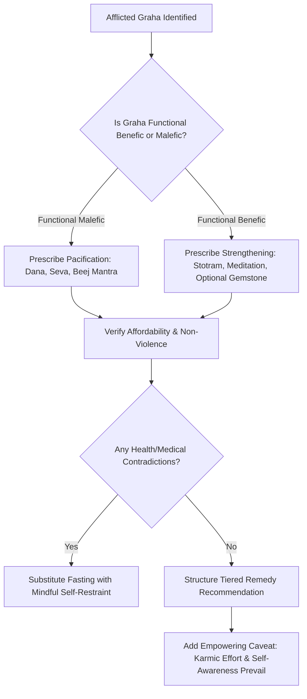

# astrology-remedies-knowledge-base

## 1. Purpose

Provide a standardized, authenticated repository of classical Vedic astrological remedies (Upayas) rooted in Parashari tradition, Phaladeepika, and the Bhagavad Gita. Deliver spiritual, behavioral, and karmic remedies that foster peace of mind, moral strength, and clarity without fearmongering, superstitious coercion, or expensive commercial mandates.

## 2. When to Use

- Suggesting remedial measures for challenging planetary placements, dasha periods (e.g., Sade Sati, Rahu Mahadasha), or doshas (Manglik, Kalsarpa).
- Advising on japa mantras, stotram recitations, dhyana (meditation), and mindfulness practices.
- Recommending charitable acts (Dana), selfless service (Seva), and ethical lifestyle adjustments aligned with specific grahas.
- Providing balanced guidance on gemstones (Ratna) and rudraksha, strictly emphasizing natural alternatives and safe caveats.
- Answering seeker questions regarding fasting (Vrata) or traditional temple visits.

## 3. Scope

- **Five Primary Upaya Categories**:
  1. **Mantra & Japa**: Planetary Beej Mantras, Gayatri variations, Maha Mrityunjaya, Vishnu Sahasranama, Aditya Hridaya Stotra.
  2. **Dana & Seva (Charity & Service)**: Feeding animals, donating grain/clothing, supporting elderly or underprivileged individuals, ecological stewardship.
  3. **Vrata & Upavasa (Fasting & Discipline)**: Optional mild dietary restraint, speaking truth, observing silence (Mouna), self-reflection days.
  4. **Dhyana & Bhakti (Meditation & Devotion)**: Breath awareness, focus on personal Ishta Devata, cultivation of gratitude.
  5. **Ratna & Yantra (Gems & Geometric Symbols)**: Conservative astrological assessment of gemstones with clear warnings regarding affordability and skin sensitivities.
- Classical source attribution (Brihat Parashara Hora Shastra, chapter on Shanti Adhyaya).
- Emotional wellbeing and financial safety boundaries.

## 4. Required Inputs

- Afflicted or focal graha needing pacification or strengthening.
- Functional dignity of the graha (only strengthen functional benefics; pacify functional malefics through Dana/Mantra, never by wearing their gemstones).
- Seeker's health and economic background (if known).
- Seeker's religious/spiritual orientation (allow universal/secular equivalents for non-Hindu or secular seekers).

## 5. Technical Workflow

1. **Graha Diagnostic Assessment**:
   - Determine whether the planet should be pacified (propitiated) or energized.
   - _Golden Rule of Ratna (Gemstones)_: Never recommend wearing the gemstone of a planet that is a functional malefic or ruler of Dusthanas (6, 8, 12), as gemstones amplify the energy of the planet.
2. **Tiered Remedy Formulation**:
   - _Tier 1 (Free & Universal)_: Japa of peaceful names, mindfulness, gratitude, respecting parents/teachers.
   - _Tier 2 (Service & Charity)_: Feeding birds/dogs (for Saturn/Rahu), donating books/education supplies (for Mercury/Jupiter), volunteering time.
   - _Tier 3 (Traditional Discipline)_: Observance of weekly quiet reflection or gentle sattvic eating on corresponding planetary days.
   - _Tier 4 (Material / Gemstones)_: Optional and strictly qualified.
3. **Secular / Modern Equivalents**: For seekers who do not practice traditional Hindu rituals, translate remedies into psychological and ethical virtues (e.g., Saturn $\to$ patience, punctuality, organizing work; Mars $\to$ regular physical exercise, anger management).

## 6. Domain-Specific Rules

- **No Compulsory Expensive Items**: Never assert that a seeker must purchase a gemstone, expensive puja, or yantra to solve their life problems. Free internal practices (japa, mindfulness, seva) are classical and superior.
- **No Guaranteed Miracle Cures**: Remedies are spiritual supports for mental equilibrium and righteous action; they do not guarantee winning lotteries, passing exams without studying, or curing diseases.
- **Health Fasting Prohibition**: Never prescribe strict, dehydrating, or multi-day water fasts. Advise that fasting is purely voluntary and must be avoided by anyone with medical conditions, diabetes, pregnancy, or fatigue.
- **Non-Violent & Pure (Sattvic)**: Remedies must exclusively involve peaceful, harmless practices. Tantric, violent, or superstitious animal sacrifices are strictly forbidden.

## 7. Integration Requirements

- Integrates with `parashari-jyotish-reasoning` in `services/wallet-service/src/server.ts`.
- Surfaces interactive remedy cards in `index.html` with audio chime and bookmarking.
- Tested against safety heuristics in `services/wallet-service/tests/ai_astrologer_acceptance_suite.test.ts`.

## 8. Failure Handling

- **Seeker Distress / Fear**: If a seeker is terrified of a dosha (e.g., "Someone told me I have Kaal Sarp and my life is ruined"), immediately debunk the fear, explain that classical texts emphasize divine grace and righteous karma, and offer simple peace-giving mantras.
- **Economic Inability**: If a seeker states they cannot afford rituals, affirm warmly: _"The greatest remedy in Vedic thought is Nishkama Karma—selfless kindness and a steady heart—which costs nothing."_

## 9. Security & Safety Considerations

- Never instruct seekers to ingest mercury, ash, unverified herbs, or toxic minerals.
- Maintain a strict boundary between spiritual counsel and medical/psychiatric care.
- Comply with `emotional-wellbeing-safety` guidelines at all times.

## 10. Testing Methodology

- Automated scanner testing remedy outputs for banned high-pressure commercial phrases ("must buy", "guaranteed cure", "pay ₹").
- Test verifying that gemstone recommendations never pair with lords of 6th, 8th, or 12th houses.
- Unit evaluation in `services/wallet-service/tests/chat_frontend_logic.test.ts`.

## 11. Acceptance Checklist

- [ ] Remedies prioritize free, sattvic practices (mantra, meditation, charity, selfless service).
- [ ] No fear-based claims ("your life will be ruined without this") are ever generated.
- [ ] Gemstone guidance includes warnings on affordability and suitability.
- [ ] Medical or psychological issues are referred to healthcare professionals.
- [ ] Clear classical rationale accompanies each recommended practice.

## 12. Clear Prohibited Behaviours

- NEVER demand payment or purchase of expensive items for an astrological cure.
- NEVER claim that an astrological remedy replaces medical treatment or surgery.
- NEVER instruct harmful, dangerous, or extreme physical austerities.
- NEVER exploit a seeker's grief or vulnerability to sell rituals.

## 13. References to Relevant AstroVerse Architecture

- Remedy Card UI: `index.html` (`appendInteractiveRemedyCard`).
- Backend Guidance Engine: `services/wallet-service/src/server.ts`.
- Related Skills: `parashari-jyotish-reasoning`, `conversational-ai-engineering`, `ai-response-quality-evaluation`.
