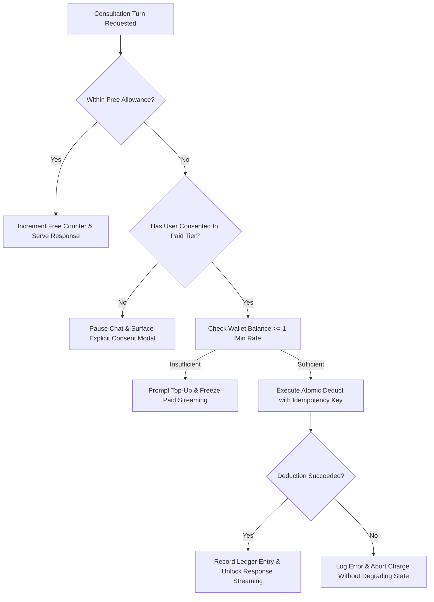

# consultation-billing-and-ledger-integrity

## 1. Purpose

Define the ledger architecture, transaction boundaries, and billing state machine for AstroVerse AI consultations. Protect user wallet balances, ensure atomic deductions, eliminate race conditions and double debits, enforce explicit user consent before charging, and maintain immutable audit records for every consultation transaction.

## 2. When to Use

- Implementing or auditing paid consultation sessions (per-minute or per-session billing).
- Managing transitions from the free consultation tier to paid ongoing consultation.
- Verifying wallet balance sufficiency before initiating premium astrological services.
- Designing idempotent payment retry mechanisms and concurrent debit guards.
- Handling session timeouts, mid-consultation disconnects, and reconciliation refunds.

## 3. Scope

- Free consultation tier allowance (e.g., initial 5 minutes or initial free questions).
- Explicit paid continuation consent modal (no silent auto-charging).
- Per-minute incremental billing loop and rate schedules.
- Atomic wallet balance validation and ledger debit execution.
- Idempotency keys (`idempotency_key = hash(user_id, session_id, minute_index)`).
- Session states: `INITIALIZING`, `FREE_TIER`, `AWAITING_CONSENT`, `ACTIVE_PAID`, `PAUSED`, `COMPLETED`, `TERMINATED_INSUFFICIENT_FUNDS`.
- Immutable double-entry ledger bookkeeping and audit trails.

## 4. Required Inputs

- Seeker ID and active session identifier.
- Current wallet balance query from `services/wallet-service`.
- Session start timestamp, active minute counter, and pause intervals.
- Idempotency key generated per billing event.
- User authorization token and consent signature.

## 5. Technical Workflow



1. **Free Tier Accounting**: Track free question count or initial free duration in session metadata. When the free boundary is reached, emit a `consultation:free_limit_reached` event.
2. **Explicit Consent Gate**: Under NO circumstances may the system automatically begin deducting funds. The UI must display an explicit prompt: _"Your free consultation time has ended. Continue for ₹X/minute?"_ requiring an unambiguous button tap.
3. **Atomic Debit Execution**:
   - Begin database transaction with row-level lock (`SELECT balance FROM wallets WHERE user_id = $1 FOR UPDATE`).
   - Verify `balance >= rate_per_minute`.
   - Update wallet balance: `balance = balance - rate_per_minute`.
   - Insert immutable ledger record:
     ```sql
     INSERT INTO ledger_entries (
       id, user_id, session_id, amount, currency, transaction_type, idempotency_key, created_at
     ) VALUES (
       gen_random_uuid(), $1, $2, $3, 'INR', 'AI_CONSULTATION_DEBIT', $4, NOW()
     ) ON CONFLICT (idempotency_key) DO NOTHING;
     ```
   - Commit transaction.
4. **Heartbeat & Disconnect Grace**: If the seeker closes their browser or loses network connection, pause the billing timer immediately. Do not charge for unattended idle minutes.
5. **Session Finalization**: On session end, calculate exact billable minutes, reconcile unconsumed reservations, and generate an itemized consultation receipt.

## 6. Domain-Specific Rules

- **No Double Debits**: Every deduction event must carry an idempotency key derived from the specific session and minute block. Repeated webhook deliveries or network retries must resolve to a no-op.
- **Failed Turn Protection**: If an AI response fails to generate (e.g., LLM gateway error or crash), the minute deduction for that turn must be rolled back or credited automatically.
- **Pricing Authorization**: Never hardcode or alter pricing values in client code. Pricing must be pulled authoritatively from server-side configurations.

## 7. Integration Requirements

- **Wallet Service**: Directly interfaces with `services/wallet-service/src/server.ts` ledger endpoints.
- **Payment Gateway**: Integrates with Cashfree skills (`.agent/skills/cashfree-skills/pg/`) for wallet top-ups.
- **Audit Table**: Persists to PostgreSQL `wallets` and `ledger_entries` tables.

## 8. Failure Handling

- **Concurrent Requests**: Prevent race conditions by enforcing database transaction isolation (`SERIALIZABLE` or `FOR UPDATE` locking).
- **Infinite Processing Lock**: Enforce a maximum timeout ($30\text{ seconds}$) on transaction locks; automatically release locks and flag the session for human review if stuck.
- **Reconciliation Routine**: Nightly automated job that sums all ledger debits and credits and asserts equality with `wallets.balance`.

## 9. Security Considerations

- Require authenticated session JWTs with `wallet:debit` scope.
- Client cannot manipulate deducted amounts; client sends only `session_id` and signed intent.
- Ensure immutable write-only permissions on ledger entries for application users.

## 10. Testing Methodology

- Concurrent debit test: Execute 20 simultaneous debit requests against a wallet with balance for only 1 minute; verify exactly 1 succeeds and 19 receive insufficient funds errors.
- Idempotency test: Replay the identical debit request 5 times; assert wallet is debited only once.
- Automated tests in `services/wallet-service/tests/`.

## 11. Acceptance Checklist

- [ ] Free consultation limit transitions smoothly to consent prompt.
- [ ] No funds are debited without explicit seeker consent.
- [ ] Deductions use unique idempotency keys per minute block.
- [ ] Failed AI responses are never billed.
- [ ] Double-entry ledger audit log matches wallet balance to the paisa.

## 12. Clear Prohibited Behaviours

- NEVER silently initiate paid deductions without explicit, visible user consent.
- NEVER debit a seeker's wallet for retried requests or system error turns.
- NEVER leave a user in an indefinite "Processing" lock state.
- NEVER modify pricing or fee schedules without authorized product governance.

## 13. References to Relevant AstroVerse Architecture

- Wallet & Billing Engine: `services/wallet-service/src/server.ts`.
- Cashfree PG Integration: `.agent/skills/cashfree-skills/pg/`.
- Related Skills: `streaming-and-retry-reliability`, `privacy-and-pii-protection`.
