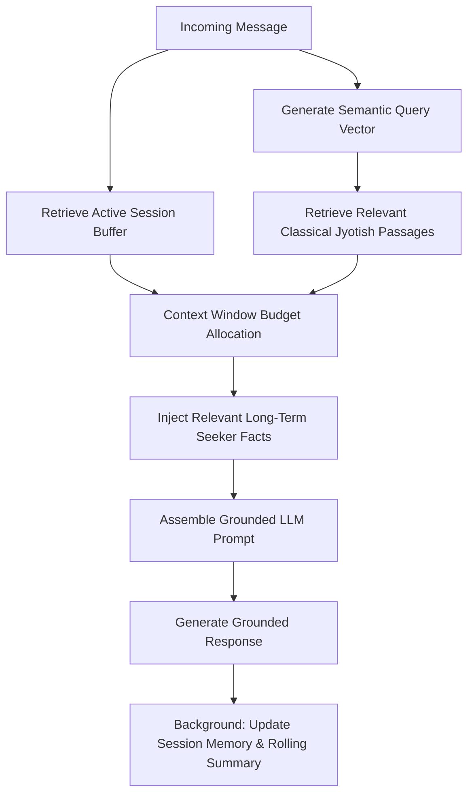

# conversation-memory-and-rag

## 1. Purpose

Provide architectural standards and operational patterns for managing conversational memory, persistent seeker profiles, and retrieval-augmented generation (RAG) in AstroVerse. Ensure that AI responses draw upon verified seeker history and authentic classical Jyotish knowledge without unbounded context expansion, prompt bloat, or privacy compromise.

## 2. When to Use

- Managing short-term conversational sliding windows and turn-by-turn dialogue continuity.
- Generating compact, semantically dense summaries of completed consultation sessions.
- Ingesting, indexing, and retrieving classical Vedic astrological scripture, commentaries, and verified remedies.
- Grounding AI responses in verified facts while rejecting ungrounded assumptions.
- Handling seeker profile corrections, topic changes, and GDPR/CCPA compliant memory erasure requests.

## 3. Scope

- Short-term sliding buffer management (typically last 6–10 turns of active dialogue).
- Hierarchical conversation summarization for long-running consultations ($>15$ turns).
- Vectorized knowledge retrieval for classical Jyotish concepts (Brihat Parashara Hora Shastra, Phaladeepika, Jataka Parijata).
- Dynamic context-window budgeting (limiting prompt overhead to under 3,000 tokens for context and memory).
- Stale memory eviction and real-time correction invalidation when seekers update their birth coordinates or life details.

## 4. Required Inputs

- Current incoming user message and active session identifier.
- Raw message transcript from the current session.
- Stored long-term seeker profile entity graph (name, verified birth coordinates, previous topics discussed).
- Query embedding or keyword search parameters for classical RAG index.
- Context token budget constraints based on target LLM window limits.

## 5. Technical Workflow

1. **Short-Term Context Buffering**: Maintain an ordered ring buffer of the most recent turns. For turns exceeding the buffer size, invoke background rolling summarization.
2. **Selective Relevance Retrieval**: Do NOT dump entire historical transcripts into the prompt. Perform vector similarity search ($\text{cosine similarity} \ge 0.78$) against the indexed Jyotish knowledge base for query-specific astrological doctrines.
3. **Memory Correction Processing**: If the seeker states a correction (e.g., "Actually I was born at 4:15 PM, not 4:45 PM"), immediately invalidate prior derived chart cache, flag previous chart interpretations as superseded, and persist the corrected facts.
4. **Context Assembly**: Construct the LLM prompt payload with deterministic token limits:
   - System Prompt & Identity: ~800 tokens
   - Active Chart Facts (D1/D9/Dasha): ~600 tokens
   - Relevant RAG Knowledge Chunks: ~700 tokens
   - Sliding Conversation Window: ~1,000 tokens
   - Room for Response Generation: ~1,500 tokens
5. **Session Eviction / Deletion**: On explicit user command (e.g., "Forget our conversation" or "Clear memory"), execute an atomic purge of session embeddings and conversation logs from memory and database storage.

## 6. Domain-Specific Rules

- **No Unrestricted History Dumps**: Never append more than 10 raw dialog turns into a prompt. Use structured summaries for prior context.
- **Strict Separation of Personas**: In multi-person sessions, long-term memory about a spouse or child must be linked to that specific sub-profile, never blended into the primary seeker's personal memory.
- **Grounded Astrological Canon**: RAG snippets must come strictly from authenticated translations of classical texts (Parashara, Mantreswara, Varahamihira), not unverified modern web forums or algorithmic horoscopes.
- **No Memory Fabrication**: If a past conversation detail is absent from memory, state that it is not on record rather than guessing or hallucinating past interactions.

## 7. Integration Requirements

- **Storage Layer**: Supabase Postgres with `pgvector` or local SQLite fallback (`memory_sessions` and `jyotish_knowledge_chunks` tables).
- **Backend Service**: `services/wallet-service/src/server.ts` conversation state manager.
- **Memory API Endpoints**: `GET /api/ai-astrologer/memory/:sessionId`, `DELETE /api/ai-astrologer/memory/:sessionId`.

## 8. Failure Handling

- **Vector DB Unavailable**: Fall back smoothly to keyword-indexed classical tables and recent in-memory transcript without crashing the consultation.
- **Context Limit Exceeded**: Gracefully drop oldest non-essential conversational turns while strictly retaining the system prompt, birth chart data, and latest user query.
- **Contradictory Memory Entries**: When stored memory conflicts with the latest user statement, treat the user's latest statement as the authoritative truth and update storage asynchronously.

## 9. Security Considerations

- Redact PII (phone numbers, full postal addresses, financial account numbers) before storing dialogue turns into the vector database.
- Isolate memory namespaces strictly by authenticated user ID / session ID to prevent cross-tenant data leakage.
- Comply with privacy policies outlined in `privacy-and-pii-protection`.

## 10. Testing Methodology

- Automated tests verifying that memory persists across multiple HTTP calls within the same session ID.
- Memory purge verification test ensuring `DELETE` leaves zero residual vectors or transcript rows.
- Retrieval benchmark tests measuring latency ($<150\text{ms}$) and relevance MRR (Mean Reciprocal Rank $\ge 0.85$).
- Regression test suite: `services/wallet-service/tests/chat_frontend_logic.test.ts`.

## 11. Acceptance Checklist

- [ ] Context window budget is strictly enforced ($< 3,500$ prompt tokens).
- [ ] RAG queries retrieve classical Vedic references matching the query intent.
- [ ] Memory updates and user corrections take effect on the very next turn.
- [ ] Memory wipe endpoint purges all session context completely.
- [ ] No cross-seeker or cross-session memory leakage occurs under concurrent load.

## 12. Clear Prohibited Behaviours

- NEVER inject unrestricted entire chat histories into model prompts.
- NEVER retain or recall memory from an unverified third party without seeker consent.
- NEVER invent memories of past consultations that did not happen.
- NEVER persist unredacted credit card or financial transaction details into conversational memory.

## 13. References to Relevant AstroVerse Architecture

- Database Schemas: `supabase/migrations/` and SQLite session cache.
- RAG Pipeline: Vector store embeddings and similarity retrieval functions.
- Related Skills: `conversational-ai-engineering`, `privacy-and-pii-protection`, `multi-seeker-identity-resolution`.
