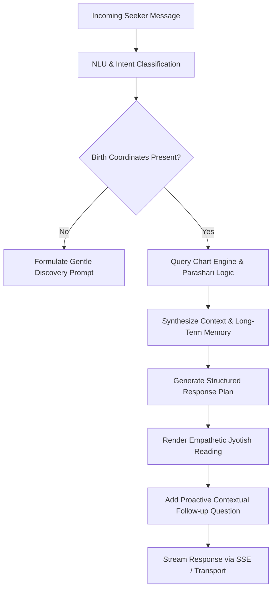

# conversational-ai-engineering

## 1. Purpose

Define the conversational architecture and interaction principles for AstroVerse AI Astrologer. Enable natural, context-aware, empathetic, and multi-turn Jyotish consultations that converse with the warmth, patience, and analytical rigor of an experienced Vedic astrologer while maintaining strict transparency that the service is an AI.

## 2. When to Use

- Designing or refining chat interaction flows, system prompts, and response planning logic.
- Implementing natural language understanding (NLU), intent classification, and entity extraction for astrology queries.
- Handling multi-turn dialogues, follow-up inquiry synthesis, and graceful clarification loops.
- Preventing repetitive greetings, mechanical template paragraphs, response duplication, and ungrounded statements.
- Structuring streaming token delivery and graceful conversational error recovery.

## 3. Scope

- Conversational turn state machine (Greeting, Discovery, Chart Verification, Astrological Reading, Remedy Guidance, Follow-Up).
- Intent classification across 12 classical Jyotish life domains (Marriage, Career, Wealth, Education, Health, Children, Foreign Travel, Property, Spirituality, Family, Litigation, Muhurta).
- Response plan formulation balancing astrological depth with empathetic, customer-friendly counsel.
- Dynamic selection between concise conversational responses (1–2 paragraphs for quick checks) and detailed structured consultations (multi-faceted planetary breakdowns).
- AI identity transparency and boundary enforcement (no human impersonation, no medical or fatalistic guarantees).

## 4. Required Inputs

- Seeker's raw text message and message sequence number.
- Active conversation history (last $N$ validated turns).
- Active seeker profile and verified birth chart coordinates (from `multi-seeker-identity-resolution`).
- Grounded planetary analysis facts (from `parashari-jyotish-reasoning` and `swiss-ephemeris-integration`).
- Relevant long-term seeker context or memory summaries (from `conversation-memory-and-rag`).
- Active consultation billing status (free tier vs. active paid session from `consultation-billing-and-ledger-integrity`).

## 5. Technical Workflow

1. **Input Normalization**: Sanitize message string, normalize punctuation, detect seeker language (routing to `multilingual-conversational-ai`).
2. **Intent & Entity Extraction**: Classify seeker primary intent, secondary intents, emotional valence, and temporal references (e.g., current year, upcoming dasha, specific date).
3. **Context Alignment**: Verify whether the question refers to the primary seeker or a third-party relation (`multi-seeker-identity-resolution`).
4. **Response Planning**: Formulate a response structure:
   - _Empathetic acknowledgement_: Validate the seeker's core question or concern without repeating stock phrases.
   - _Astrological core_: Present astrological facts (rashi, dasha, bhava lords) explained in accessible, modern language.
   - _Practical guidance_: Actionable Vedic life counsel grounded in classical principles.
   - _Engaged follow-up_: Exactly one natural, probing question inviting deeper exploration.
5. **Deduplication Check**: Compare planned response against the last 3 assistant turns; suppress identical openings, stock paragraphs, or repeated disclaimers.
6. **Streaming Dispatch**: Emit tokens incrementally via Server-Sent Events with progress indication.

## 6. Domain-Specific Rules

- **No Mechanical Re-introductions**: Never begin subsequent turns with "Namaste! Welcome to AstroVerse" or "Pranam! I have successfully connected..." if the greeting has already occurred in the session.
- **Immediate Relevance**: Address the seeker's explicit question in the very first two sentences. Do not bury answers behind extensive introductory filler.
- **Contextual Adaptation**: If the seeker expresses distress or anxiety (e.g., relationship breakup, job loss), soften tone immediately, emphasize protective planetary factors, and suggest grounding spiritual practices.
- **Depth Proportionality**: Keep simple queries (e.g., "What is my Moon sign?") direct and crisp (under 120 words). Provide multi-dimensional depth (houses, aspects, current dasha, transits) for complex life dilemmas.

## 7. Integration Requirements

- **Server Endpoint**: Integrates directly with `POST /api/ai-astrologer/ask` in `services/wallet-service/src/server.ts`.
- **Frontend Controller**: Connects with `sendAiUserChatMessage()` and streaming listeners in `index.html`.
- **Telemetry & Metrics**: Exposes token latency, intent classification confidence, and response word count.

## 8. Failure Handling

- **Ambiguous Queries**: If seeker intent is completely unclear (e.g., "tell me"), do not fabricate chart predictions. Ask warmly which life area they wish to focus on today (career, relationships, health, or personal path).
- **Missing Birth Data**: If the seeker asks a chart-dependent question without birth coordinates, politely explain that Vedic astrology requires exact date, time, and place of birth for precise lagna and dasha calculation, and invite them to share those details.
- **Transport Disconnects**: If client disconnects mid-stream, cache the complete generated response against `messageId` for instant retrieval upon client reconnection (`streaming-and-retry-reliability`).

## 9. Security Considerations

- Prevent prompt injection attacks that attempt to alter astrological rules or extract system prompts.
- Do not echo private birth data (exact home address, sensitive personal notes) unnecessarily in response text.
- Follow `privacy-and-pii-protection` guidelines for seeker data masking.

## 10. Testing Methodology

- Multi-turn conversation simulation scripts testing 10+ turn dialogues for coherence and non-repetition.
- Semantic similarity checks between consecutive responses to ensure cosine distance $> 0.35$ on introductory phrasing.
- Evaluation against the standard test suite: `services/wallet-service/tests/ai_astrologer_acceptance_suite.test.ts`.

## 11. Acceptance Checklist

- [ ] No repetitive greeting occurs on turns $2+$.
- [ ] Explicit life questions receive direct answers within the first two sentences.
- [ ] Responses end with a natural, single-question conversational hook.
- [ ] Seeker is never addressed with a hardcoded persona name (e.g., Aryan).
- [ ] Transparent AI identity is maintained without claiming human physical presence.
- [ ] Tone is supportive, respectful, dignified, and astrologically authoritative.

## 12. Clear Prohibited Behaviours

- NEVER output hardcoded fallback charts or default seeker names.
- NEVER make fatalistic predictions (e.g., predicting exact dates of death, divorce, or incurable illness).
- NEVER give prescriptive medical diagnoses or financial investment guarantees.
- NEVER ignore the user's latest message to repeat an earlier canned response.
- NEVER overwhelm the user with four or five consecutive questions in a single turn.

## 13. References to Relevant AstroVerse Architecture

- Chat Client Engine: `index.html` (`sendAiUserChatMessage`, `appendAiChatMessage`)
- Backend Orchestration: `services/wallet-service/src/server.ts` (`/api/ai-astrologer/ask`)
- Skill Pairings: `conversation-memory-and-rag`, `multi-seeker-identity-resolution`, `parashari-jyotish-reasoning`
