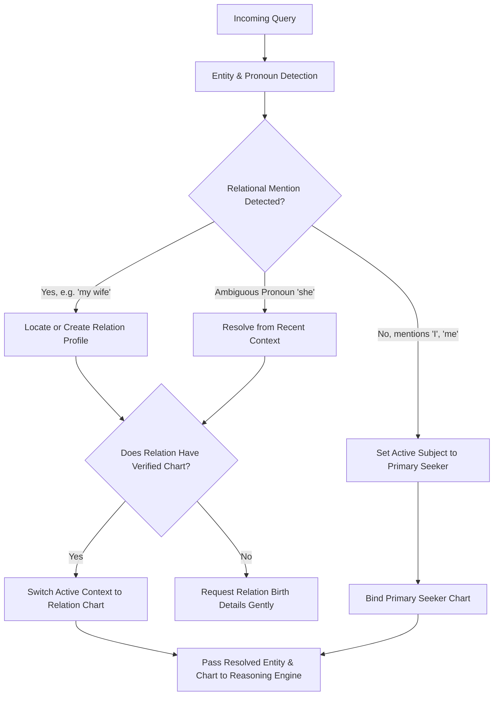

# multi-seeker-identity-resolution

## 1. Purpose

Define the architecture and heuristics for resolving subject identities, familial relationships, and distinct birth charts within AstroVerse consultations. Ensure that questions regarding spouses, children, parents, partners, or friends use the intended person's chart, while strictly preventing accidental chart overwrites or cross-person data leakage.

## 2. When to Use

- Determining whether a query pertains to the primary seeker or another individual (spouse, child, parent, business partner).
- Managing multiple birth profiles within a single conversation session.
- Parsing pronouns ("he", "she", "my husband", "my daughter", "my friend") and resolving anaphora to the appropriate astrological entity.
- Switching active chart contexts when a consultation transitions between people, and restoring the primary chart when returning to self.
- Validating whether a date mentioned in conversation represents an event date (e.g., marriage anniversary, job interview) rather than a new birth date.

## 3. Scope

- Entity relationship graph within a session:
  - `Self` (Primary Seeker)
  - `Spouse` / `Partner` / `Fiancé`
  - `Parent` (Mother / Father)
  - `Sibling` (Brother / Sister)
  - `Child` (Son / Daughter)
  - `Associate` (Business Partner / Friend)
- Entity ownership and birth data attribution.
- Subject switching state machine with explicit confirmation.
- Safe third-party consultation boundaries and privacy controls.

## 4. Required Inputs

- Seeker's current message text.
- Prior message history with resolved entity mentions.
- Session entity registry containing named profiles and associated birth charts:
  ```json
  {
    "primaryProfileId": "prof_self_01",
    "activeSubjectId": "prof_self_01",
    "profiles": {
      "prof_self_01": { "name": "Arun", "relation": "self", "hasChart": true },
      "prof_rel_02": {
        "name": "Sunita",
        "relation": "spouse",
        "hasChart": true
      }
    }
  }
  ```
- Raw date/time strings detected in current turn.

## 5. Technical Workflow



1. **Relation Parsing**: Scan query for kinship terms (`husband`, `wife`, `fiancé`, `partner`, `son`, `daughter`, `mother`, `father`, `boss`, `friend`).
2. **Event Date vs. Birth Date Discrimination**:
   - If user says: _"I got married on 14 Feb 2020"_ or _"My job interview is on 15 March"_, classify as **Event Date / Transit Date**. DO NOT overwrite the birth chart.
   - Only update birth data when explicitly phrased as birth info: _"Born on...", "Her birth date is...", "DOB:..."_.
3. **Subject Context Switching**:
   - When query shifts to third party (e.g., _"How is my wife's health looking?"_), transition `activeSubjectId` to spouse.
   - If spouse chart exists, calculate 6th house/lord from spouse Lagna or 12th house (6th from 7th) from primary chart.
   - When seeker follows up with _"And what about me?"_, immediately restore `activeSubjectId` to primary seeker.
4. **Third-Party Profile Creation**: If a third party is introduced without birth data, create an unlinked stub profile and invite the seeker to provide their date, time, and city of birth if they desire an independent natal reading.

## 6. Domain-Specific Rules

- **Anti-Leakage Isolation**: Never attribute primary seeker's planetary yogas (e.g., primary seeker's Gajakesari Yoga) to their spouse or friend.
- **Date Protection**: An isolated date mentioned in chat MUST NOT overwrite any active birth chart unless preceded by explicit birth declaration keywords.
- **Synastry / Matching Integrity**: When conducting Kundli Milan (marriage compatibility), both profiles must remain distinctly instantiated as `Seeker 1 (Boy/Girl)` and `Seeker 2 (Girl/Boy)` with separate Guna Milan scores, Ashta Kuta breakdowns, and individual Mangal Dosha calculations.
- **Explicit Notification**: When the AI answers for a third party, it must clearly prefix or ground the response: _"Looking at your spouse Sunita's chart..."_ or _"From your chart's 7th house perspective..."_.

## 7. Integration Requirements

- **Server Module**: Integrated into `services/wallet-service/src/server.ts` session pipeline.
- **Client State**: Synced with client-side profile registry in `index.html`.
- **Event Bus**: Emits `seeker:switched`, `seeker:profile_added`, and `seeker:restored_self` events.

## 8. Failure Handling

- **Ambiguous Relationship Reference**: If the seeker says _"Is she compatible with me?"_ without prior mention of a person, ask gently: _"Could you share who you are asking about, and if you have her birth details?"_
- **Profile Collision**: If two persons share the same first name (e.g., two friends named Rahul), assign contextual disambiguators (e.g., `Rahul (Friend)` vs `Rahul (Colleague)`).

## 9. Security Considerations

- Require seeker confirmation before saving third-party personal details permanently.
- Ensure third-party profile details cannot be accessed by other unrelated platform users.
- Redact sensitive relationship disclosures in audit logs according to `privacy-and-pii-protection`.

## 10. Testing Methodology

- Multi-person dialog scenarios testing rapid topic switching: Self $\to$ Spouse $\to$ Child $\to$ Self.
- Event-date robustness test verifying that dates in the past (e.g., 2018 graduation) do not overwrite birth year (2001).
- Test suite: `services/wallet-service/tests/test_astro_multi_seeker.test.ts`.

## 11. Acceptance Checklist

- [ ] Primary seeker chart is never overwritten by general conversational dates.
- [ ] Mentions of spouse, child, or parent cleanly fork into dedicated profile contexts.
- [ ] Pronouns ("he", "she", "they") resolve correctly based on recent conversation history.
- [ ] Switching back to self ("What about my career?") instantly restores the primary natal chart.
- [ ] Kundli matching holds two distinct, immutable chart payloads simultaneously.

## 12. Clear Prohibited Behaviours

- NEVER assume every user is the same default persona (e.g., Aryan Tiwari).
- NEVER overwrite a seeker's birth chart because they mentioned an event date or anniversary.
- NEVER mix planetary placements of two different individuals into a single synthesized chart.
- NEVER disclose one seeker's profile to another user on the platform.

## 13. References to Relevant AstroVerse Architecture

- Session State: `activeConsultationSession` in `services/wallet-service/src/server.ts`.
- Acceptance Tests: `services/wallet-service/tests/test_astro_multi_seeker.test.ts`.
- Skill Pairings: `conversational-ai-engineering`, `parashari-jyotish-reasoning`, `privacy-and-pii-protection`.
