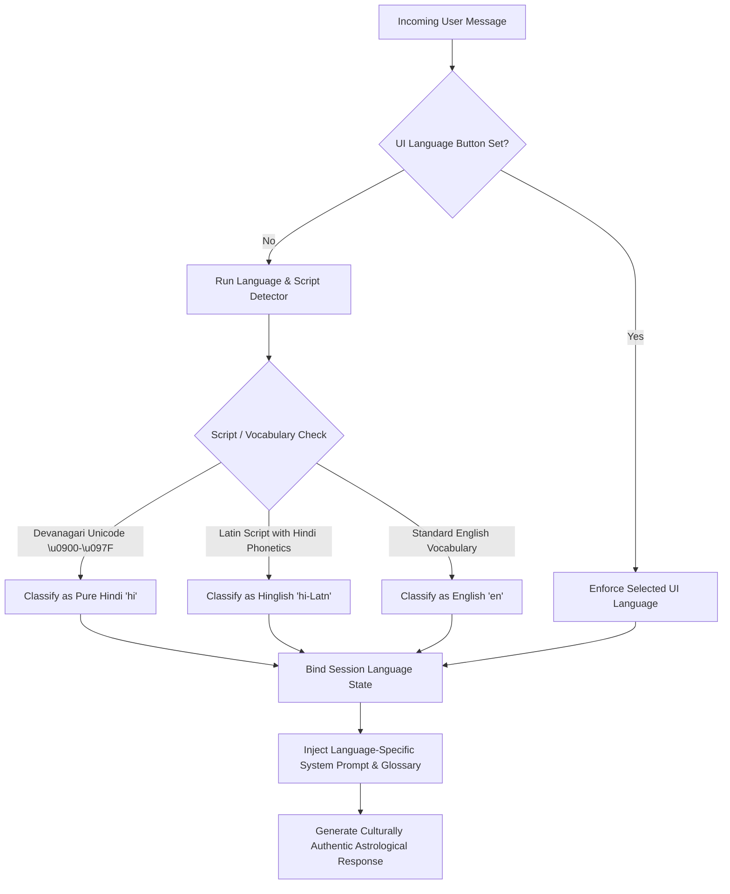

# multilingual-conversational-ai

## 1. Purpose

Define the linguistic processing pipeline, terminology lexicons, and conversational rules for multilingual AstroVerse AI consultations. Provide native-level fluency and cultural sensitivity in English, Hindi (Devanagari script), and Hinglish (Romanized conversational Hindi), ensuring accurate Sanskrit astrological terms and seamless language preservation across turns.

## 2. When to Use

- Detecting the seeker's preferred language from initial or mid-session user messages.
- Responding in the exact linguistic medium selected by the user (English, Hindi, or Hinglish).
- Preserving authentic Sanskrit Jyotish terminology (Rashis, Nakshatras, Bhavas, Dashas) with correct transliteration and explanation.
- Handling code-switching (mixed English and Hindi vocabulary common in urban Indian conversations).
- Translating complex classical astrological Sanskrit sutras into lucid, natural Hindi and English.

## 3. Scope

- **Fully Supported & Tested Tier**:
  - English (Global international and Indian English).
  - Hindi (हिन्दी in Devanagari script).
  - Hinglish (Latin/Romanized Hindi: e.g., _"Meri shaadi kab hogi?", "Career me kab stability aayegi?"_).
- **Extensible Architecture**: Design hooks for regional Indian languages (Tamil, Telugu, Bengali, Marathi, Gujarati) for future release phases upon validation.
- Standardized astrological vocabulary mappings between Sanskrit, Hindi, and English.
- Turn-by-turn language state persistence.

## 4. Required Inputs

- Raw incoming user text.
- Prior session language code (`en`, `hi`, `hi-Latn`).
- Language toggle setting from UI (`.ai-lang-btn`).
- Authoritative Jyotish glossary dictionary.

## 5. Technical Workflow

1. **Language Classification Heuristics**:
   - _Devanagari Range Check_: If regex `/[\u0900-\u097F]/` matches $\ge 15\%$ of text $\implies$ Hindi (`hi`).
   - _Hinglish Token Match_: Check against common phonetic markers (`mera`, `meri`, `kab`, `kya`, `hoga`, `hai`, `kripya`, `kundli`, `shaadi`, `naukri`, `paisa`) $\implies$ Hinglish (`hi-Latn`).
   - _Default_: If purely English lexicon $\implies$ English (`en`).
2. **Astrological Lexicon Normalization**:
   - Maintain uniform planetary names across languages:
     - Sun $\leftrightarrow$ Surya (सूर्य)
     - Moon $\leftrightarrow$ Chandra (चन्द्र)
     - Mars $\leftrightarrow$ Mangala (मंगल)
     - Mercury $\leftrightarrow$ Budha (बुध)
     - Jupiter $\leftrightarrow$ Guru / Brihaspati (गुरु / बृहस्पति)
     - Venus $\leftrightarrow$ Shukra (शुक्र)
     - Saturn $\leftrightarrow$ Shani (शनि)
     - North Node $\leftrightarrow$ Rahu (राहु)
     - South Node $\leftrightarrow$ Ketu (केतु)
   - Ensure Rashis and Bhavas use accurate phonetic forms (e.g., Mesha, Vrishabha, Mithuna; 1st house / Tanu Bhava, 7th house / Kalatra Bhava).
3. **Conversational Tone Synthesis**:
   - In Hindi: Use respectful honorifics (_"आप"_, _"नमस्ते"_, _"प्रणाम"_, _"जी"_).
   - In Hinglish: Use natural, conversational Romanized Hindi without clumsy robotic syntax (e.g., _"Aapki kundli me 10th house me Surya ki sthiti kaafi mazboot hai..."_).
   - In English: Maintain a warm, dignified, and articulate tone without excessive esoteric jargon.

## 6. Domain-Specific Rules

- **No Clumsy Machine Translation**: Never run raw mechanical string replacement. Prompts must be authored with native conversational phrasing.
- **Language Continuity**: If a seeker starts in Hindi, the AI must reply in Hindi on all subsequent turns unless the seeker explicitly switches language.
- **Code-Switching Tolerance**: If a seeker asks in Hinglish (_"career me growth kab hogi?"_), do not force them into formal Devanagari script; reply naturally in Hinglish.
- **Transliteration Clarity**: When introducing a classical term in English, provide an immediate parenthetical definition (e.g., _"Gajakesari Yoga (the combination of elephant-like majesty formed by Jupiter and the Moon)..."_).

## 7. Integration Requirements

- Integrates with language detection middleware in `services/wallet-service/src/server.ts`.
- Synchronizes with frontend language toggle buttons in `index.html` (`.ai-lang-btn`).
- Evaluated against multilingual test suites in `services/wallet-service/tests/`.

## 8. Failure Handling

- **Ambiguous Script**: If a single word is typed (e.g., "hi", "ok"), retain the language of the immediately preceding turn.
- **Unverified Languages**: If a seeker asks in an unsupported language (e.g., French or Japanese), reply politely in English acknowledging the language and asking if they are comfortable proceeding in English or Hindi.

## 9. Security Considerations

- Sanitize unicode control characters and zero-width spaces that could be used for prompt injection or display obfuscation.
- Ensure character length validations account for multi-byte UTF-8 sequences in Devanagari.

## 10. Testing Methodology

- Parallel test fixtures executing the identical astrological consultation in English, Hindi, and Hinglish.
- Automated assertion verifying correct Devanagari script presence when `hi` is active.
- Automated assertion verifying absence of unreadable corrupted unicode entities.

## 11. Acceptance Checklist

- [ ] English responses are polished, empathetic, and grammatically impeccable.
- [ ] Hindi responses use natural Devanagari script and respectful grammar.
- [ ] Hinglish queries receive natural, conversational Hinglish responses.
- [ ] Astrological terms (grahas, rashis, bhavas) are accurate across all languages.
- [ ] Language preference persists across 10+ turn dialogues.

## 12. Clear Prohibited Behaviours

- NEVER claim full fluency in languages that have not been systematically tested.
- NEVER mix incoherent machine-translated fragments into native text.
- NEVER switch languages abruptly without the seeker initiating or requesting the change.
- NEVER misspell fundamental Vedic astrological terms (e.g., writing "Mesh" as "Mezh" or "Shukra" as "Sukra").

## 13. References to Relevant AstroVerse Architecture

- Language Controller: `index.html` (`.ai-lang-btn`).
- Backend Prompt Localizer: `services/wallet-service/src/server.ts`.
- Related Skills: `conversational-ai-engineering`, `parashari-jyotish-reasoning`, `ai-response-quality-evaluation`.
