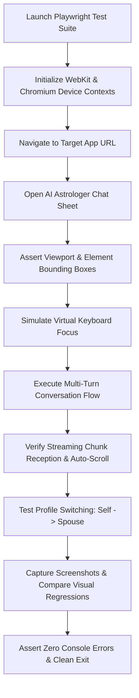

# playwright-webkit-qa

## 1. Purpose

Define comprehensive end-to-end (E2E) testing standards, cross-engine test suites, and visual regression practices using Playwright across Chromium, WebKit (Safari engine), and Mobile Safari viewports. Ensure that the live AstroVerse customer consultation interface, streaming animations, mobile keyboard adaptations, and billing flows function reliably under real browser conditions.

## 2. When to Use

- Validating the customer-facing chat UI before production deployments to Vercel.
- Verifying cross-browser compatibility across Apple WebKit (iOS/macOS Safari) and Chromium (Chrome, Edge, Android).
- Testing real-time Server-Sent Events (SSE) streaming and auto-scroll behavior under simulated network throttling.
- Asserting mobile layout dimensions (sheet height, composer width, virtual keyboard focus) on mobile devices.
- Conducting automated multi-turn conversation workflows without relying on mocked unit stubs.
- Verifying accessibility (a11y) standards, keyboard focus traps, and screen-reader semantics in the chat sheet.

## 3. Scope

- Browser engines: WebKit, Chromium, and Firefox.
- Device profiles: iPhone 13 / 14, iPhone SE, Pixel 5, iPad Pro, Desktop ($1920 \times 1080$).
- Real application workflows:
  - Opening floating AI Astrologer sheet.
  - Sending initial message and receiving streaming response.
  - Submitting birth details and observing chart link animation.
  - Switching between multiple seeker profiles.
  - Long conversation scrolling ($>20$ turns) with "Jump to Latest" validation.
  - Transitioning into paid consultation and testing consent modals.
- Network simulation: Offline mode, flaky 3G connections, and HTTP 500 error recovery.

## 4. Required Inputs

- Target web server URL (e.g., local dev server `http://localhost:3000` or production `https://astroverse-eta.vercel.app`).
- Playwright test runner configuration (`playwright.config.ts`).
- Standardized test seeker profiles (synthetic birth dates, times, locations).
- Viewport and device emulation fixtures.

## 5. Technical Workflow



1. **Device Matrix Configuration**:
   ```typescript
   import { defineConfig, devices } from "@playwright/test";
   export default defineConfig({
     projects: [
       { name: "webkit-mobile", use: { ...devices["iPhone 13"] } },
       { name: "webkit-desktop", use: { ...devices["Desktop Safari"] } },
       { name: "chromium-mobile", use: { ...devices["Pixel 5"] } },
       { name: "chromium-desktop", use: { ...devices["Desktop Chrome"] } },
     ],
   });
   ```
2. **Mobile Dimensions Assertion**:
   ```typescript
   test("mobile composer maintains required width and visible placement", async ({
     page,
   }) => {
     await page.goto("/");
     await page.locator("#ai-astrologer-btn").click();
     const sheet = page.locator("#ai-astrologer-sheet");
     await expect(sheet).toBeVisible();

     const input = page.locator("#ai-chat-input");
     const inputBbox = await input.boundingBox();
     expect(inputBbox?.width).toBeGreaterThanOrEqual(220);

     const sendBtn = page.locator("#ai-chat-send-btn");
     const btnBbox = await sendBtn.boundingBox();
     expect(btnBbox?.width).toBeLessThanOrEqual(90);
   });
   ```
3. **Streaming & Auto-Scroll Test**:
   - Submit message: _"Tell me about my career"_.
   - Assert streaming status indicator appears.
   - Verify that message scroll container scrolls down as new content arrives.
   - Manually scroll up by $300\text{px}$; assert auto-scroll halts and "Jump to Latest" button appears.
   - Click "Jump to Latest"; assert container immediately scrolls flush to bottom.
4. **Console Error Gate**: Fail the test immediately if any unhandled JavaScript exception or CSP violation is logged in the browser console.

## 6. Domain-Specific Rules

- **No Mock Stubs as Final Evidence**: While unit tests use mocks, Playwright E2E suites must test the actual running application with real DOM rendering and network exchanges.
- **WebKit Verification Mandatory**: Because iOS Safari accounts for over 60% of mobile astrology traffic in target markets, WebKit engine testing is a mandatory release gate.
- **Visual Stability**: Prevent cumulative layout shift (CLS) during streaming. Bubble height must expand smoothly without popping or jumpy layout recalculations.

## 7. Integration Requirements

- Integrates with Playwright runner (`playwright-core`, `playwright-cli`, `playwright-skill`).
- Uses existing audit script: `scripts/verify_mobile_chat_dimensions.mjs`.
- Automated CI pipeline execution via GitHub Actions (`playwright-ci`).

## 8. Failure Handling

- **Flaky Selectors**: Use resilient role-based and test-id selectors (`getByRole`, `getByPlaceholder`, `data-testid`) rather than fragile CSS hierarchies.
- **Streaming Timeouts**: Set appropriate per-action timeouts ($10\text{ seconds}$) for streaming completion, but do not use arbitrary `page.waitForTimeout()` sleeps.
- **Artifact Capture**: On test failure, automatically capture full-page screenshot, DOM snapshot, and Playwright trace file.

## 9. Security Considerations

- Ensure test scripts never transmit production credentials or real customer birth data.
- Validate that the browser sandbox cannot execute unauthorized local filesystem operations.

## 10. Testing Methodology

- Cross-engine execution across 4 parallel browser profiles.
- Visual regression comparison with baseline screenshots ($\Delta < 0.2\%$).
- Automated script: `node scripts/verify_mobile_chat_dimensions.mjs`.

## 11. Acceptance Checklist

- [ ] Tests pass across both WebKit and Chromium engines.
- [ ] Mobile composer remains visible and unobstructed upon input focus.
- [ ] Multi-turn conversation flows maintain context without crashing.
- [ ] Auto-scroll tracks streaming tokens and releases on manual scroll-up.
- [ ] Zero unhandled browser console errors during the entire test run.

## 12. Clear Prohibited Behaviours

- NEVER present simulated unit mock passes as proof of cross-browser mobile compatibility.
- NEVER skip WebKit testing when releasing mobile UI changes.
- NEVER use arbitrary `sleep(5000)` in tests instead of condition-based waiting (`waitForSelector`, `expect.toPass`).
- NEVER ignore visual clipping or horizontal overflow on small mobile viewports ($375\text{px}$).

## 13. References to Relevant AstroVerse Architecture

- Verification Script: `scripts/verify_mobile_chat_dimensions.mjs`.
- Frontend Layout: `index.html`.
- Related Skills: `mobile-chat-scroll-engineering`, `streaming-and-retry-reliability`, `ai-response-quality-evaluation`.
