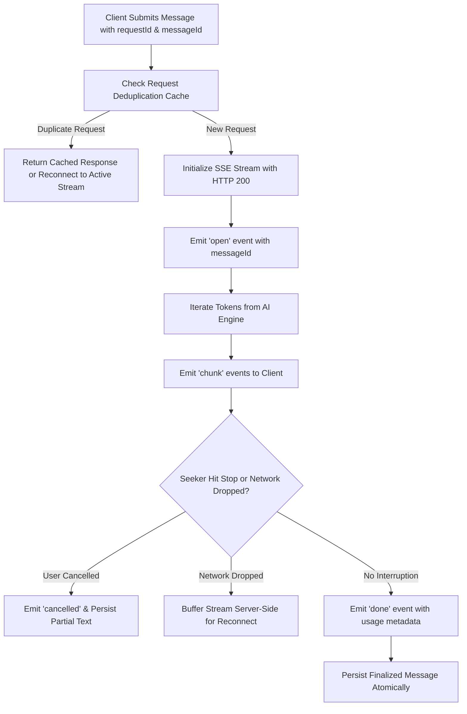

# streaming-and-retry-reliability

## 1. Purpose

Define the transport architecture and reliability standards for real-time AI response delivery in AstroVerse. Provide smooth, chunked token streaming over Server-Sent Events (SSE), eliminate message duplication, handle unexpected client disconnects, and ensure idempotent retries without double-charging or corrupting conversation state.

## 2. When to Use

- Implementing or refining real-time token streaming from LLM backends to frontend clients.
- Managing client-side SSE reconnect logic and stream resumption after temporary network loss.
- Attaching client-generated Request IDs and Message IDs for end-to-end trace correlation.
- Handling seeker-initiated stream cancellation ("Stop Generating" button).
- Designing exponential backoff with jitter for upstream AI provider rate limits (429) and gateway errors (502/503/504).

## 3. Scope

- Transport protocols: HTTP/1.1 and HTTP/2 Server-Sent Events (`text/event-stream`) and chunked fetch responses.
- Message state lifecycle: `QUEUED` $\to$ `STREAMING` $\to$ `COMPLETED` (or `CANCELLED` / `FAILED`).
- Client-side event buffering and DOM batching (preventing layout thrashing on fast token bursts).
- Safe retry policies: non-idempotent operations (like paid consultation initiation) require strict transaction checks before retrying.
- Persistent snapshotting of finalized messages in the database.

## 4. Required Inputs

- Client-generated `requestId` (UUIDv4) and `messageId` (UUIDv4).
- Active session token and user identifier.
- Streaming LLM token generator (or SSE reader).
- Heartbeat interval configurations ($15\text{ seconds}$ ping to keep intermediary proxies alive).

## 5. Technical Workflow



1. **Handshake & Headers**:
   ```http
   HTTP/1.1 200 OK
   Content-Type: text/event-stream
   Cache-Control: no-cache, no-transform
   Connection: keep-alive
   X-Accel-Buffering: no
   ```
2. **Chunk Framing Protocol**:
   - `event: open`: `{ "messageId": "msg_123", "timestamp": 1732185600 }`
   - `event: delta`: `{ "text": "Based on your 10th house..." }`
   - `event: ping`: `{}` (every 15s to prevent NAT/proxy timeouts)
   - `event: done`: `{ "finishReason": "stop", "tokenCount": 384 }`
3. **Frontend Batching**: Buffer incoming delta chunks into animation frame buckets (`requestAnimationFrame`) to avoid triggering style recalculations on every single token.
4. **Resilient Reconnection**:
   - If the connection drops during streaming, the client reconnects passing `Last-Event-ID` or `messageId`.
   - The backend checks its in-memory stream buffer: if active, it streams remaining chunks; if completed, it returns the stored full message.
5. **Safe Retry Guarantees**: Retrying a query with the same `requestId` must NEVER increment the user's consultation minute counter or ledger charges (`consultation-billing-and-ledger-integrity`).

## 6. Domain-Specific Rules

- **No Lost Readings**: If the client disconnects while the AI is mid-sentence, the server must finish generating the reading and store it, ensuring the seeker can read their answer upon returning.
- **Graceful Cancellation**: When a seeker clicks "Stop", terminate the upstream LLM call immediately to conserve API tokens and stop billing timers.
- **Progress Visibility**: Display subtle, soothing loading cues (e.g., "Synthesizing planetary alignments...") before the first token arrives.

## 7. Integration Requirements

- Implemented in `services/wallet-service/src/server.ts` streaming handler.
- Client consumption in `index.html` via `fetch()` and `ReadableStreamDefaultReader` or `EventSource`.
- Observability via structured logger tracking `ttft` (Time to First Token) and total stream duration.

## 8. Failure Handling

- **Upstream Rate Limit (429)**: Apply bounded exponential backoff with jitter (initial delay 500ms, max 3 retries) using `api-rate-limit-handler`.
- **Gateway Timeout (504)**: Send a user-friendly conversational fallback: _"The planetary calculation service is experiencing high traffic. Please retry in a moment."_ without charging any wallet balance.
- **Corrupted Stream Chunks**: Client detects malformed JSON chunks and requests a clean replay using `messageId`.

## 9. Security Considerations

- Validate authorization headers on SSE endpoints.
- Prevent Cross-Site Scripting (XSS) by treating streamed deltas as plain text or passing through an HTML sanitizer before DOM insertion.
- Prevent stream amplification denial-of-service by limiting concurrent streams per user to 2.

## 10. Testing Methodology

- Network interruption test: Artificially close TCP connection mid-stream and assert client reconnects without duplicate messages.
- Cancellation test: Trigger "Stop" after 50 tokens and verify LLM process family terminates upstream call within 200ms.
- End-to-end tests: `services/wallet-service/tests/chat_frontend_logic.test.ts`.

## 11. Acceptance Checklist

- [ ] SSE headers include `X-Accel-Buffering: no` and `no-cache`.
- [ ] Periodic heartbeat pings prevent proxy timeouts during long pauses.
- [ ] Client batching renders smoothly at 60 FPS without DOM freeze.
- [ ] Reconnecting with identical `requestId` does not duplicate charges or responses.
- [ ] User cancellation cleanly halts upstream token generation.

## 12. Clear Prohibited Behaviours

- NEVER allow an unhandled stream drop to trigger duplicate wallet billing.
- NEVER leave upstream LLM connections running indefinitely after client disconnects.
- NEVER block the UI thread during high-frequency token streaming.
- NEVER emit unescaped, raw HTML directly from streaming chunks into `innerHTML`.

## 13. References to Relevant AstroVerse Architecture

- Backend Streaming Handler: `services/wallet-service/src/server.ts`.
- Client Stream Reader: `index.html` (`sendAiUserChatMessage`).
- Related Skills: `mobile-chat-scroll-engineering`, `consultation-billing-and-ledger-integrity`, `conversational-ai-engineering`.
