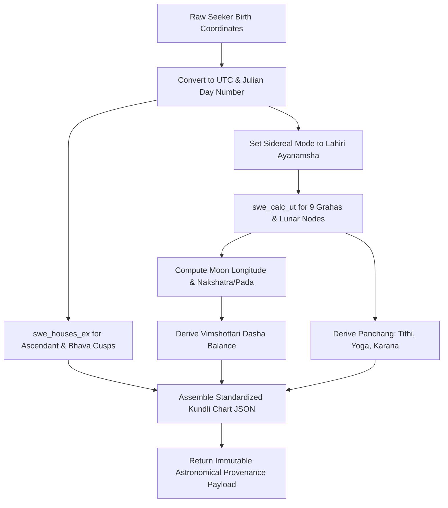

# swiss-ephemeris-integration

## 1. Purpose

Define the integration standards, astronomical calculation pipeline, and licensing governance for Swiss Ephemeris (pyswisseph / SWEPH) within AstroVerse. Guarantee astronomical accuracy down to arcseconds for planetary longitudes, house cusps, ascendant calculation, panchang components, and Vimshottari dasha timelines.

## 2. When to Use

- Calculating natal charts from raw birth inputs (Date, Time, Latitude, Longitude, Timezone).
- Computing sidereal planetary longitudes, retrograde states, and declination.
- Solving Ascendant (Lagna) degrees and Bhava cusps using Sripati or Equal House systems.
- Determining Nakshatra, Pada, Tithi, Nitya Yoga, Karana, Sunrise, and Sunset.
- Computing exact Moon longitude to initiate Vimshottari Dasha balance and timeline generation.
- Validating planetary transit positions (Gochara) for any target date/time.

## 3. Scope

- Authoritative calculation engine: Python Swiss Ephemeris backend (`pyswisseph`).
- Ayanamsha: Explicit Lahiri / Chitrapaksha (`SE_SIDM_LAHIRI`).
- Ephemeris files: Moshier ephemeris fallback or high-precision Swiss Ephemeris data files (`.se1`).
- Geocentric vs. topocentric coordinates and refraction flags for horizon calculations.
- Historical timezone conversions (handling DST changes, historical UTC offsets).
- Licensing compliance (GNU AGPL v3 vs. Astrodienst Swiss Ephemeris Commercial License).

## 4. Required Inputs

- Seeker birth coordinates:
  ```json
  {
    "year": 2001,
    "month": 12,
    "day": 19,
    "hour": 14,
    "minute": 30,
    "second": 0,
    "latitude": 28.6139,
    "longitude": 77.209,
    "timezoneOffsetMinutes": 330
  }
  ```
- Calculation parameters:
  - Ayanamsha identifier: `SE_SIDM_LAHIRI` (default)
  - House system: `P` (Placidus) or `W` (Whole Sign) or `E` (Equal)

## 5. Technical Workflow



1. **Time Conversion**: Convert local birth time to UTC and calculate Julian Day Number (`swe_julday`).
2. **Ayanamsha Setting**: Execute `swe_set_sid_mode(SE_SIDM_LAHIRI, 0, 0)` to guarantee Chitrapaksha Ayanamsha.
3. **Planetary Longitude Calculation**: For each body (Sun, Moon, Mars, Mercury, Jupiter, Venus, Saturn, Mean Rahu/Ketu):
   - Invoke `swe_calc_ut(tjd_ut, planet_id, SEFLG_SWIEPH | SEFLG_SIDEREAL | SEFLG_SPEED)`.
   - Extract longitude, latitude, distance, and daily motion speed ($\text{speed} < 0 \implies \text{Retrograde}$).
4. **Ascendant & Houses**: Call `swe_houses_ex(tjd_ut, SEFLG_SIDEREAL, lat, lon, b'W')` to determine sidereal Lagna and house cusps.
5. **Dasha Balance Calculation**:
   $$\text{Moon Longitude} \pmod{13^\circ 20'} = \text{Elapsed Nakshatra Span}$$
   $$\text{Remaining Balance Fraction} = 1 - \frac{\text{Elapsed Span}}{13^\circ 20'}$$
   Multiply remaining balance fraction by the total planetary Mahadasha period to establish starting dasha date.
6. **Payload Signing**: Include ephemeris version, ayanamsha value, and calculation timestamp in the output JSON for full provenance.

## 6. Domain-Specific Rules

- **No Duplicate JS Calculation**: Do not duplicate core astronomical ephemeris math in Node.js or JavaScript. All calculations must originate from the authoritative Python Kundli engine or pre-calculated verified chart objects.
- **Explicit Lahiri**: Never rely on default tropical positions or unspecified ayanamshas. Always enforce Chitrapaksha Lahiri.
- **Node Calculations**: Default to Mean Nodes (`SE_MEAN_NODE`) for traditional Parashari dasha calculations, with True Nodes available as a configurable option.

## 7. Integration Requirements

- Authority: Existing Python Kundli engine API (`services/kundli-engine/`).
- Invocation: Subprocess or HTTP microservice called by `services/wallet-service/src/server.ts`.
- Response Cache: Cache calculated charts by hashed `(lat, lon, utc_timestamp, ayanamsha)` to prevent redundant recalculation.

## 8. Failure Handling

- **Missing Ephemeris Files**: Fall back automatically to built-in Moshier mathematical algorithms (`SEFLG_MOSEPH`) which provide arcminute precision ($< 0.1'$ error) without external binary files.
- **Polar Latitudes**: For extreme birth locations ($>66^\circ$ N/S) where quadrant house systems fail, fall back cleanly to Equal House or Whole Sign systems.

## 9. Security & Licensing Considerations

- **AGPL / Commercial Licensing Verification**: Swiss Ephemeris is published under GNU AGPL v3 or a commercial license from Astrodienst. When AstroVerse is distributed or offered as a commercial service, the engineering team must verify either:
  1. Full AGPL compliance (providing complete source code of the interacting services); OR
  2. Acquisition of an official Astrodienst Professional/Commercial SWEPH license.
- Sanitize coordinates to valid ranges: Latitude $[-90, +90]$, Longitude $[-180, +180]$.

## 10. Testing Methodology

- Golden fixture regression tests comparing calculated planetary degrees against known benchmark charts (e.g., standard Indian Ephemeris and NC Lahiri tables) within $\pm 0.001^\circ$.
- Dasha balance test asserting exact transition dates for Vimshottari cycles.
- Acceptance test suite: `services/wallet-service/tests/test_astro_dynamic.ts`.

## 11. Acceptance Checklist

- [ ] Lahiri Ayanamsha is explicitly initialized before every calculation.
- [ ] Planetary positions include longitude, sign, nakshatra, pada, and retrograde status.
- [ ] Ascendant degree is accurate to within 1 arcminute of reference ephemeris.
- [ ] Vimshottari dasha start date and balances calculate accurately.
- [ ] AGPL / Commercial license verification is documented in release prerequisites.

## 12. Clear Prohibited Behaviours

- NEVER calculate tropical (Sayana) positions and present them as Vedic (Nirayana) without ayanamsha correction.
- NEVER fabricate approximate planetary positions using simple arithmetic loops in JavaScript.
- NEVER deploy to production with unverified licensing compliance for Astrodienst Swiss Ephemeris.
- NEVER ignore historical daylight saving time or time zone anomalies.

## 13. References to Relevant AstroVerse Architecture

- Authoritative Engine: `services/kundli-engine/` (Python pyswisseph).
- Backend Bridge: `services/wallet-service/src/server.ts` (`calculateClientKundli`).
- Verification Tests: `services/wallet-service/tests/test_astro_dynamic.ts`.
- Related Skills: `parashari-jyotish-reasoning`, `ai-response-quality-evaluation`.
