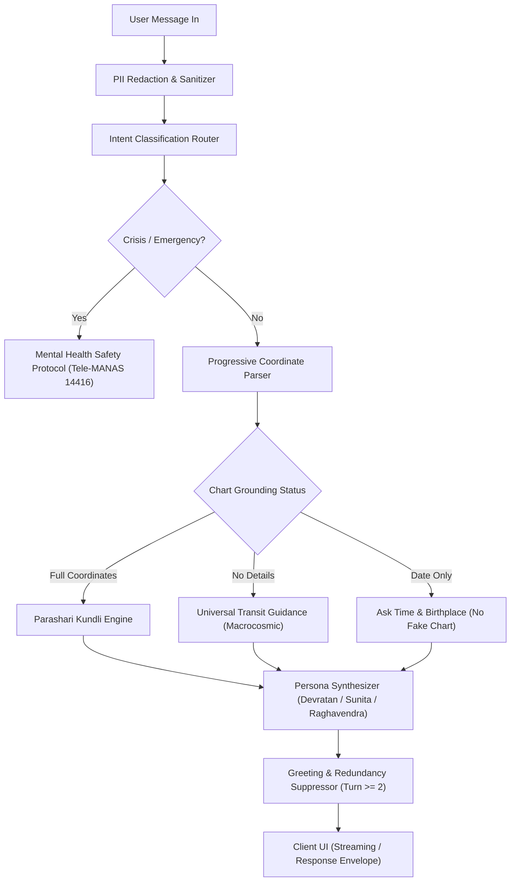

# AstroVerse AI Astrologer: Multi-Turn Conversation Architecture & Intent Engine

**Date:** 2026-11-21  
**Target Runtimes:** [server.ts](file:///e:/rea/services/wallet-service/src/server.ts), [index.html](file:///e:/rea/index.html)  
**Verification Suite:** [ai_astrologer_acceptance_suite.test.ts](file:///e:/rea/services/wallet-service/tests/ai_astrologer_acceptance_suite.test.ts)

---

## 1. Architectural Overview

The AstroVerse AI Astrologer conversation engine is built as a state-aware, multi-turn consultation platform adhering to Maharishi Parashara's classical _Brihat Parashara Hora Shastra_ (BPHS). Unlike naive LLM chat wrappers that suffer from prompt injection, context loss, and hallucinated calculations, AstroVerse decouples deterministic astrological computation from conversational natural language synthesis.



---

## 2. Intent Classification Engine

The intent engine classifies natural language queries across 32 deterministic astrological and consultation categories:

1. `greeting` — Initial contact; persona salutation with explicit AI transparency.
2. `name_introduction` — Seeker states name; acknowledges warm greeting without generating ungrounded astrological claims.
3. `source_inquiry` — Seeker questions how the system knows unprovided details; acknowledges mistake, retracts baseless claims, and requests true birth details.
4. `partial_birth_data` — Seeker provides birth date only; acknowledges date and requests birth time and birthplace to calculate Ascendant and Nakshatra Padas.
5. `everything_overview` — Seeker requests complete reading ("Everything"); presents the 5 Shastric consultation pillars (if no chart) or synthesizes the 3 key pillars (if chart linked).
6. `career` — 10th House (Karma Bhava), Amatyakaraka, and D10 Dashamsha analysis.
7. `career_transit_timing` — Fine-grained timing for job changes, promotions, and interviews using Jupiter/Saturn double transit.
8. `dasha_career_stability` — Vimshottari Mahadasha/Antardasha trajectory for professional stability.
9. `ambiguous_future` — Broad future questions; presents 4 structured life pillars rather than a generic monologue.
10. `marriage` — 7th House (Kalatra Bhava), Upapada Lagna, and D9 Navamsha compatibility.
11. `kundli_matching` — Ashta Koota 36 Guna analysis and Manglik Dosha evaluation.
12. `wealth` — 2nd House (Dhana Bhava), 11th House (Labha Bhava), and Indu Lagna prosperity yogas.
13. `app_wallet` — Strictly separated from astrological wealth; displays live AstroVerse account balance and top-up links.
14. `remedy` — Sattvic classical remedies (Japa, Daana, Stotras) with functional benefic/malefic gemstone guardrails.
15. `education` — 4th House (Vidya) and 5th House (Buddhi) academic potential.
16. `children` — 5th House (Santan Bhava), Jupiter karaka, and D7 Saptamsha indicators.
17. `health` — 6th House (Roga Bhava) and Tanu Bhava vitality.
18. `property` — 4th House (Matru/Bhumi Bhava) and Mars land-ownership indicators.
19. `foreign_travel` — 9th and 12th House overseas relocation indicators.
20. `spiritual` — 9th (Dharma) and 12th (Moksha) Houses, Atmakaraka, and Ishta Devata.
21. `litigation` — 6th House (Shatru Bhava) dispute resolution.
22. `daily_routine` — Classical Vedic Dinacharya (Brahma Muhurta, solar digestion, lunar rest).
23. `hourly_hora` — 24 planetary Horas from local sunrise.
24. `daily_forecast` — Five limbs of Panchanga (Tithi, Vara, Nakshatra, Yoga, Karana).
25. `weekly_forecast` — 7-day planetary transit outlook.
26. `monthly_forecast` — Lunar month transit synthesis.
27. `yearly_forecast` — Solar return (Varshaphala) and major Graha transits.
28. `relative_natal_connection` — Third-party relative chart calculation without overwriting seeker identity.
29. `switch_to_primary_chart` — Restores seeker's primary chart from multi-profile session store.
30. `emotional_wellbeing` — Empathetic validation of stress using 4th House / Moon analysis.
31. `crisis_safety` — Non-astrological emergency helpline redirection (Tele-MANAS, 112, 988).
32. `out_of_scope` — Graceful refusal of lottery predictions, medical diagnosis, or speculative gambling.

---

## 3. Persona Differentiation & AI Transparency

AstroVerse provides three distinct Astrologer personas. To ensure complete regulatory compliance, **every persona explicitly declares their AI identity**:

### 3.1 Acharya Devratan (AI Astrologer)

- **Archetype:** Classical Parashari scholar and strategic life advisor.
- **Tone:** Grounded, philosophical, authoritative yet humble.
- **Opening:** _"Pranam! I am Acharya Devratan, your AI Vedic Astrologer..."_
- **Focus:** D1 Rashi, D9 Navamsha, Vimshottari timing, and functional benefic gemstone prescriptions.

### 3.2 Dr. Sunita Shastri (AI Astrologer)

- **Archetype:** Mindful, empathetic Jyotish scholar focusing on emotional harmony and relationships.
- **Tone:** Warm, nurturing, perceptive.
- **Opening:** _"Namaste! I am Dr. Sunita Shastri, your AI Astrologer specializing in relationship harmony and mindful Vedic guidance..."_
- **Focus:** 7th House kalatra analysis, emotional moon conditioning, and compassionate communication.

### 3.3 Pandit Raghavendra (AI Astrologer)

- **Archetype:** Devotional Vedic ritualist and traditional remedy specialist.
- **Tone:** Reverent, disciplined, sacred.
- **Opening:** _"Om Namah Shivaya! I am Pandit Raghavendra, your AI Vedic Astrology and Remedial Specialist..."_
- **Focus:** Japa mantras, Stotras (Aditya Hridaya, Vishnu Sahasranama), charitable Daana, and planetary pacification.

---

## 4. Repetition Guard & Turn-Aware Synthesis

A critical defect in earlier versions was that the engine repeated introductory greetings on every single turn (e.g., repeating _"Pranam! I have connected to your chart..."_ on Turn 2, Turn 3, Turn 4).

### The Turn-Aware Greeting Filter:

In [server.ts](file:///e:/rea/services/wallet-service/src/server.ts#L15440) and [index.html](file:///e:/rea/index.html#L21430):

```typescript
const isSubsequentTurn = session_history && session_history.length >= 2;

if (isSubsequentTurn && intent === "greeting") {
  message = isHi
    ? `प्रणाम! मैं आपकी सेवा में उपस्थित हूँ। आज आप अपनी कुंडली के किस विषय (करियर, विवाह, वित्त या उपाय) पर मार्गदर्शन चाहते हैं?`
    : `I am here with you. Which specific area of your life or chart would you like to explore next (such as career, relationships, finances, or remedies)?`;
}
```

For domain queries (career, marriage, timing):

- Turn 1 with new chart: Generates initial greeting + natal connection summary + domain answer.
- Turn 2+ with existing chart: **Completely suppresses introductory greetings**, launching directly into deep Shastric analysis.

---

## 5. High-Stakes Crisis Safety Gate

AstroVerse enforces a non-negotiable safety policy:
When emotional distress escalates to suicidal ideation, self-harm, or severe crisis:

1. **Zero Astrological Attribution:** The engine never attributes severe crisis to "bad Rahu", "evil Saturn", or "past life karmic punishment".
2. **Immediate Helpline Routing:** Surfaces national crisis support:
   - India: **Tele-MANAS (14416 / 1800-891-4416)** and **KIRAN (1800-599-0019)**
   - USA/Global: **988 Suicide & Crisis Lifeline**
   - General Emergency: **112 / 911**
3. **Compassionate Empathy:** Warm human validation urging the seeker to connect with trusted family, friends, or licensed medical professionals immediately.

Verified by Acceptance Test Suite and automated safety tests.
