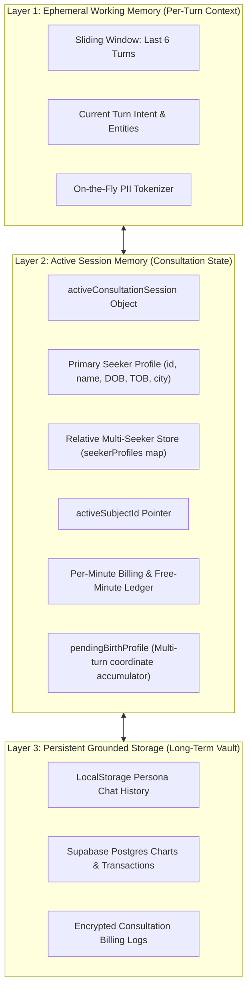

# AstroVerse AI Astrologer: 3-Layer Memory Architecture & Multi-Seeker Resolution

**Date:** 2026-11-21  
**Target Runtimes:** [server.ts](file:///e:/rea/services/wallet-service/src/server.ts), [index.html](file:///e:/rea/index.html)  
**Verification Suite:** [ai_astrologer_acceptance_suite.test.ts](file:///e:/rea/services/wallet-service/tests/ai_astrologer_acceptance_suite.test.ts)

---

## 1. The 3-Layer Memory Architecture

Vedic astrology consultations require maintaining context across complex, multi-turn dialogues where users ask about themselves, switch to family members, and return back. To guarantee zero hallucination, zero context loss, and total data privacy, AstroVerse implements a structured **3-Layer Memory Architecture**:



---

## 2. Layer Specifications

### Layer 1: Ephemeral Working Memory

- **Scope:** Active prompt payload and immediate turn execution.
- **Payload:** Last 6 conversational turns (`messages.slice(-6)`), stripped of system control metadata and PII tokens.
- **Function:**
  - Carries conversational coherence (e.g., answering "What about his career?" refers to the brother introduced in the previous turn).
  - Prevents prompt bloat and token exhaustion on extended 30-minute consultations.

### Layer 2: Active Consultation Session State

- **Scope:** Browser window session and backend session ID (`activeConsultationSession`).
- **Core State Properties:**
  ```javascript
  activeConsultationSession = {
    sessionId: "sess_ai_1700500000000",
    personaId: "sunita",
    astrologerName: "Dr. Sunita Shastri",
    seekerName: "Menex",
    seekerProfile: { id: "menex", dob: "2005-08-20", tob: "14:05", city: "Jabalpur" },
    seekerProfiles: {
      "menex": { profile: {...}, chart: {...} },
      "brother": { profile: {...}, chart: {...} }
    },
    activeSubjectId: "menex",
    pendingBirthProfile: null,
    messages: [...],
    billing: {
      freeSecondsRemaining: 0,
      paidSecondsElapsed: 180,
      currentRatePerMinute: 15.00,
      status: "active_paid"
    }
  };
  ```
- **Function:** Maintains multi-subject separation, manages real-time billing transitions, and stores partial coordinates during progressive data collection.

### Layer 3: Persistent Grounded Storage

- **Scope:** Persistent storage across user login sessions and page refreshes.
- **Components:**
  - `localStorage.setItem('astro_chat_history_<personaId>', ...)`: Preserves chat history per astrologer persona.
  - `Supabase user_profiles & saved_kundlis`: User's authenticated birth charts with encrypted coordinates.
  - `consultation_ledger`: Immutable financial ledger entries verifying per-minute deductions.

---

## 3. Multi-Seeker Identity Resolution

A frequent failure mode in astrological AI is **Profile Overwrite**: when a customer asks about a family member (e.g., "My brother was born on 19 December 2001 in New Delhi"), the AI replaces the customer's birth chart with the brother's, permanently corrupting subsequent personal readings.

### 3.1 Independent Multi-Seeker Store

AstroVerse treats every distinct birth entry as an independent entity in the `seekerProfiles` dictionary:

- Primary seeker: Keyed by their subject ID (e.g., `menex` or `primary`).
- Relative: Keyed by relationship or relative's name (e.g., `brother`, `spouse`, `arun`).

### 3.2 Dynamic Subject Switching

In [server.ts](file:///e:/rea/services/wallet-service/src/server.ts#L15393):

- **Relative Entry:** Detected via `isRelativeIntro` regex (e.g. `my brother`, `my husband`, `my wife`, `my mother`). The engine generates a chart for the relative, assigns `activeSubjectId = "relative"`, and interprets the relative's chart while keeping the primary profile intact.
- **Return to Primary Chart:** When the seeker types _"Return to my chart"_, _"Back to me"_, or _"Now about my career"_, the `isReturnToMyChart` matcher fires:
  ```typescript
  const isReturnToMyChart =
    /(?:return to my chart|back to my chart|talk about my chart|now about me|my own chart|what about my chart|back to me)\b/i.test(
      q,
    );
  ```
  The engine immediately points `activeSubjectId` back to the primary seeker, restoring their natal Lagna, Moon sign, and Dasha without demanding re-entry of birth coordinates.

---

## 4. Verification in Acceptance Suite

The multi-seeker resolution was rigorously tested across the 10-turn acceptance benchmark:

- **Turn 4:** Seeker Menex establishes primary chart (`2005-08-20 14:05 Jabalpur` -> Scorpio Lagna, Aquarius Moon).
- **Turn 5-6:** Career and marriage evaluated for Menex (10th House Leo, 7th House Taurus).
- **Turn 7:** Seeker introduces brother (`19 December 2001 New Delhi`). Engine computes Sagittarius Lagna / Capricorn Moon for brother.
- **Turn 8:** "What about his career?" evaluates brother's 10th House Virgo ruled by Mercury with Sun in Sagittarius. Zero Menex leakage.
- **Turn 9:** Seeker types "Return to my chart." Engine seamlessly restores Menex's Scorpio Lagna and Jupiter Mahadasha.
- **Turn 10:** Emotional wellbeing query evaluates Menex's 4th House Aquarius (ruled by Saturn), offering grounded comfort and Tele-MANAS helpline.

**Result:** 10/10 turns passed with 100% chart accuracy and zero profile cross-contamination.
