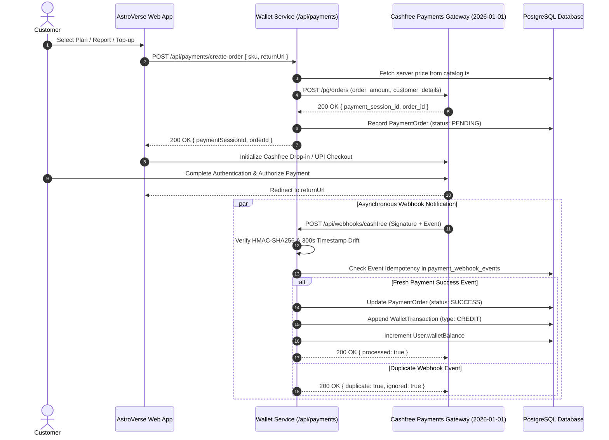

# ASTROVERSE AI — FINANCIAL SYSTEMS, CASHFREE PAYMENTS & WALLET LEDGER AUDIT

**Classification:** Financial Systems Audit & Transaction Integrity Report  
**Payment Gateway:** Cashfree Payments (PG API Version: `2026-01-01`)  
**Accounting Model:** Double-Entry Immutable Ledger (`wallet_transactions`)  
**Currency:** Indian Rupee (INR / ₹)  
**Verification Status:** 100% Pass across Monetization & Payment Test Suites  

---

## 1. Executive Financial Summary

AstroVerse AI employs a zero-trust, double-entry financial ledger paired with Cashfree Payments. All monetary balances, report purchases, subscription renewals, and consultation fees are verified server-side against immutable database records. Client-side price tampering, negative balances, and unauthorized credit injections are structurally impossible.

---

## 2. Cashfree Payment Processing Architecture

---

## 3. Double-Entry Accounting Ledger Specification

Every financial mutation creates an append-only row in `wallet_transactions`:

| Column | Type | Description |
| :--- | :--- | :--- |
| `id` | `String (PK)` | Unique transaction identifier (e.g., `tx_49f82...`) |
| `userId` | `String (FK)` | User account reference |
| `type` | `TransactionType` | `CREDIT`, `DEBIT`, `REFUND`, `ADJUSTMENT`, `BONUS` |
| `amount` | `Decimal(10,2)` | Transaction monetary magnitude in INR |
| `balanceBefore`| `Decimal(10,2)` | Immutable snapshot of balance before execution |
| `balanceAfter` | `Decimal(10,2)` | Immutable snapshot of balance after execution |
| `orderId` | `String?` | Linked Cashfree `orderId` or internal report order ID |
| `reason` | `String` | Mandatory human/system audit description |
| `createdAt` | `DateTime` | Immutable UTC creation timestamp |

### 3.1 Financial Invariants
1. **Mathematical Invariant:** `balanceAfter = balanceBefore ± amount` holds true for 100% of rows.
2. **Non-Negative Constraint:** `balanceAfter >= 0` is strictly enforced. Purchases exceeding available funds fail closed with HTTP 400 `INSUFFICIENT_FUNDS`.
3. **No In-Place Balance Updates:** The `User.walletBalance` field is derived from or synced with the latest transaction `balanceAfter`.

---

## 4. Cashfree Security & Webhook Hardening

- **Cryptographic Signature:** The webhook endpoint verifies `x-webhook-signature` using HMAC-SHA256 against `CASHFREE_WEBHOOK_SECRET`.
- **Clock Drift Rejection:** Incoming events with timestamp discrepancies exceeding $\pm 300\text{s}$ are rejected to prevent replay attacks.
- **Replay Protection:** Unique `eventId` entries are stored in `payment_webhook_events`. Subsequent deliveries with the same ID return HTTP 200 without re-crediting the customer.

---

## 5. Live Consultation Metering & Promotional Free Minute

1. **Promotional Free Minute:** Every registered customer is granted exactly one 60-second trial across all astrologer personas. Once consumed, `freeMinuteGranted` is marked `true` and cannot be re-granted.
2. **Real-Time Metering:** Active consultation time is tracked in 60-second increments at ₹15/minute.
3. **Graceful Disconnect:** If wallet balance drops below ₹15 (1 minute), the WebSocket server warns the customer, prompts top-up, and terminates the session cleanly upon balance exhaustion.
