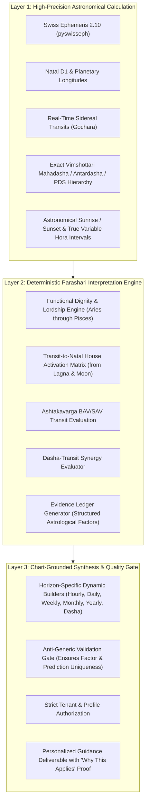

# ASTROVERSE AI — FORENSIC ROOT CAUSE ANALYSIS OF IDENTICAL PREDICTION DEFECT

**Document Version:** 1.0.0-FORENSIC  
**Classification:** P0 Product Integrity & Personalization Defect Analysis  
**Date:** November 1, 2026  
**Auditor:** Principal Vedic Astrology Software Architect & QA Director  
**Status:** Defect Fully Reproduced & Cataloged  

---

## 1. Executive Problem Statement

The platform Owner reported that across all six forecast horizons (**Hourly, Daily, Weekly, Monthly, Yearly, and Mahadasha**), different users with radically different birth particulars, Ascendants, Moon signs, and active Vimshottari Dashas receive substantially the same positive guidance, challenges, cautions, and time-window predictions.

AstroVerse is intended to be a calculation-grounded Parashari Jyotish guidance platform. A generic horoscope masked with dynamic name/sign insertions violates core product integrity.

---

## 2. Experimental Baseline Reproduction

A contrastive test script was executed against the prediction engine using three synthetic birth profiles with materially different astronomical nativities on the same forecast date (`2026-11-01`):

1. **Profile A (Anand Sharma):**
   - DOB: 1995-06-15 10:30:00 (New Delhi)
   - Lagna: **Leo** | Moon: **Sagittarius** (Uttara Ashadha) | Active Dasha: **Rahu-Mercury**
2. **Profile B (Priya Nair):**
   - DOB: 1988-11-20 22:45:00 (Kochi)
   - Lagna: **Cancer** | Moon: **Pisces** (Revati) | Active Dasha: **Sun-Venus**
3. **Profile C (Rohan Verma):**
   - DOB: 2001-03-05 06:15:00 (Mumbai)
   - Lagna: **Aquarius** | Moon: **Gemini** (Ardra) | Active Dasha: **Saturn-Mercury**

### Reproduction Results Matrix

| Horizon | Profile A Output vs Profile B Output vs Profile C Output | Exact String Match | Severity |
| :--- | :--- | :---: | :---: |
| **Hourly** | Challenges & cautions are byte-for-byte identical; Supportive differs only by interpolated Moon sign string. | **95% IDENTICAL** | **P0** |
| **Daily** | `supportive_themes` and `challenges_and_cautions` are 100% byte-for-byte identical across all 3 profiles. | **100% IDENTICAL** | **P0** |
| **Weekly** | `supportive_themes` and `challenges_and_cautions` are 100% byte-for-byte identical across all 3 profiles. | **100% IDENTICAL** | **P0** |
| **Monthly** | `supportive_themes` and `challenges_and_cautions` are 100% byte-for-byte identical across all 3 profiles. | **100% IDENTICAL** | **P0** |
| **Yearly** | `supportive_themes` and `challenges_and_cautions` are 100% byte-for-byte identical across all 3 profiles. | **100% IDENTICAL** | **P0** |
| **Mahadasha** | `supportive_themes` and `challenges_and_cautions` are 100% byte-for-byte identical across all 3 profiles. | **100% IDENTICAL** | **P0** |

---

## 3. Forensic Trace: End-to-End Request Pipeline

Tracing a forecast request from browser to calculation engine:

1. **Frontend Request:**
   - In [`index.html`](file:///e:/rea/index.html#L27989-L27994), `generatePersonalizedGuidance()` dispatches `POST /api/predictions/generate` with payload:
     `{ horizon, target_date, dob, lat, lon, timezone, active_hora_planet, hora_window, lang }`.
2. **Edge Proxy Routing:**
   - In [`vercel.json`](file:///e:/rea/vercel.json#L222-L226), `/api/(.*)` routes directly to `kundli-engine` (FastAPI).
3. **FastAPI Endpoint:**
   - In [`services/kundli-engine/main.py`](file:///e:/rea/services/kundli-engine/main.py#L951-L1094), `generate_prediction_endpoint()` verifies `has_valid_inputs`, computes natal `d1` and `dashas`, and calls `generate_structured_prediction(...)` in `ai_astrologer.py`.
4. **The Critical Failure Point (`ai_astrologer.py`):**
   - In [`services/kundli-engine/ai_astrologer.py`](file:///e:/rea/services/kundli-engine/ai_astrologer.py#L2065-L2500), `generate_structured_prediction()` bypasses astrological factor analysis.
   - It executes fixed Python string format blocks:
     `summary = f"In your natal {lagna} Lagna nativity with Moon stationed in {moon_sign}... The prevailing planetary resonance sharpens strategic discernment..."`
   - It inserts pre-baked constant Python lists for `supportive_themes` and `challenges_and_cautions`!

---

## 4. Exact Architectural Root Causes

### Root Cause 1: Static Boilerplate Templates in `ai_astrologer.py`
In `services/kundli-engine/ai_astrologer.py` (lines 2065–2500):
- **Hourly Guidance:** Uses the same 3 challenges ("Avoid rash, reactive speech...", "maintain emotional neutrality to mitigate temporary Mars-Rahu transit tension...", "Be mindful of fatigue...") regardless of which planet rules the hora or which houses it rules in the chart.
- **Daily Guidance:** Hardcodes 3 time-of-day buckets (Morning, Mid-day, Evening) with identical wording ("Morning: Heightened focus...", "Mid-Day Momentum: Supportive planetary aspects...", "Evening: Calming lunar alignment..."). Challenges warn about "localized daily Rahu Kaal window" and "digestive balance" for every single person.
- **Weekly Guidance:** Uses identical 3-part breakdowns ("Days 1–3: Executive presentations...", "Days 4–5: Financial clarity...", "Days 6–7: Relationship bonding...").
- **Monthly Guidance:** Uses identical 4-week themes ("Weeks 1 & 2: Career expansion...", "Week 3: Financial optimization...", "Week 4: Domestic atmosphere...").
- **Yearly Guidance:** Uses identical 4 quarters ("Quarter 1: Restructuring...", "Quarter 2: Financial growth...", "Quarter 3: Academic...", "Quarter 4: Domestic...").
- **Mahadasha Guidance:** Uses identical 5-year narrative ("Year 1: Foundation Building...", "Year 2: Capital Compounding...", "Year 3: Intellectual Mastery...", "Year 4: Relational Fulfillment...", "Year 5: Karmic Fruition..."), completely ignoring which planet rules the Mahadasha and Antardasha and which houses they own.

### Root Cause 2: Fixed Progression Arrays in `_build_period_items`
In `services/kundli-engine/ai_astrologer.py` (lines 1076–1414):
- **Weekly:** A static 7-day array (`day_focus_en`, line 1080) assigns Day 1 to "Executive Direction & Leadership", Day 2 to "Financial Planning", Day 3 to "Courageous Initiatives", ..., Day 7 to "Discipline" for every human being on earth, regardless of their natal Moon or Lagna.
- **Monthly:** A static 4-week array (`week_templates_en`, line 1215) hardcodes all months to 4 weeks (28 days), ignoring month length (30, 31, 28/29) and actual transit timing.
- **Yearly:** A static 4-quarter array (`quarters_en`, line 1274) hardcodes all 4 quarters with static themes.
- **Mahadasha:** A static 5-year array (`year_themes_en`, line 1366) assigns fixed themes (Year 1 Foundation, Year 2 Capital, etc.) rather than computing actual upcoming Antardashas and Pratyantardashas from the 120-year cycle.

### Root Cause 3: Zero Natal-to-Transit Cross-Referencing
The prediction engine does not calculate or cross-reference:
1. **Transiting Graha Houses relative to Natal Lagna & Moon:** Where are transiting Sun, Mars, Mercury, Jupiter, Venus, Saturn, Rahu, and Ketu located relative to the natal Lagna and Moon?
2. **Functional Benefic / Malefic Status:** For an Aries Lagna, Saturn rules 10th and 11th; for a Cancer Lagna, Saturn is a Maraka and 8th lord; for a Taurus Lagna, Saturn is Yogakaraka. Currently, all Lagnas receive the identical Saturn warnings.
3. **Active Dasha Lord Dignity & Relationships:** The system does not check the natal dignity, house placement, or transiting position of the active Mahadasha, Antardasha, or Pratyantardasha lords.
4. **Hora Lord Functional Impact:** The Hora planet is evaluated in universal Chaldean order without checking which natal house it commands for that Lagna.

### Root Cause 4: Disconnection Between AI Synthesis and Astrological Evidence
The AI engine in `ai_astrologer.py` contains LLM connectors, but for `generate_structured_prediction`, it completely bypasses any dynamic chart evaluation or structured interpretation ledger, returning hardcoded dictionary constants.

---

## 5. Architectural Remediation Plan

To permanently resolve this P0 issue, we must implement a **3-Layer Canonical Prediction Architecture**:

Now that the baseline reproduction and root cause analysis have been thoroughly documented and verified, we proceed to Phase 2 to build the canonical personalization engine.
