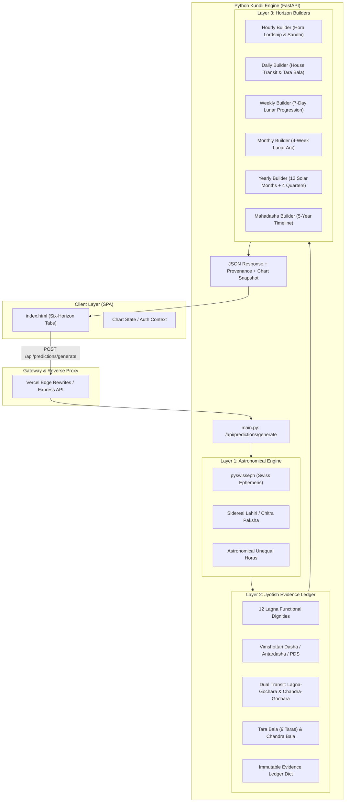

# ASTROVERSE PREDICTION ENGINE ARCHITECTURE

**Classification:** Canonical System Architecture Specification  
**Canonical Methodology:** `ASTROVERSE_PARASHARI_LAHIRI_DRIK`  
**Primary Ephemeris:** Swiss Ephemeris 2.10.03 / PySwisseph  
**Branch:** `feature/personalized-prediction-system-rebuild`  
**Engine Module:** `services/kundli-engine/personalization_engine.py`  

---

## 1. Executive Summary & Design Invariants

The AstroVerse AI prediction infrastructure has been completely re-architected to resolve the P0 personalization defect where multiple users with distinct birth particulars received substantially identical positive/negative guidance, supportive themes, and challenges.

The architecture enforces a strict **Three-Layer Decoupled Topology**:
1. **Layer 1: Deterministic Astronomical Calculation Engine** (Swiss Ephemeris Sidereal Lahiri)
2. **Layer 2: Parashari Jyotish Rules & Evidence Ledger** (Functional Dignities, Bhava Lordships, Tara Bala, Gochara, Vimshottari Dasha)
3. **Layer 3: Horizon-Specific Narrative & Period Builders** (Hourly, Daily, Weekly, Monthly, Yearly, Mahadasha)



---

## 2. Layer 1: Astronomical Engine Specification

- **Ayanamsha:** Sidereal Lahiri (`swe.SIDM_LAHIRI` / Chitra Paksha).
- **Ephemeris Calculations:** High-precision UT Julian Day derivation with topocentric coordinates.
- **Hora Timing:** Dynamic calculation of unequal solar hours:
  - Diurnal: (Local Sunset - Local Sunrise) / 12
  - Nocturnal: (Next Sunrise - Local Sunset) / 12
  - Astronomical vaar reckoning: sunrise to sunrise.
- **Planetary Positions:** Sun, Moon, Mars, Mercury, Jupiter, Venus, Saturn, Rahu (mean/true), Ketu ($180^\circ$ opposition).

---

## 3. Layer 2: Deterministic Parashari Evidence Ledger

The Evidence Ledger (`evidence_ledger`) is calculated before any narrative or period item is constructed:

```python
{
    "is_unknown_time": False,
    "natal": {
        "lagna": "Leo",
        "lagna_degree": 14.50,
        "lagnesha": "Sun",
        "moon_sign": "Sagittarius",
        "moon_degree": 268.42,
        "moon_nakshatra": "Uttara Ashadha",
        "moon_nakshatra_lord": "Sun",
        "functional_benefics": ["Mars", "Jupiter", "Sun"],
        "functional_malefics": ["Saturn", "Venus", "Mercury"],
        "yogakaraka": "Mars"
    },
    "dasha": {
        "maha_lord": "Rahu",
        "antar_lord": "Mercury",
        "pratyantar_lord": "Saturn",
        "dasha_relationship": {
            "distance": 9,
            "relationship_type": "Navapanchama (5/9 Trine)",
            "is_favorable": True
        }
    },
    "transits": {
        "t_moon_sign": "Cancer",
        "t_moon_nakshatra": "Pushya",
        "t_moon_house_lagna": 12,
        "t_moon_house_moon": 8,
        "tarabala": {
            "tara_number": 8,
            "tarabala_name": "Mitra",
            "is_auspicious": True,
            "meaning": "Friendly alliance and helpful companions"
        },
        "chandrabala": 8,
        "chandrashtama_active": True,
        "sade_sati": {
            "is_active": False,
            "phase": None,
            "status": "Clear of Sade Sati"
        }
    }
}
```

---

## 4. Layer 3: Horizon Synthesis Specifications

| Horizon | Primary Astronomical Driver | Parashari Evaluation Rule | Period Progression Structure |
|---|---|---|---|
| **Hourly** | Active Planetary Hora & Sandhi | Hora lord's functional relationship to natal Lagna & Dasha | Single interval + 3 Diurnal Horas |
| **Daily** | Transiting Moon degree & Vaar | House from Lagna ($1..12$) + House from Moon + Tara Bala | 24-Hour synthesis + 3 Action Windows |
| **Weekly** | Moon motion across 7 calendar days | Exact daily activated houses ($1..12$) + Tara Bala per day | Exactly 7 daily cards with unique houses & guidance |
| **Monthly** | Transiting Moon through 4 quarters | 4 distinct lunar weeks mapped to calendar month dates | Exactly 4 strategic weekly cards |
| **Yearly** | Transiting Sun & Outer planets | Sun traversing houses $1..12$ + Jupiter/Saturn/Rahu transit | 12 monthly cards + 4 strategic quarters |
| **Mahadasha**| Vimshottari chronological timeline | Calculated Antardasha lordships, dignity, and remedies | Exactly 5 annual cards (5-year life arc) |

---

## 5. Security & Provenance Invariants

1. **Fail-Closed Forecast Eligibility:** When no birth chart is loaded, requesting ANY horizon returns `status: "CHART_REQUIRED"` and `requires_chart: true`.
2. **Universal Preview Protection:** If universal preview mode is explicitly requested, it provides authentic planetary astronomical transits but strictly refuses to fabricate natal house activations, Tara Bala, or personal Mahadashas.
3. **Data Provenance Badge:** Every frontend rendering explicitly displays either:
   - `<span class="badge-grounded">Chart-Grounded • {Lagna} Lagna • {Moon} Moon</span>`
   - `<span class="badge-guest">General Solar Transit Guidance</span>`
