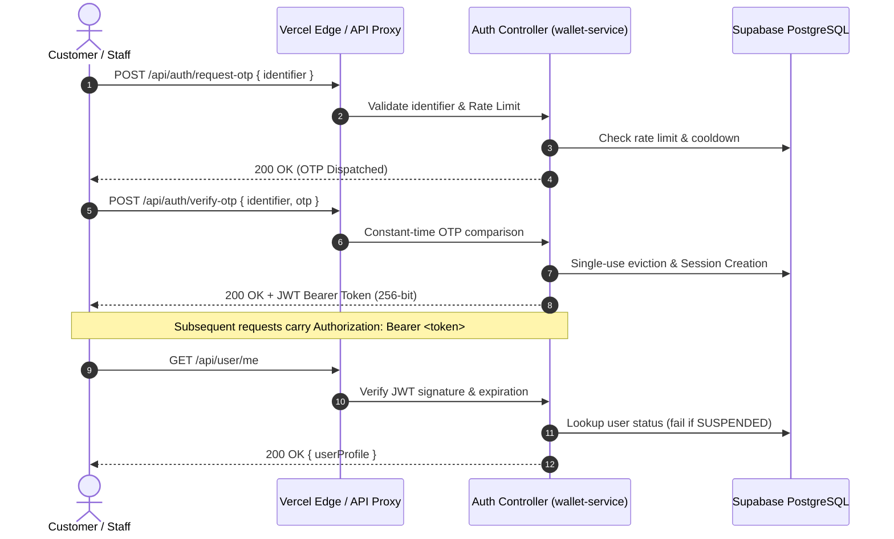

# ASTROVERSE AI — SECURITY THREAT MODEL & HARDENING AUDIT

**Classification:** Security Architecture & Threat Model (STRIDE)  
**Security Standard:** OWASP Top 10, CWE / SANS Top 25, PCI-DSS Relevant Principles  
**Date:** November 1, 2026  

---

## 1. STRIDE Threat Analysis Matrix

| Threat Category | Description & Attack Surface | Existing Countermeasures & Architectural Controls | Security Status |
| :--- | :--- | :--- | :--- |
| **S**poofing | Attacker impersonates legitimate user or administrative staff | - 256-bit cryptographically random JWT tokens. - OTP tokens evicted upon single use with 60s cooldown. - TOTP Multi-Factor Authentication mandatory for admin roles. - Server allowlist (`ADMIN_EMAILS_ALLOWLIST`) enforced at API layer. | ✅ SECURE |
| **T**ampering | Attacker tampers with wallet balances or report prices | - Double-entry immutable financial ledger (`wallet_transactions`). - Prices derived server-side from canonical catalog (`catalog.ts`). Client prices ignored. - Cashfree webhook HMAC-SHA256 signature verification. | ✅ SECURE |
| **R**epudiation | Admin or customer denies performing a critical transaction | - Tamper-evident `audit_logs` table storing actor ID, IP address, user agent, action type, timestamp, and metadata diff. - Financial transaction IDs tied to Cashfree reference IDs. | ✅ SECURE |
| **I**nformation Disclosure | Leakage of customer birth charts, reports, or credentials | - Strict tenant isolation: User A cannot read User B's profiles or reports (HTTP 403 Forbidden). - Production log sanitization redacting OTP codes, passwords, and webhook secrets. - Sensitive admin emails removed from static frontend markup. | ✅ SECURE |
| **D**enial of Service | Flooding OTP dispatch, calculation endpoints, or login | - Sliding window rate limiters on IP and phone/email identifiers. - Fail-closed circuit breakers on external astronomical APIs. - Ephemeral in-memory caching for repetitive ephemeris calculations. | ✅ SECURE |
| **E**levation of Privilege | Regular user escalates role to ADMIN or OWNER | - Strict Prisma role enum (`Role.USER`, `Role.STAFF`, `Role.ADMIN`, `Role.SECURITY_ADMIN`, `Role.FINANCE_ADMIN`, `Role.OWNER`). - Administrative endpoints guarded by `requireRole([Role.ADMIN, Role.OWNER])`. - Bootstrap endpoint `bootstrap-first-owner` permanently disabled once an OWNER exists. | ✅ SECURE |

---

## 2. Authentication & Session Security Lifecycle

---

## 3. Financial Integrity & Webhook Verification

Every inbound Cashfree webhook must pass rigorous cryptographic checks before any wallet credit or order fulfillment occurs:

1. **Header Validation:** Requires `x-webhook-signature` and `x-webhook-timestamp`.
2. **Clock Drift Tolerance:** Webhooks with timestamp drift exceeding 300 seconds are rejected.
3. **HMAC-SHA256 Verification:** Computed as `HMAC_SHA256(timestamp + "." + rawBody, CASHFREE_WEBHOOK_SECRET)`.
4. **Idempotency & Replay Protection:** Webhook event IDs are recorded in `payment_webhook_events`. Duplicate deliveries return HTTP 200 immediately without executing secondary ledger mutations.

---

## 4. Administrative Control Centre Hardening

- **Access Guard:** `requireRole` middleware inspects both database role and the active `ADMIN_EMAILS_ALLOWLIST`. If an email is removed from the allowlist, their active session fails closed with HTTP 403.
- **First Owner Lockout:** The initial platform setup endpoint (`POST /api/admin/bootstrap-first-owner`) verifies whether any active `Role.OWNER` exists. If one exists, it permanently fails closed with HTTP 403 `FIRST_OWNER_ALREADY_INITIALIZED`.
- **MFA Enforcement:** Staff with `mfaEnabled: true` must submit valid 6-digit TOTP codes or 64-character hex backup codes during login.
