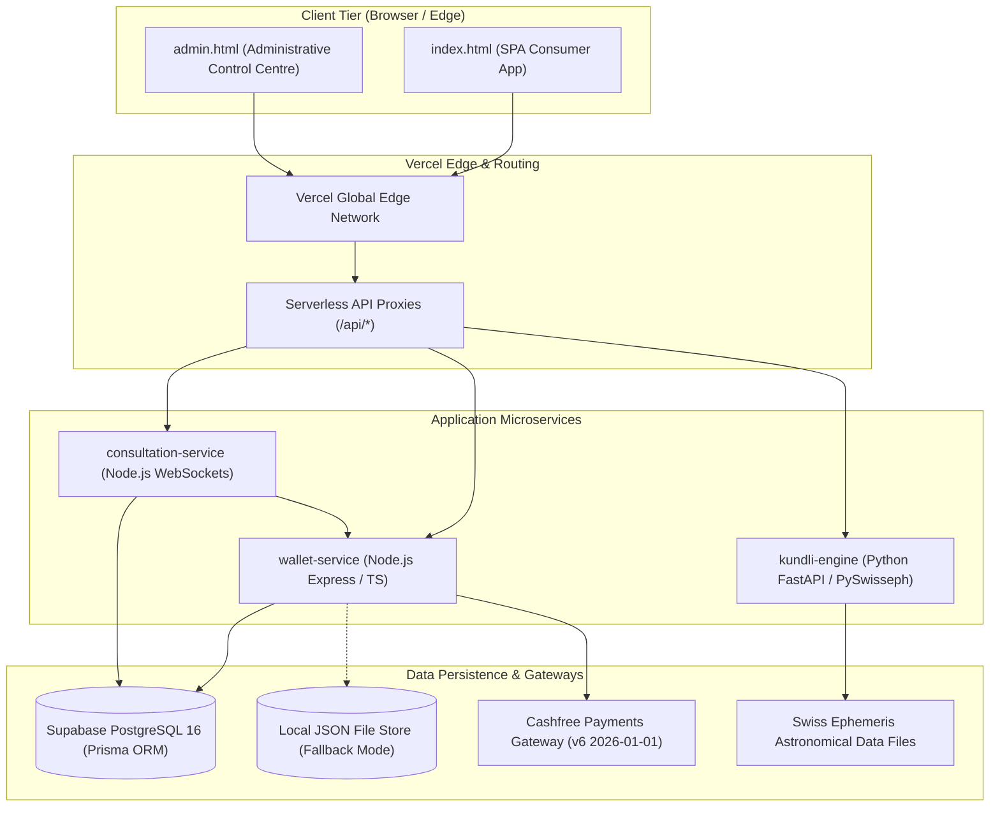

# ASTROVERSE AI — SYSTEM ARCHITECTURE SPECIFICATION

**Classification:** Technical Architecture Specification  
**Canonical Methodology:** `ASTROVERSE_PARASHARI_LAHIRI_DRIK`  
**Primary Engine:** Swiss Ephemeris 2.10.03 / PySwisseph  
**Frameworks:** Vercel Serverless, Node.js Express 4.x, FastAPI Python 3.11, Prisma 5.x, PostgreSQL 16  

---

## 1. High-Level Architectural Topology

AstroVerse AI is built on a decoupled, asynchronous, hybrid-language architecture optimized for astronomical precision, sub-100ms calculation latency, and zero-loss financial auditing:

---

## 2. Microservice Layer Responsibilities

### 2.1 Client Tier (`index.html` & `admin.html`)
- **Single-Page Application (SPA):** Zero-build static asset delivery designed for immediate worldwide edge caching.
- **Embedded Meeus Ephemeris Engine:** In-browser client calculations when offline or running in local guest mode.
- **Responsive Layout Engine:** Fluid dynamic typography, 360px to 4K responsive breakpoints, and WCAG 2.2 AA accessibility.
- **Role-Gated Admin Portal:** Multi-factor authentication (TOTP/Backup codes), customer 360 telemetry, entitlement overrides, financial transaction ledger, and promotional code management.

### 2.2 Financial & User Service (`services/wallet-service`)
- **Port / Route:** Port 4000 (`/api/*` proxy)
- **Runtime:** Node.js 20.x, Express, TypeScript, Prisma ORM.
- **Core Domains:**
  - `Authentication`: Passwordless OTP (Email/SMS), Password Registration, Google OAuth, 256-bit JWT sessions.
  - `Wallet & Ledger`: Double-entry accounting ledger, balance holds, auto-refunds, idempotency enforcement.
  - `Payment Processing`: Cashfree Order Creation, Webhook Signature Verification, Settlement Reconciliation.
  - `Catalog & Monetization`: 15 canonical SKUs (Subscriptions, Kundli Reports, Wallet Packs).
  - `Administrative Access Recovery`: CLI provisioning, role-based access control (USER, STAFF, ADMIN, SECURITY_ADMIN, FINANCE_ADMIN, OWNER).

### 2.3 Astronomical Kundli Engine (`services/kundli-engine`)
- **Port / Route:** Port 8000 (`/api/complete-kundli`, `/api/horoscope`, `/api/panchang`)
- **Runtime:** Python 3.11+, FastAPI, Uvicorn, pyswisseph 2.10.03.
- **Ephemeris Method:** Drik Ganita (Lahiri / Chitra Paksha Ayanamsha, Swiss Ephemeris sidereal mode `SE_SIDM_LAHIRI`).
- **Computational Capabilities:**
  - True planetary positions (Sun through Ketu + Outer planets Uranus, Neptune, Pluto).
  - True Node calculation for Rahu and Ketu (180° opposite).
  - Ascendant (Lagna) and 12 Bhavas (Equal House and Sripati / Porphyry systems).
  - 16 Divisional Charts (D1 through D60 Shodashavarga).
  - Vimshottari Mahadasha, Antardasha, and Pratyantardasha (PDS) boundary matrices.
  - Planetary Dignity, Shadbala (6-fold strength), and 400+ Yoga detection algorithms.

### 2.4 Real-Time Consultation Engine (`services/consultation-service`)
- **Port / Route:** Port 4001 (`/ws/consultation`)
- **Runtime:** Node.js, WebSockets (`ws`), streaming AI synthesis.
- **Capabilities:** Real-time billing per minute, promotional free-minute countdown, automated disconnection upon zero balance, and synchronized transcripts.

---

## 3. Data Persistence Architecture & Entity Relationships

The relational schema is defined in `services/wallet-service/prisma/schema.prisma` comprising 16 models:

| Model | Table Name | Purpose |
| :--- | :--- | :--- |
| `User` | `users` | Identity, authentication, phone/email verification, MFA, wallet balance, active subscription |
| `BirthProfile` | `birth_profiles` | Stored horoscopes with verified geographical coordinates and timezone |
| `WalletTransaction`| `wallet_transactions` | Immutable double-entry financial ledger (CREDIT, DEBIT, REFUND, ADJUSTMENT) |
| `PaymentOrder` | `payment_orders` | Inbound Cashfree orders, gateway tokens, transaction states, and metadata |
| `PaymentWebhookEvent`| `payment_webhook_events`| Processed Cashfree webhook deliveries for idempotency and signature audits |
| `SavedReport` | `saved_reports` | Generated PDF and digital horoscope reports linked to users and birth profiles |
| `ConsultationSession`| `consultation_sessions`| Real-time consultation logs, billing meters, and audio transcripts |
| `AuditLog` | `audit_logs` | Tamper-evident administrative action log (role changes, refunds, impersonation) |
| `Promotion` | `promotions` | Discount codes, usage caps, validity windows, and target SKU filters |
| `Entitlement` | `entitlements` | Feature flags and subscription tier overrides (FREE, PLUS, PREMIUM) |
| `CustomerNote` | `customer_notes` | Staff and admin CRM customer support annotations |
| `RateLimitRecord` | `rate_limits` | Sliding window IP and identifier throttling counters |

---

## 4. Fail-Closed Integration & State Management

1. **Dual Storage Mode:** In development or environments without PostgreSQL, `wallet-service` switches gracefully to a thread-safe JSON store (`astroverse_db.json`). In production, it verifies connectivity via `/api/ready` (`status: "READY"`, `supabaseConnected: true`).
2. **Production Auto-DDL Guard:** `schemaBootstrap.ts` enforces `ALLOW_PRODUCTION_AUTO_DDL !== '1'`, preventing automatic table mutations at runtime and delegating DDL to versioned Prisma CLI migrations.
3. **Idempotency Guarantees:** Financial order creation and webhook processing utilize database-level uniqueness constraints on `orderId` and `cfPaymentId`.
