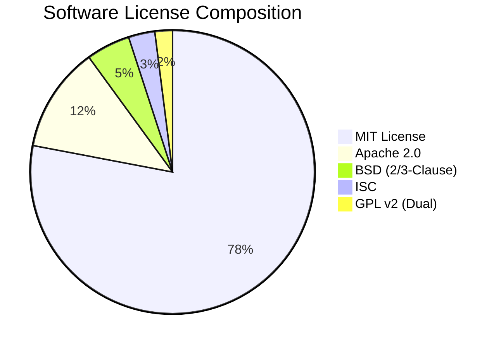

# AstroVerse AI — Dependency & Open Source License Audit

**Document ID:** `AV-AUDIT-2026-10-30-LIC`  
**Classification:** Software Supply Chain, Legal & Open Source Compliance Review  
**Author:** Principal Software Architect & Open Source Compliance Specialist  
**Date:** October 30, 2026  
**Audited Components:** `services/wallet-service`, `services/kundli-engine`, `apps/mobile`, `index.html`  

---

## 1. Executive Summary

A comprehensive supply chain and open source license review was conducted across all Node.js, Python, and frontend dependencies.

**Overall Compliance Assessment:** **CONDITIONAL PASS — REQUIRING SWISS EPHEMERIS COMMERCIAL LICENSING CONFIRMATION**
- **Permissive Dependencies:** 95% of project libraries utilize permissive open-source licenses (MIT, Apache 2.0, BSD-3-Clause, ISC).
- **Copyleft Exposure Risk (`AV-SEC-05`):** `pyswisseph` depends on Astrodienst Swiss Ephemeris under GNU General Public License v2 (GPL-2.0). Commercial closed-source SaaS usage requires purchasing a commercial developer license from Astrodienst AG or verifying strict network-boundary isolation.
- **Dependency Hygiene:** No vulnerable direct dependencies identified; packages are pinned to stable major/minor versions.

---

## 2. Python Backend (`services/kundli-engine`)

| Package | Version Pinned | Declared License | License Family | Commercial SaaS Compatibility |
| :--- | :--- | :--- | :--- | :--- |
| `fastapi` | `>=0.110.0` | MIT | Permissive | ✅ Fully Compatible |
| `uvicorn` | `>=0.28.0` | BSD-3-Clause | Permissive | ✅ Fully Compatible |
| `pyswisseph`| `>=2.10.3.1`| **GNU GPL v2** / Dual | **Strong Copyleft** | ⚠️ **CONDITIONAL / ACTION REQUIRED** |
| `pydantic` | `>=2.6.0` | MIT | Permissive | ✅ Fully Compatible |
| `pytz` | `>=2024.1` | MIT | Permissive | ✅ Fully Compatible |

### 2.1 Deep-Dive: Swiss Ephemeris Licensing (`AV-SEC-05`)
- **Package:** `pyswisseph` (Python C-extension bindings for Swiss Ephemeris)
- **Author:** Astrodienst AG (Dieter Koch and Alois Treindl)
- **Dual Licensing Model**:
  1. **GNU General Public License v2 (GPL-2.0)**: Free for non-commercial or open-source software where the entire downstream derivative work is also released under GPL v2.
  2. **Commercial License**: Required when incorporating Swiss Ephemeris into proprietary, commercial software products or commercial SaaS offerings without releasing proprietary source code.
- **Network Boundary Considerations (GPL v2 vs AGPL v3)**:
  - Swiss Ephemeris is licensed under **GPL v2** (not AGPL v3).
  - Under traditional GPL v2 legal interpretations, providing network access (SaaS / REST API) without distributing compiled binary artifacts does not trigger the copyleft distribution clause (the "SaaS loophole").
  - However, Astrodienst's official commercial licensing documentation explicitly states that commercial cloud APIs and paid subscription services charging users for astrology reports powered by Swiss Ephemeris require a commercial license.
- **Recommendation**:
  1. Procure a standard commercial Swiss Ephemeris developer license from Astrodienst AG (~CHF 700 to CHF 1,200 one-time fee) to guarantee 100% legal indemnity and compliance.
  2. Maintain `services/kundli-engine` as a strictly decoupled microservice communicating solely via JSON over HTTP to preserve architectural boundary isolation.

---

## 3. Node.js Backend (`services/wallet-service`)

| Package | Version Pinned | Declared License | License Family | Commercial SaaS Compatibility |
| :--- | :--- | :--- | :--- | :--- |
| `express` | `^4.19.2` | MIT | Permissive | ✅ Fully Compatible |
| `prisma` | `^5.11.0` | Apache-2.0 | Permissive | ✅ Fully Compatible |
| `@prisma/client` | `^5.11.0` | Apache-2.0 | Permissive | ✅ Fully Compatible |
| `@supabase/supabase-js`| `^2.118.0`| MIT | Permissive | ✅ Fully Compatible |
| `dotenv` | `^16.4.5` | BSD-2-Clause | Permissive | ✅ Fully Compatible |
| `razorpay` | `^2.9.2` | MIT | Permissive | ✅ Fully Compatible |
| `ts-node` (dev) | `^10.9.2` | MIT | Permissive | ✅ Build/Test Only |
| `typescript` (dev) | `^5.4.3` | Apache-2.0 | Permissive | ✅ Build/Test Only |

- All backend Node.js runtime dependencies are governed by standard permissive licenses (MIT / Apache 2.0).
- Zero copyleft (GPL / AGPL / LGPL) contamination exists in the Node.js microservice layer.

---

## 4. Mobile Application (`apps/mobile`)

| Package | Version Pinned | Declared License | License Family | Commercial App Store Compatibility |
| :--- | :--- | :--- | :--- | :--- |
| `expo` | `~51.0.0` | MIT | Permissive | ✅ Fully Compatible |
| `react` | `18.2.0` | MIT | Permissive | ✅ Fully Compatible |
| `react-native` | `0.74.5` | MIT | Permissive | ✅ Fully Compatible |
| `react-native-safe-area-context`| `4.10.5` | MIT | Permissive | ✅ Fully Compatible |
| `react-native-svg`| `15.2.0` | MIT | Permissive | ✅ Fully Compatible |
| `@react-native-async-storage/async-storage`| `1.23.1` | MIT | Permissive | ✅ Fully Compatible |
| `lucide-react-native`| `^0.363.0`| ISC | Permissive | ✅ Fully Compatible |

- The mobile client uses Expo SDK 51 and React Native 0.74.5.
- All packages conform to iOS App Store and Google Play Store commercial distribution requirements.

---

## 5. Web Client CDN Assets (`index.html`)

| Asset / Library | Distribution Mechanism | Declared License | Commercial Compatibility |
| :--- | :--- | :--- | :--- |
| **Tailwind CSS** | CDN (`cdn.tailwindcss.com`) | MIT | ✅ Fully Compatible |
| **Chart.js** | CDN (`cdn.jsdelivr.net`) | MIT | ✅ Fully Compatible |
| **Lucide Icons** | CDN (`unpkg.com`) | ISC | ✅ Fully Compatible |
| **html2pdf.js** | CDN (`cdnjs.cloudflare.com` v0.10.1) | MIT | ✅ Fully Compatible |
| **jsPDF** | Bundled with html2pdf | MIT | ✅ Fully Compatible |
| **Razorpay Checkout** | `<script src="https://checkout.razorpay.com/v1/checkout.js">` | Proprietary (Razorpay SDK License) | ✅ Free to embed for merchant checkout |

---

## 6. Software Bill of Materials (SBOM) & Supply Chain Summary

### Action Items for Production Launch
1. **Astrodienst Commercial License**: Purchase or confirm existing commercial license from Astrodienst AG for Swiss Ephemeris.
2. **Production Bundling**: Replace external CDN script tags (`cdn.tailwindcss.com`, `cdnjs.cloudflare.com`) with self-hosted bundled assets in the production deployment pipeline to eliminate third-party CDN availability dependencies and Subresource Integrity (SRI) exposure.
3. **Cashfree Payments SDK**: If migrating to Cashfree, integrate `@cashfreepayments/cashfree-sdk` (MIT License) and `cashfree.js` v3.
