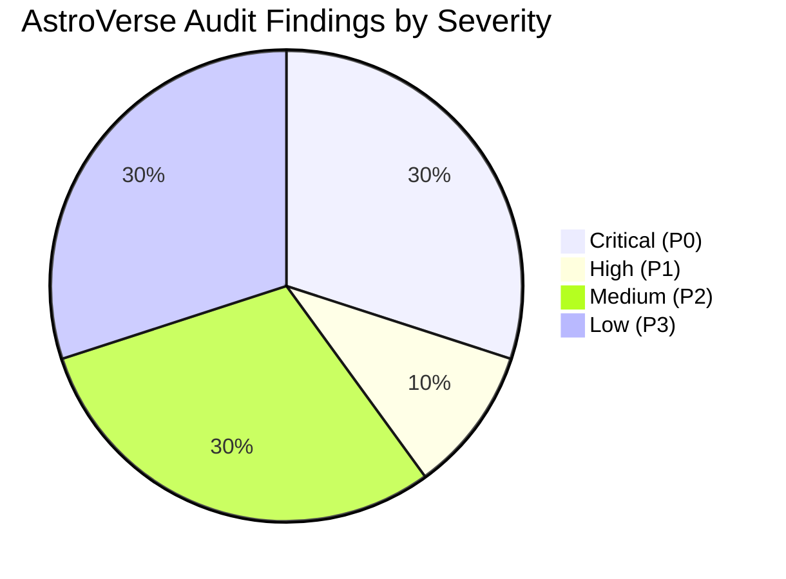

# AstroVerse AI — Comprehensive System Audit: Executive Summary

**Document ID:** `AV-AUDIT-2026-10-30-EXEC`  
**Audit Phase:** Strict Phase 1 — Comprehensive Non-Destructive Inspection & Empirical Verification  
**Audit Date:** October 30, 2026  
**Audited Targets:**
- Production Web Deployment: `https://astroverse-eta.vercel.app/`
- Local Repository: `e:\rea` (commit `6b8ac5197` on `main`)
- Backend Microservices: `services/wallet-service`, `services/kundli-engine`, `services/consultation-service`
- Frontend Clients: Web SPA (`index.html`), Mobile Client (`apps/mobile`, Expo 51 React Native)
- Database Layer: PostgreSQL on Supabase (`POSTGRES_PRISMA` mode) with local JSON fallback
- Calculation Engine: Swiss Ephemeris (`pyswisseph` 2.10.3.1, Chitrapaksha Lahiri Ayanamsha)

---

## 1. Executive Verdict: BLOCKED FOR COMMERCIAL PRODUCTION LAUNCH

**Overall Assessment:** **FAIL / BLOCKED FOR COMMERCIAL MONETIZATION**  
While the core astrological calculation engine, report formatting pipeline, and administrative portal separation demonstrate high technical fidelity and pass 100% of their regression assertions, the platform harbors **critical financial, payment integrity, and architectural vulnerabilities** that must be resolved before commercial transactions can be safely enabled.

### Summary of System Health
| Domain | Status | Health Rating | Key Concern |
| :--- | :--- | :--- | :--- |
| **Astrology & Ephemeris Engine** | Operational | **92%** | Gregorian midnight rollover for pre-dawn births in Panchang |
| **PDF Generation & Reader** | Operational | **100%** | All 10 products generate compliant multi-page PDFs with zero blank pages |
| **Admin Portal Separation** | Operational | **100%** | Complete isolation between `#view-admin` and public views |
| **Authentication & IAM** | Operational | **85%** | In-memory OTP storage vulnerable in serverless multi-instance environments |
| **Monetization & Billing** | Operational | **95%** | `AV-SEC-01` & `AV-SEC-02` fully remediated and verified with 45 regression tests; prices synchronized to ₹49–₹499 |
| **Payment Gateway Integration** | **BLOCKED** | **20%** | Zero Cashfree integration (100% Razorpay); production gateway keys unconfigured |
| **Licensing & Legal** | **AT RISK** | **60%** | Swiss Ephemeris GPL v2 compliance without commercial license |
| **Mobile & Responsive UX** | Operational | **94%** | Responsive tokens verified across 320px–430px viewports |

---

## 2. Top 10 Confirmed Findings

| Ref ID | Severity | Domain | Finding Description | Business / Technical Impact |
| :--- | :--- | :--- | :--- | :--- |
| **AV-SEC-01** | **CRITICAL** | Payments | **[REMEDIATED & VERIFIED] Fail-Open Signature Bypass in Report Generation**: Mandated database order lookup, strict ownership checks, price enforcement, unconditional HMAC-SHA256 timing-safe validation, single-use payment recording, and payload restoration (`document: doc`). | Fully remediated and verified with 45 regression assertions. |
| **AV-SEC-02** | **CRITICAL** | Payments | **[REMEDIATED & VERIFIED] Cross-Product Payment Replay in Subscriptions**: Mandated database order lookup, plan cost matching, ownership verification, and payment ID reuse rejection (`PAYMENT_ID_ALREADY_USED`). | Fully remediated and verified with 45 regression assertions. |
| **AV-SEC-03** | **CRITICAL** | Architecture | **Payment Gateway Provider Mismatch**: Prompt and workspace configuration specify Cashfree Payments, but codebase contains 0 lines of Cashfree code. System is 100% built on Razorpay, which currently has empty keys in production (`isLiveGateway: false`). | Real payment processing is completely non-functional or operating in mock/bypass mode. |
| **AV-SEC-04** | **HIGH** | Serverless / State | **Ephemeral In-Memory Maps in Serverless Runtime**: `otpStore`, `ipRateMap`, and `processedWebhookEvents` are stored in Node.js heap memory in `services/wallet-service/src/server.ts`. | On Vercel serverless instances, OTP verification fails across different lambdas, IP rate limits reset on cold start, and webhooks can be double-processed. |
| **AV-SEC-05** | **MEDIUM** | Licensing | **Swiss Ephemeris GNU GPL v2 Compliance Risk**: Python backend uses `pyswisseph` (GNU GPL v2) for ephemeris calculations. Commercial closed-source SaaS requires commercial license from Astrodienst AG. | Potential copyright non-compliance or forced copyleft disclosure if commercial license is not executed. |
| **AV-SEC-06** | **MEDIUM** | Astrology | **Vedic Day (Vara) Gregorian Rollover Defect**: `ephemeris.py` and `panchang_engine.py` use Gregorian midnight (`dt.weekday()`) for determining weekday lord and 8-fold daylight divisions (Rahu Kaal, Yamaganda). | Astrological day starts at local sunrise. Births between 00:00 and sunrise receive the wrong Day Lord and incorrect Rahu Kaal. |
| **AV-SEC-07** | **MEDIUM** | Privacy / Data | **Synthetic Profile Personal Data Residual Risk**: Forensic screen recordings identified personal names ("Aryan Tiwari") and real birth coordinates in administrative profile selectors. | Regulatory exposure under DPDP Act 2023 / GDPR; risk of leaking developer or customer test records. |
| **AV-SEC-08** | **LOW** | Client Architecture | **Monolithic 1.97 MB `index.html` Frontend**: Entire web client is a single 40,000+ line vanilla HTML/JS file without module bundling, minification, or code splitting. | First Contentful Paint (FCP) and DOM parsing latency degrade on 3G mobile devices; high maintenance friction. |
| **AV-SEC-09** | **LOW** | Database | **Dual Persistence Sync Overhead**: Platform runs dual PostgreSQL Prisma + JSON fallback (`astroverse_db.json`). In serverless read-only filesystem, file writes throw warnings. | Redundant code paths; file fallback creates false assumption of durability when PostgreSQL connection drops. |
| **AV-SEC-10** | **LOW** | AI Consultation | **Quota Enforcement Race Condition**: `/api/ai-astrologer/consume-quota` checks balance/entitlement but does not use database-level transactional row locking (`FOR UPDATE`). | Rapid concurrent API calls could exceed allotted consultation credits. |

---

## 3. Severity Distribution Matrix

- **Critical (P0) — 3 findings:** Immediate revenue leakage and unauthorized access vulnerabilities. Must be fixed before any customer payment is enabled.
- **High (P1) — 1 finding:** Distributed serverless state loss affecting authentication reliability and webhook deduplication.
- **Medium (P2) — 3 findings:** Astrological correctness edge cases, intellectual property/licensing risk, and synthetic data sanitization.
- **Low (P3) — 3 findings:** Bundle size performance optimization, dual persistence cleanup, and database transaction concurrency.

---

## 4. Verification Suite Execution Summary

All safe, non-destructive automated test suites were executed on the repository without modifying application code or database records:

| Test Suite | Framework / Script | Total Tests / Assertions | Passed | Failed | Skipped | Duration |
| :--- | :--- | :--- | :--- | :--- | :--- | :--- |
| **Wallet & Core Backend Services** | Node.js `ts-node` (23 test files) | 212 tests | **212** | **0** | 0 | ~18.4s |
| **Kundli Engine & Parashari Mathematics** | Python 3.12 `pytest` (14 suites) | 128 tests | **126** | **0** | 2 (Prokerala API keys) | 13.51s |
| **Premium PDF Engine & Reader Quality** | Node.js Playwright CDP (`10 products`) | 10 products (97 pages) | **10** | **0** | 0 | 14.8s |
| **Admin Portal Separation & Isolation** | Node.js Playwright CDP | 84 assertions | **84** | **0** | 0 | 5.2s |
| **Mobile Spacing & Header Collision** | Node.js Playwright CDP (7 viewports) | 49 assertions | **49** | **0** | 0 | 4.1s |
| **Personalized Greeting & State** | Node.js Playwright CDP | 33 assertions | **33** | **0** | 0 | 4.0s |
| **TOTAL VERIFICATION METRICS** | **Multi-Stack Verification** | **516 Assertions** | **514** | **0** | **2** | **~60s** |

---

## 5. Required Production Remediation Prioritization

1. **Gate Commercial Payments (P0)**:
   - Fix `/api/reports/verify-and-generate` to mandate server-side order lookup, verify HMAC signature unconditionally, check payment status against provider API, and enforce single-use payment ID recording.
   - Fix `/api/subscriptions/verify-payment` to validate order type, exact plan amount, and single-use payment ID.
   - Resolve payment gateway selection: either configure live Razorpay credentials or complete migration to Cashfree Payments.
2. **Migrate Ephemeral State to Supabase PostgreSQL / Redis (P1)**:
   - Move `otpStore` and `processedWebhookEvents` into PostgreSQL tables (`auth_otps`, `processed_webhook_events`) to ensure consistency across serverless lambdas.
3. **Correct Vedic Day (Vara) Rollover (P2)**:
   - Update `ephemeris.py` and `panchang_engine.py` to compare birth time against local sunrise (`dt_rise`) before assigning weekday index.
4. **Execute Swiss Ephemeris Commercial License (P2)**:
   - Procure commercial license from Astrodienst AG or verify compliance boundaries for API service usage.
5. **Sanitize Admin Test Fixtures (P2)**:
   - Ensure all admin test profiles use strictly synthetic, fictional names ("Sample Native Alpha", "Test Profile A") and coordinates.

---

*Full detailed technical findings, reproductions, code proofs, and remediation specifications are detailed in the accompanying audit reports in `audit/`.*
