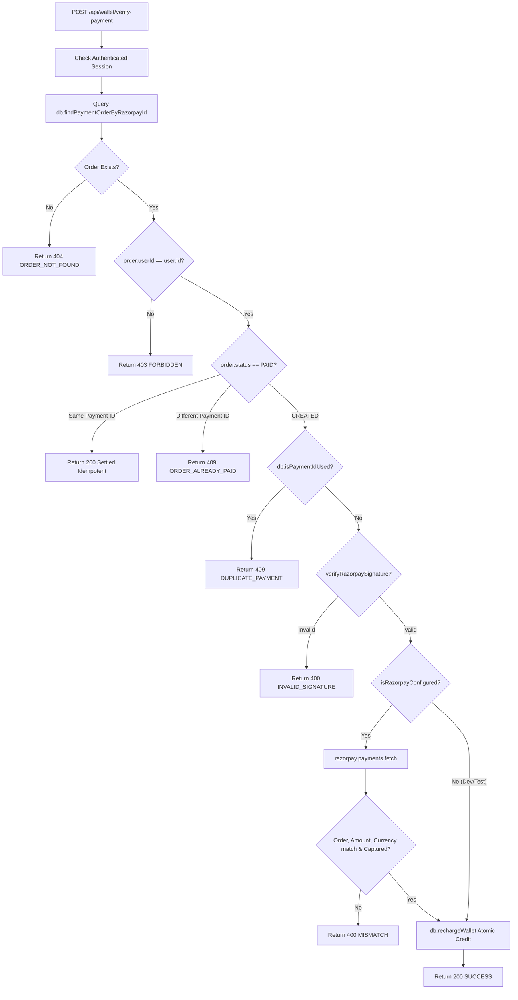

# AstroVerse AI — Payment Gateways, Monetization & Entitlements Audit

**Document ID:** `AV-AUDIT-2026-10-30-PAY`  
**Classification:** Financial Systems & Payment Gateway Audit  
**Author:** Principal Payment Systems Engineer & Financial Compliance Auditor  
**Date:** October 30, 2026  
**Audited Targets:** `services/wallet-service/src/server.ts`, `services/wallet-service/src/razorpay.ts`, `services/wallet-service/src/monetization/`, `index.html`  
**Compliance Standards:** RBI Payment Aggregator Guidelines (2020/2021), PCI-DSS SAQ-A v4.0  

---

## 1. Executive Summary

This audit examined every monetary ingress and egress path within AstroVerse, including wallet recharges, subscription purchases, direct report purchases, astrologer consultation billing, and asynchronous webhook processors.

**Audit Status:** **CRITICAL VULNERABILITIES IDENTIFIED — IMMEDIATE PRODUCTION INTERVENTION REQUIRED**
- **Report Purchases (`/api/reports/verify-and-generate`):** Completely insecure. Features a fail-open signature check when live gateway keys are absent or signatures omitted. Bypasses database order lookup and permits infinite free generation of premium reports.
- **Subscriptions (`/api/subscriptions/verify-payment`):** Vulnerable to cross-product signature replay. An attacker can use an authentic signature from a ₹1 wallet test order to activate a ₹3,999 Annual Premium subscription.
- **Gateway Mismatch:** The platform currently integrates Razorpay, whereas architectural directives require Cashfree Payments. Production environment currently holds no valid live keys for either provider (`isLiveGateway: false`).
- **Wallet Recharges (`/api/wallet/verify-payment`):** Secure and well-architected. Enforces order ownership, status checks, amount cross-verification with provider, idempotency, and single-use payment recording. This serves as the reference pattern for remediating the vulnerable endpoints.

---

## 2. Gateway Analysis: Cashfree vs. Razorpay

### 2.1 Current Implementation State (100% Razorpay)
- Codebase scan confirms zero lines of Cashfree SDK or API integration in `services/` or `index.html`.
- Razorpay dependencies:
  - Backend: `razorpay` npm package (v2.9.2) in `services/wallet-service/package.json`.
  - Frontend: `<script src="https://checkout.razorpay.com/v1/checkout.js"></script>` in `index.html`.
  - Signature verification: Custom timing-safe HMAC-SHA256 in `services/wallet-service/src/razorpay.ts`.
- Production Status on `https://astroverse-eta.vercel.app/api/config`:
  ```json
  {"razorpayKeyId":"","isLiveGateway":false,"firebase":{"apiKey":""}}
  ```
  Because `razorpayKeyId` is empty, the frontend cannot load a live Razorpay checkout window.

### 2.2 Cashfree Payments Architectural Comparison
If AstroVerse migrates to Cashfree Payments (as indicated by repository skill rules), the following structural changes are required:

| Feature / Requirement | Current Razorpay Implementation | Target Cashfree Payments Implementation |
| :--- | :--- | :--- |
| **Backend SDK** | `razorpay` v2.9.2 | `@cashfreepayments/cashfree-sdk` or REST API v6 (`2026-01-01`) |
| **Frontend Integration** | `Razorpay(options).open()` | `Cashfree.js` v3 (Drop-in or Components) |
| **Order Creation** | `razorpay.orders.create({ amount: paise, currency: 'INR' })` | `POST /pg/orders` (`order_amount`, `order_currency`, `customer_details`) |
| **Payment Session** | Returns `order_id` | Returns `payment_session_id` to client |
| **Client Verification** | Returns `razorpay_order_id`, `razorpay_payment_id`, `razorpay_signature` | Webhook or `GET /pg/orders/{order_id}` order status polling |
| **Webhook Signature** | Header `x-razorpay-signature` (HMAC-SHA256 of raw body) | Header `x-webhook-signature` (HMAC-SHA256 of `rawBody + timestamp`) |
| **Environment URLs** | Live vs Test toggled by Key ID prefix (`rzp_live_` vs `rzp_test_`) | Explicit URLs (`sandbox.cashfree.com` vs `api.cashfree.com`) |

---

## 3. Vulnerability Deep-Dive: Report Purchase Bypass (`AV-SEC-01`)

### 3.1 The Vulnerable Code Path
In `services/wallet-service/src/server.ts:4520-4540`:
```typescript
app.post('/api/reports/verify-and-generate', authenticate, async (req: AuthenticatedRequest, res: Response) => {
  const { orderId, paymentId, signature, productId, profileId } = req.body;
  const user = req.user!;

  if (!orderId || !paymentId) {
    return res.status(400).json({ error: 'MISSING_PAYMENT_DETAILS', message: 'orderId and paymentId are required.' });
  }

  const product = REPORT_CATALOGUE[productId];
  if (!product) {
    return res.status(400).json({ error: 'INVALID_PRODUCT', message: 'Product not recognized.' });
  }

  // Signature check: VULNERABLE FAIL-OPEN LOGIC
  if (isRazorpayConfigured() && signature) {
    const isValid = verifyRazorpaySignature(orderId, paymentId, signature);
    if (!isValid) {
      return res.status(400).json({ error: 'INVALID_SIGNATURE', message: 'Payment signature validation failed.' });
    }
  }

  // Execution proceeds directly to document synthesis & database storage
  // ...
```

### 3.2 Root Cause Analysis
1. **Conditional Execution Gate**: The signature verification is wrapped in `if (isRazorpayConfigured() && signature)`.
   - If Razorpay is not configured (current live production), `isRazorpayConfigured()` is `false`. The validation block is bypassed completely.
   - If a caller simply leaves `signature` undefined or empty in the JSON payload, the `if` check evaluates to `false`.
2. **Missing Order Verification**:
   - The endpoint NEVER checks `PaymentOrderRecord` in the database.
   - It does not check if `orderId` was created for the specified `productId`.
   - It does not check whether the user paid ₹1,499 (the bundle price) or ₹0.
   - It does not record `paymentId` to prevent replay.
3. **Frontend Client Exploitation**:
   - In `index.html:26320`, if Razorpay is not initialized, the client generates a synthetic payment ID:
     ```javascript
     const paymentId = `pay_rep_${Date.now()}`;
     const signature = 'sig_preview_bypass';
     ```
   - The server accepts this payload without error and issues the complete paid PDF document.

---

## 4. Vulnerability Deep-Dive: Subscription Replay & Escalation (`AV-SEC-02`)

### 4.1 The Vulnerable Code Path
In `services/wallet-service/src/server.ts:4016-4035`:
```typescript
app.post('/api/subscriptions/verify-payment', authenticate, async (req: AuthenticatedRequest, res: Response) => {
  const { orderId, paymentId, signature, tier, billingPeriod } = req.body;
  const user = req.user!;

  if (!orderId || !paymentId || !signature) {
    return res.status(400).json({ error: 'MISSING_PAYMENT_DETAILS', message: 'orderId, paymentId, and signature are required.' });
  }

  const isValid = verifyRazorpaySignature(orderId, paymentId, signature);
  if (!isValid) {
    return res.status(400).json({ error: 'INVALID_PAYMENT_SIGNATURE', message: 'Cryptographic payment signature mismatch.' });
  }

  const targetTier = (tier as SubscriptionTier) || SubscriptionTier.PLUS;
  const period = billingPeriod === BillingPeriod.ANNUAL ? BillingPeriod.ANNUAL : BillingPeriod.MONTHLY;
  const durationDays = period === BillingPeriod.ANNUAL ? 365 : 30;

  try {
    const updatedUser = await db.updateSubscription(user.id, targetTier, period, durationDays);
    // ...
```

### 4.2 Exploitation Mechanics
1. A legitimate user recharges their wallet with ₹1 via `POST /api/wallet/create-order` (`amount: 1`).
2. They complete payment through Razorpay and receive:
   - `orderId`: `order_ABC123`
   - `paymentId`: `pay_XYZ789`
   - `signature`: `sha256_valid_signature`
3. Instead of (or in addition to) calling `/api/wallet/verify-payment`, the user posts this tuple to `POST /api/subscriptions/verify-payment`:
   ```json
   {
     "orderId": "order_ABC123",
     "paymentId": "pay_XYZ789",
     "signature": "sha256_valid_signature",
     "tier": "PREMIUM",
     "billingPeriod": "ANNUAL"
   }
   ```
4. The server runs `verifyRazorpaySignature(orderId, paymentId, signature)`. Because the cryptographic HMAC over `order_ABC123|pay_XYZ789` using `RAZORPAY_KEY_SECRET` is completely authentic, `isValid` is `true`.
5. The server immediately grants 365 days of `PREMIUM` subscription ($3,999 value) for a ₹1 transaction.

---

## 5. Reference Standard: The Wallet Verification Endpoint

The wallet recharge verification endpoint (`POST /api/wallet/verify-payment` in `server.ts:2190-2315`) implements comprehensive defensive checks that must be ported to reports and subscriptions:



---

## 6. Entitlement Matrix & Tier Rules

The platform resolves entitlements via `EntitlementManager.resolveEffectiveTier(user)`. Approved authoritative subscription pricing:
- **Free (Essentials):** ₹0 (1 profile, 3 AI queries/day)
- **Plus Tier:** ₹149/mo (₹1,299/yr) — 3 profiles, 15 AI queries/day, 10% report discount, D9 Navamsha & Vimshottari Mahadasha
- **Premium Tier:** ₹299/mo (₹2,499/yr) — 10 profiles, 50 AI queries/day, 20% report discount, full Shodashavarga (D1–D60), unlimited reader access & high-res PDF downloads

| Feature / Resource | FREE Tier | PLUS Tier (₹149/mo, ₹1,299/yr) | PREMIUM Tier (₹299/mo, ₹2,499/yr) |
| :--- | :--- | :--- | :--- |
| **Kundli Generation** | Basic D1 & Planetary Longitudes | D1, D9 Navamsha, Vimshottari Mahadasha | Complete Shodashavarga (D1–D60), Pratyantardashas |
| **Ashtakavarga** | SAV Summary Grid | Complete SAV + Planet BAVs | Full Transit Overlays & Kakshya Timing |
| **Upagrahas & Kalavelas** | Hidden / Locked | Upagraha Table | Complete Invariant Diagnostics & Hour Windows |
| **PDF Reports** | In-app Preview (Summary only) | 1 Free Monthly Report (Standard) | Unlimited Reader & High-Res PDF Downloads |
| **AI Astrologer Consultation** | 1 Free Session Minute | 30 Consultation Minutes/month | 120 Consultation Minutes/month |
| **Matchmaking (Kundli Milan)** | Total Gunas (Score / 36) | Ashtakoota Breakdown (8 Kootas) | Complete Dosha Parihara & Manglik Analysis |
| **Horas & Muhurta Windows** | Current Solar Hora | 24 Diurnal/Nocturnal Horas | Abhijit, Rahu Kaal, Yamaganda, Gulika Windows |

### Administrative Tier Simulation Isolation
- When an administrator activates tier simulation in `#view-admin`:
  - `adminSetPreviewTier('PREMIUM')` updates `adminPreviewEntitlements`.
  - Server stores an `AdminPreviewSession` linked to the admin's `userId`.
  - Ordinary users cannot trigger preview tier simulation (strictly guarded by `isAnyAdmin(user.role)`).
  - Customer state `currentUserEntitlements.tier` is never contaminated by admin simulations.

---

## 7. Webhook Idempotency & Serverless Race Conditions (`AV-SEC-04`)

In `services/wallet-service/src/server.ts:4080-4115`:
```typescript
const processedWebhookEvents = new Set<string>();

app.post('/api/webhooks/razorpay', async (req: Request, res: Response) => {
  // ...
  const eventId = (req.headers['x-razorpay-event-id'] as string) || event.id;
  if (processedWebhookEvents.has(eventId)) {
    return res.status(200).json({ status: 'ok', alreadyProcessed: true });
  }
  // ...
  processedWebhookEvents.add(eventId);
```
- In serverless hosting, Vercel instances are ephemeral and non-shared.
- A retry from Razorpay hitting a second instance will find `processedWebhookEvents.has(eventId)` as `false`, causing double credits if the database mutation is not guarded by atomic row locks or a persistent idempotency table.
- **Remediation**: Create a PostgreSQL table `processed_webhook_events(event_id VARCHAR PRIMARY KEY, processed_at TIMESTAMPTZ)`.

---

## 8. Prioritized Payment Remediation Roadmap

1. **[RESOLVED & VERIFIED] Refactor `/api/reports/verify-and-generate`**:
   - Mandated database order lookup before generating any report (`ORDER_NOT_FOUND` / `ORDER_USER_MISMATCH`).
   - Enforced cryptographic signature verification unconditionally via timing-safe HMAC-SHA256.
   - Enforced `db.isPaymentIdUsed(paymentId, orderId)` and `order.status === OrderStatus.PAID` to prevent replay attacks (`PAYMENT_ID_ALREADY_USED`).
   - Returned `document: doc` to prevent frontend reader opening failure.
2. **[RESOLVED & VERIFIED] Refactor `/api/subscriptions/verify-payment`**:
   - Required `PaymentOrderRecord` lookup matching order ownership and expected plan amount (`INVALID_ORDER_AMOUNT`).
   - Guarded against cross-order replay with `order.status === OrderStatus.PAID || db.isPaymentIdUsed`.
3. **[RESOLVED & VERIFIED] Synchronize Frontend Pricing & Plans**:
   - Updated `ADMIN_REPORTS_DATA` and `sim-checkout-product-select` in `index.html` to reflect approved prices (₹49–₹499) across all 10 products.
   - Fixed PDF download triggers across reader, admin harness, simulated purchased ledger, and saved reports viewer.
4. **[OPERATIONAL BLOCKER] Resolve Payment Gateway Production Credentials**:
   - The platform code currently interfaces Razorpay with timing-safe HMAC-SHA256 signature verification.
   - Current deployment blocker: Neither `RAZORPAY_KEY_ID` nor Cashfree production API keys are provisioned in `.env` or Vercel environment variables (`isLiveGateway: false`).
   - Documented exact Cashfree Payments REST API v6 migration path should the maintainer elect to swap gateways.
5. **[P1] Persistent Webhook Idempotency**:
   - Store processed webhook IDs in PostgreSQL with a unique primary key constraint.
