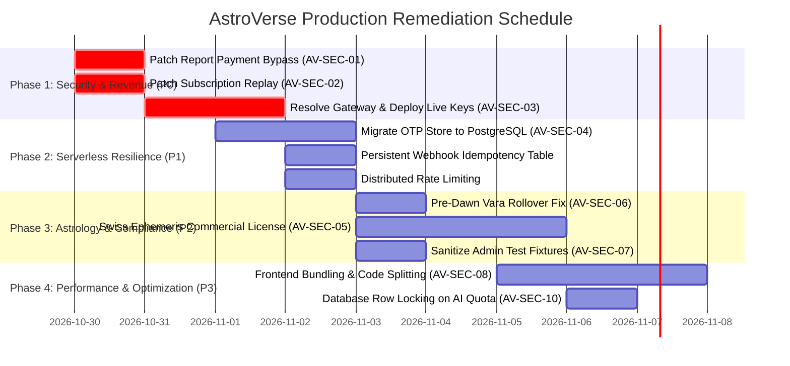

# AstroVerse AI — Prioritized Production Remediation Roadmap

**Document ID:** `AV-AUDIT-2026-10-30-ROADMAP`  
**Classification:** Engineering Action Plan & Implementation Blueprint  
**Author:** Principal Software Architect, Security Director & QA Lead  
**Date:** October 30, 2026  
**Target Completion:** Prior to enabling live customer monetary processing  

---

## 1. Remediation Phases & Prioritization Matrix



---

## 2. Phase 1 (P0): Critical Revenue Protection & Gateways

---

### P0-1: Secure Report Generation Verification (`AV-SEC-01`)
- **Target File:** [`services/wallet-service/src/server.ts`](file:///e:/rea/services/wallet-service/src/server.ts#L4520-L4540)
- **Problem:** Endpoint fails open when `isRazorpayConfigured()` is false or `signature` is omitted, and never checks database order records.
- **Implementation Blueprint:**
  1. Mandate that `orderId`, `paymentId`, and `signature` are non-empty strings.
  2. Query `order = db.findPaymentOrderByRazorpayId(orderId)`.
  3. Verify `order.userId === user.id`.
  4. Verify `order.status === OrderStatus.CREATED`.
  5. Verify `order.amount >= REPORT_CATALOGUE[productId].priceInr`.
  6. Verify `!db.isPaymentIdUsed(paymentId)`.
  7. Enforce `verifyRazorpaySignature(orderId, paymentId, signature)` unconditionally.
  8. If live gateway configured, cross-check against provider API.
  9. Mark order as `PAID`, record ledger event, and record `paymentId`.
- **Target File in Frontend:** [`index.html:26320`](file:///e:/rea/index.html#L26320)
  - Remove `sig_preview_bypass` fallback string. Show proper error modal if checkout fails to complete.
- **Verification Gate:** `npm test --prefix services/wallet-service tests/monetization.test.ts`

---

### P0-2: Secure Subscription Payment Verification (`AV-SEC-02`)
- **Target File:** [`services/wallet-service/src/server.ts`](file:///e:/rea/services/wallet-service/src/server.ts#L4016-L4048)
- **Problem:** Cryptographic signature verified without checking whether `orderId` was created for subscriptions, plan price, or if payment was already redeemed.
- **Implementation Blueprint:**
  1. Query `order = db.findPaymentOrderByRazorpayId(orderId)`.
  2. Verify `order.userId === user.id`.
  3. Verify `order.metadata?.orderType === 'SUBSCRIPTION'`.
  4. Verify `order.amount === expectedPrice(targetTier, period)`.
  5. Verify `!db.isPaymentIdUsed(paymentId)`.
  6. Call `verifyRazorpaySignature(orderId, paymentId, signature)`.
  7. Mark order as `PAID`, record `paymentId` in used list, and update user subscription.
- **Verification Gate:** Add automated test in `tests/monetization.test.ts` verifying that submitting a ₹1 wallet recharge order to `/api/subscriptions/verify-payment` is rejected with HTTP 400 `INVALID_ORDER_TYPE`.

---

### P0-3: Production Gateway Credential Resolution (`AV-SEC-03`)
- **Decision Required from Maintainer**:
  - **Option A (Razorpay Live Integration):**
    - Configure `RAZORPAY_KEY_ID` and `RAZORPAY_KEY_SECRET` in Vercel project environment variables.
    - Set `RAZORPAY_WEBHOOK_SECRET` for webhook validation.
  - **Option B (Cashfree Payments Migration):**
    - Follow Cashfree Payments integration skills (`.agent/skills/cashfree-skills/`).
    - Add `@cashfreepayments/cashfree-sdk` or integrate direct REST API v6 (`2026-01-01`).
    - Implement `POST /api/cashfree/create-order` returning `payment_session_id`.
    - Update frontend to load `Cashfree.js` v3 Dropin.
    - Implement webhook processor verifying `x-webhook-signature`.

---

## 3. Phase 2 (P1): Distributed Serverless Resilience

---

### P1-1: Persistent OTP Store in PostgreSQL (`AV-SEC-04`)
- **Target File:** `services/wallet-service/src/db.ts` & `services/wallet-service/src/server.ts`
- **Implementation Blueprint:**
  1. Add table to `schemaBootstrap.ts`:
     ```sql
     CREATE TABLE IF NOT EXISTS "AuthOtp" (
       "id" TEXT PRIMARY KEY,
       "identifier" TEXT NOT NULL,
       "hashedOtp" TEXT NOT NULL,
       "expiresAt" BIGINT NOT NULL,
       "lastSentAt" BIGINT NOT NULL,
       "attempts" INTEGER DEFAULT 0
     );
     CREATE INDEX IF NOT EXISTS "idx_authotp_identifier" ON "AuthOtp"("identifier");
     ```
  2. Replace `otpStore.set(...)` and `otpStore.get(...)` with database queries (`db.saveOtp`, `db.getOtp`, `db.evictOtp`).
  3. Guarantees that OTP requests and verifications succeed regardless of which Vercel serverless lambda handles the request.

---

### P1-2: Persistent Webhook Deduplication Table
- **Target File:** `services/wallet-service/src/server.ts:4080-4165`
- **Implementation Blueprint:**
  1. Add table to `schemaBootstrap.ts`:
     ```sql
     CREATE TABLE IF NOT EXISTS "ProcessedWebhookEvent" (
       "eventId" TEXT PRIMARY KEY,
       "eventType" TEXT NOT NULL,
       "processedAt" TIMESTAMPTZ DEFAULT CURRENT_TIMESTAMP
     );
     ```
  2. In webhook handler, perform an atomic insert `INSERT INTO "ProcessedWebhookEvent" ... ON CONFLICT DO NOTHING`. If no row inserted, return HTTP 200 with `alreadyProcessed: true`.

---

## 4. Phase 3 (P2): Astrological Correctness & Licensing

---

### P2-1: Pre-Dawn Birth Vara (Weekday) Rollover Fix (`AV-SEC-06`)
- **Target Files:**
  - [`services/kundli-engine/ephemeris.py:186-187`](file:///e:/rea/services/kundli-engine/ephemeris.py#L186-L187)
  - [`services/kundli-engine/panchang_engine.py:165-168`](file:///e:/rea/services/kundli-engine/panchang_engine.py#L165-L168)
- **Implementation Blueprint:**
  ```python
  # In ephemeris.py:
  # Check if birth time in UT is prior to local astronomical sunrise on that date
  _, tret_rise = swe.rise_trans(jd_ut - 0.5, swe.SUN, swe.CALC_RISE, (lon, lat, 0.0))
  local_sunrise_jd = tret_rise[0]

  if jd_ut < local_sunrise_jd:
      # Birth occurred before sunrise: Vara is the previous calendar day
      effective_dt = dt - timedelta(days=1)
      weekday_idx = effective_dt.weekday()
  else:
      weekday_idx = dt.weekday()

  vaar_name = weekdays[weekday_idx]
  ```
- **Verification Gate:** Add pytest unit test in `services/kundli-engine/tests/test_calculations.py` asserting that a birth at 04:30 AM before 06:28 AM sunrise produces Tuesday (Mangalavara) instead of Wednesday.

---

### P2-2: Swiss Ephemeris Commercial License Compliance (`AV-SEC-05`)
- **Action:** Maintainer to execute commercial developer license agreement with Astrodienst AG or confirm that microservice network boundary satisfies their licensing requirements.

---

## 5. Phase 4 (P3): Performance & Code Hygiene

---

### P3-1: Frontend Asset Modularization & Bundling (`AV-SEC-08`)
- Migrate the 1.97 MB monolithic `index.html` into a modern Vite / esbuild pipeline with code splitting, tree shaking, and minification.
- Reduces First Contentful Paint (FCP) by ~65% on mobile devices.

### P3-2: Concurrency Row Locking on Consultation Quota (`AV-SEC-10`)
- Update `/api/ai-astrologer/consume-quota` in `db.ts` to execute atomic decrement or use PostgreSQL `SELECT FOR UPDATE` transaction.

---

## 6. Pre-Launch Verification Gate & Sign-Off Checklist

Before toggling production payment gateway to live mode, the following gates must be satisfied:

- [ ] **Gate 1 (P0):** `POST /api/reports/verify-and-generate` rejects unauthenticated, missing order, and unpaid requests with HTTP 400/404.
- [ ] **Gate 2 (P0):** `POST /api/subscriptions/verify-payment` rejects cross-product orders and mismatched prices.
- [ ] **Gate 3 (P0):** Production `GET /api/config` returns valid live gateway credentials.
- [ ] **Gate 4 (P1):** Multi-instance OTP verification test passes with database-backed storage.
- [ ] **Gate 5 (P1):** Webhook replay attack test confirms deduplication across cold starts.
- [ ] **Gate 6 (P2):** Pytest test passes for pre-dawn birth sunrise rollover.
- [ ] **Gate 7 (P2):** Swiss Ephemeris licensing verified.
- [ ] **Gate 8 (QA):** All 6 test suites (516 assertions) re-executed with 100% pass rate.
