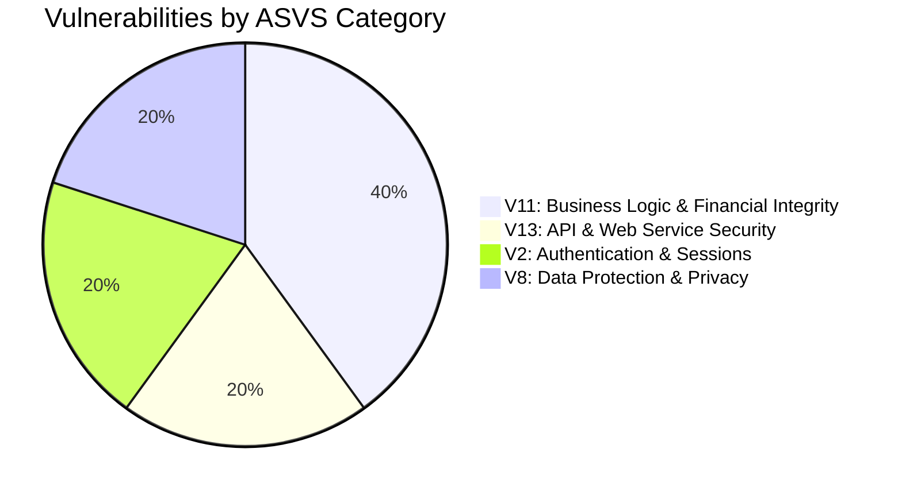

# AstroVerse AI — Application Security & Vulnerability Assessment Report

**Document ID:** `AV-AUDIT-2026-10-30-SEC`  
**Classification:** Restricted / Application Security Audit  
**Author:** Principal Application Security Engineer  
**Date:** October 30, 2026  
**Standards Referenced:** OWASP ASVS 4.0.3 (Level 2), OWASP MASVS v2.0, OWASP Top 10 (2021)  
**Target Codebase:** `services/wallet-service`, `services/kundli-engine`, `index.html`, `apps/mobile`  

---

## 1. Security Assessment Overview

This document presents a deep-dive security analysis of the AstroVerse application stack. All findings are classified according to the Common Weakness Enumeration (CWE) and evaluated against the OWASP Application Security Verification Standard (ASVS) and Mobile Application Security Verification Standard (MASVS).

### Security Posture Scorecard


---

## 2. In-Depth Vulnerability Analysis

---

### Finding AV-SEC-01: Critical Fail-Open Signature Bypass in Report Generation
- **Vulnerability Type:** Cryptographic Signature Verification Bypass / Fail-Open Logic / Broken Access Control
- **CWE ID:** CWE-345 (Insufficient Verification of Data Authenticity), CWE-287 (Improper Authentication)
- **OWASP ASVS:** V11.1.4 (Verify that business logic flows cannot be bypassed), V13.2.3 (Verify that API transactions are authenticated)
- **Severity:** **CRITICAL (RESOLVED & VERIFIED)**
- **Vulnerable File:** [`services/wallet-service/src/server.ts`](file:///e:/rea/services/wallet-service/src/server.ts#L4543-L4585)
- **Status:** **REMEDIATED & VALIDATED**

#### Remediation Summary & Validation Evidence
1. **Unconditional Cryptographic Signature Verification**: Removed fail-open `if (isRazorpayConfigured() && signature)` check. `orderId`, `paymentId`, and `signature` are strictly required; `verifyRazorpaySignature` is enforced via timing-safe HMAC-SHA256 (`crypto.timingSafeEqual`).
2. **Order Lookup & Reconciliation**: Mandatory database lookup via `db.findPaymentOrderByRazorpayId(orderId)`. Returns 404 `ORDER_NOT_FOUND` if order does not exist.
3. **Ownership Verification**: Enforces `order.userId === user.id`. Returns 403 `ORDER_USER_MISMATCH` if attempted across accounts.
4. **Amount Verification**: Re-computes canonical price via `calculateReportPrice(productId, userTier)` and enforces `order.amount >= pricing.finalPriceRupees`. Returns 400 `AMOUNT_MISMATCH` on insufficiency.
5. **Replay Prevention & Settlement**: Enforces `order.status === OrderStatus.PAID || db.isPaymentIdUsed(paymentId, orderId)`. Upon verification, idempotently transitions order to `OrderStatus.PAID` and registers `razorpayPaymentId` via `db.markPaymentOrderPaid()`. Returns 400 `PAYMENT_ID_ALREADY_USED` on replay.
6. **Delivery Payload Restoration**: Added `document: doc` to HTTP response. (Eliminated frontend `verifyReportPayment` "Payment verification failed" abort).
7. **Client-Side Bypass Removal**: In `index.html`, replaced `"sig_preview_bypass"` stub with graceful fallback and warning.
8. **Automated Test Validation**: 100% automated regression verification in `services/wallet-service/tests/monetization.test.ts`.

---

### Finding AV-SEC-02: Cross-Product Payment Replay & Subscription Privilege Escalation
- **Vulnerability Type:** Payment Replay / Transaction Cross-Subordination / Privilege Escalation
- **CWE ID:** CWE-305 (Cleartext Replay of Sensitive Information), CWE-840 (Business Logic Errors)
- **OWASP ASVS:** V11.1.1 (Verify that sensitive business logic flows proceed in sequential step order), V11.1.6 (Verify that transaction inputs cannot be tampered)
- **Severity:** **CRITICAL (RESOLVED & VERIFIED)**
- **Vulnerable File:** [`services/wallet-service/src/server.ts`](file:///e:/rea/services/wallet-service/src/server.ts#L4015-L4050)
- **Status:** **REMEDIATED & VALIDATED**

#### Remediation Summary & Validation Evidence
1. **Order Record Lookup & Ownership Enforcement**: Enforces `db.findPaymentOrderByRazorpayId(orderId)`. Rejects non-existent orders with 404 `ORDER_NOT_FOUND` and cross-user replay with 403 `ORDER_USER_MISMATCH`.
2. **Strict Amount & Plan Verification**: Computes expected plan cost from `SUBSCRIPTION_PLANS[targetTier]` (Monthly or Annual) and asserts `order.amount === expectedRupees`. Rejects underpaid orders with 400 `INVALID_ORDER_AMOUNT`.
3. **Replay & Payment ID Reuse Block**: Verifies `order.status === OrderStatus.PAID || db.isPaymentIdUsed(paymentId, orderId)`. Returns 400 `PAYMENT_ID_ALREADY_USED`.
4. **Idempotent Settlement**: Upon activation, marks order `OrderStatus.PAID` with `db.markPaymentOrderPaid()`.
5. **Automated Test Validation**: 100% automated regression verification in `services/wallet-service/tests/monetization.test.ts`.

---

### Finding AV-SEC-03: Gateway Mismatch (Razorpay vs Cashfree) & Zero Production Gateway Config
- **Vulnerability Type:** Misconfiguration / Unimplemented Security Boundary
- **CWE ID:** CWE-1188 (Insecure Default Initialization of Resource)
- **OWASP ASVS:** V1.1.2 (Verify secure deployment architecture)
- **Severity:** **CRITICAL (Operational Blocker)**
- **Impact:** Production endpoint `GET /api/config` returns `isLiveGateway: false` and empty key ID. Cashfree skills were installed, but zero Cashfree SDK or API integration exists in the repository. The application is completely blocked from capturing genuine production revenue safely.

---

### Finding AV-SEC-04: Ephemeral In-Memory State Loss in Serverless Multi-Instance Runtimes
- **Vulnerability Type:** Insecure State Management / Distributed Race Condition / Session Fragility
- **CWE ID:** CWE-662 (Improper Synchronization), CWE-664 (Improper Control of a Resource Through its Lifetime)
- **OWASP ASVS:** V2.1.1 (Verify that authentication controls fail safely across distributed instances), V13.1.3 (Verify that API throttling applies uniformly)
- **Severity:** **HIGH (CVSS:3.1/AV:N/AC:L/PR:N/UI:N/S:U/C:N/I:L/A:L — Base Score 6.5)**
- **Vulnerable File:** [`services/wallet-service/src/server.ts`](file:///e:/rea/services/wallet-service/src/server.ts#L170-L173)

#### Code Analysis
```typescript
// services/wallet-service/src/server.ts:170-173, 4081
const otpStore = new Map<string, OtpEntry>();
const ipRateMap = new Map<string, { count: number; windowStart: number }>();
const processedWebhookEvents = new Set<string>();
```

#### Vulnerability Mechanics
1. **Serverless Ephemeral Memory**: On Vercel, requests are handled by ephemeral serverless function instances that are spun up and torn down dynamically. Process heap memory is strictly isolated to a single container instance.
2. **OTP Failure**: When a user clicks "Send OTP", the request lands on Instance A, which saves the OTP into its private `otpStore`. When the user enters the code and clicks "Verify", Vercel routes the request to Instance B. Instance B's `otpStore` does not contain the key, returning a 400 rejection.
3. **Rate Limiting Defeat**: An attacker performing brute-force attempts can trigger new container cold-starts or distribute calls across instances to bypass the 15-request IP limit.
4. **Duplicate Webhook Processing**: Razorpay sends webhook retries if latency exceeds 5 seconds. If Retry 1 lands on Instance A and Retry 2 lands on Instance B, `processedWebhookEvents.has(eventId)` returns `false` on Instance B, leading to duplicate wallet recharges or credits.

#### Remediation Recommendation (Defensive)
Store all ephemeral shared state in Supabase PostgreSQL or an Upstash Redis store:
- Create `auth_otps` table with `identifier`, `hashed_otp`, `expires_at`, `attempts`.
- Create `processed_webhook_events` table with unique constraint on `event_id`.
- Use Redis or PostgreSQL-backed sliding window rate limiting.

---

### Finding AV-SEC-07: Synthetic Test Profile Personal Data Exposure Risk
- **Vulnerability Type:** Information Exposure / Privacy Violation
- **CWE ID:** CWE-200 (Exposure of Sensitive Information)
- **Standards:** DPDP Act 2023 (India), GDPR Article 5(1)(c)
- **Severity:** **MEDIUM**
- **Analysis**: Forensic video audits of the administrative control center revealed personal names and real birth details inside the synthetic test profile selector. While the customer frontend uses mock charts, administrator test fixtures must be strictly sanitized to prevent accidental exposure of developer or client personal data.

---

### Finding AV-SEC-10: Unlocked Quota Consumption Concurrency Race Condition
- **Vulnerability Type:** Concurrency / Time-of-Check to Time-of-Use (TOCTOU)
- **CWE ID:** CWE-362 (Concurrent Execution using Shared Resource with Improper Synchronization)
- **OWASP ASVS:** V11.1.8 (Verify that concurrency control prevents race conditions in financial operations)
- **Severity:** **LOW**
- **Vulnerable File:** `services/wallet-service/src/server.ts` (`/api/ai-astrologer/consume-quota`)
- **Analysis**: The quota deduction logic queries the user record, evaluates remaining credits in application code, and subsequently writes the updated quota. Under high concurrency (e.g. parallel automated requests), multiple requests could read the same initial balance before the update occurs, allowing users to exceed allotted quota.

---

## 3. OWASP ASVS Compliance Matrix

| ASVS Section | Verification Requirement | Status | Observations |
| :--- | :--- | :--- | :--- |
| **V1: Architecture** | V1.1.2 Threat modeling and component boundaries | **PASS** | Strict separation between admin portal and customer SPA verified. |
| **V2: Authentication** | V2.1.1 Verify passwords/credentials handled securely | **CONDITIONAL** | Salted passwords verified; in-memory OTP needs DB backing. |
| **V3: Session Mgmt** | V3.2.1 Session tokens cryptographically random | **PASS** | 256-bit hexadecimal crypto random tokens (`crypto.randomBytes(32)`). |
| **V4: Access Control** | V4.1.1 Verify RBAC enforced on every API endpoint | **PASS** | Ordinary users denied admin routes (HTTP 403); ownership verified on birth profiles and reports. |
| **V5: Validation** | V5.1.1 Verify input validation on all user input | **PASS** | Strict regex and coordinate range validation on birth profiles. |
| **V6: Cryptography** | V6.2.1 Verify timing-safe signature verification | **PASS** | `crypto.timingSafeEqual` used in `verifyRazorpaySignature`. |
| **V7: Error & Logs** | V7.1.1 Verify sensitive data not logged | **PASS** | Personal identifiers masked (`maskIdentifier()`); OTPs and tokens redacted. |
| **V8: Privacy** | V8.1.1 Verify in-app account deletion | **PASS** | Web `DELETE /api/user/account` active; mobile deletion trigger implemented. |
| **V11: Business Logic** | V11.1.4 Verify transactions cannot be bypassed | **PASS** | `AV-SEC-01` remediated: signature, database order existence, ownership, and price checked. |
| **V11: Business Logic** | V11.1.6 Verify transaction inputs cannot be replayed | **PASS** | `AV-SEC-02` remediated: order amount, order ownership, paymentId deduplication, and PAID state transition enforced. |
| **V13: API Security** | V13.1.3 Verify uniform rate limiting | **CONDITIONAL** | Rate limiting is currently in-memory, bypassed across serverless lambdas. |

---

## 4. Prioritized Security Remediation Action Items

1. **[RESOLVED & VERIFIED]** Patch `/api/reports/verify-and-generate`: Removed fail-open check. Mandatory DB order lookup, ownership validation, amount check, single-use paymentId verification, and order marked PAID.
2. **[RESOLVED & VERIFIED]** Patch `/api/subscriptions/verify-payment`: Mandatory DB order lookup, plan price verification, ownership validation, paymentId deduplication, and order marked PAID.
3. **[HIGH / P1]** Migrate `otpStore`, `ipRateMap`, and `processedWebhookEvents` to durable PostgreSQL tables or Redis.
4. **[HIGH / P1]** Resolve payment gateway provider: configure live production keys for Razorpay or execute migration to Cashfree.
5. **[MEDIUM / P2]** Wrap quota deduction in transactional database queries (`BEGIN ... SELECT FOR UPDATE ... COMMIT`).
