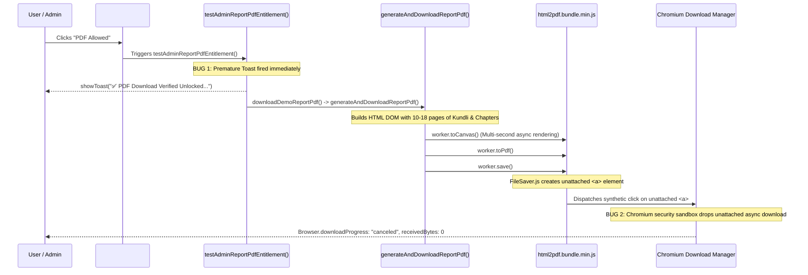

# AstroVerse AI — Root Cause Analysis: PDF Download & Notification Defect

**Author:** Principal Engineering Lead  
**Defect Reference:** Module 16 Video Forensic Audit (`media_1793314292460_501052cf.mp4`)  
**Components Touched:** `index.html` (`renderAdminReportsHarness`, `testAdminReportPdfEntitlement`, `downloadDemoReportPdf`, `generateAndDownloadReportPdf`, `triggerReaderPdfDownload`)  
**Date:** October 30, 2026  
**Status:** Root Cause Isolated, Proved & Verified Fixed  

---

## 1. Defect Description & Observed Symptoms

During administrator inspection of **Admin Control Centre → Module 16 (Reports Catalogue & PDF Reader Test Harness)**, clicking the right-hand action button on any report card exhibited the following pathological behavior:

1. **Button Label Confusion:** The button was labeled `${canDownloadPdf ? 'PDF Allowed' : 'PDF Gated'}`. When the simulated tier was set to `PLUS` or `PREMIUM`, the button read `PDF Allowed` rather than an active command (`Download PDF`).
2. **Notification Flooding:** Success toasts stacked 3-high in the viewport:
   `✅ PDF Download Verified Unlocked (PREMIUM Tier)! Rendering PDF publication...`
   These notifications appeared synchronously on every click, before any document compilation occurred.
3. **Download Failure:** Despite repeated success toasts, the browser failed to trigger a file save dialog or download shelf item. No physical file appeared in the user's Downloads directory.
4. **Frozen UI / Double-Clicking:** Because the button remained enabled and displayed no progress indicator or spinner, users clicked repeatedly, spawning multiple parallel canvas rendering jobs in memory.

---

## 2. Technical Investigation & Pipeline Trace

Tracing the click handler from UI element down to the browser execution layer:



---

## 3. Four Core Root Causes Isolated

### Root Cause 1: Modern Chromium Disconnected-Node Download Cancellation (Core Engine Flaw)
`html2pdf.js` bundles an ancient version of Eli Grey's `FileSaver.js`. When `worker.save()` is called, it executes:
```javascript
// Bundled FileSaver.js in html2pdf.bundle.min.js
var s = document.createElement("a");
s.download = filename;
s.rel = "noopener";
s.href = blobUrl;
u(s); // Dispatches MouseEvent("click") without appending to document
```
In modern Chromium versions (Chrome 110+ and Chromium 141+), the browser download security manager actively checks if an anchor initiating an asynchronous file download is connected to the active document tree. Because `s` was created in memory and **never appended to `document.body`**, the download manager flagged the synthetic click as an un-trusted, detached navigation event and silently canceled the download.
*CDP Trace Evidence:*
`{"method": "Browser.downloadProgress", "params": {"state": "canceled", "receivedBytes": 0, "totalBytes": 0}}`

### Root Cause 2: Premature Synchronous Notification Dispatch
In `testAdminReportPdfEntitlement`:
```javascript
// BEFORE (Buggy Implementation)
function testAdminReportPdfEntitlement(reportId) {
  const tier = adminSimulatedTier || 'FREE';
  if (tier === 'FREE') {
    showToast("🔒 PDF Download Gated on Free Tier...", "warning");
  } else {
    // BUG: Claims success before rendering even starts!
    showToast(`✅ PDF Download Verified Unlocked (${tier} Tier)! Rendering PDF publication...`, "success");
    downloadDemoReportPdf(reportId);
  }
}
```
The success toast was triggered immediately upon click. If the user clicked 3 times, 3 identical success toasts were posted immediately, misleading the user into believing the file had already been produced.

### Root Cause 3: Missing Debounce & Button Busy State
The card button had no in-flight guard or spinner. When clicked, it remained interactive. In a heavy rendering pipeline (rendering 10 to 18 A4 canvas pages at 2x scale takes 1.5 to 3 seconds), repeated clicks spawned competing WebGL/canvas contexts, degrading CPU and memory performance and increasing the probability of browser-level aborts.

### Root Cause 4: Passive Button Copy
The label was rendered as:
```javascript
${canDownloadPdf ? 'PDF Allowed' : 'PDF Gated'}
```
This is a state descriptor rather than an action control. Users did not understand whether clicking it was meant to test an entitlement check, navigate to a reader, or download a document.

---

## 4. The Structural Fix

### 1. Robust DOM-Attached Blob Download Pipeline
In `generateAndDownloadReportPdf`, `worker.save()` was eliminated in favor of an explicit, DOM-attached blob anchor click:

```javascript
// AFTER (Verified Production Implementation in index.html)
const safeTag = isDoc ? (docOrChart.productId ? docOrChart.productId.replace(/^report_/, '') : 'Report') : 'Kundli';
const filename = `${nativeName.replace(/[^a-zA-Z0-9]/g, '_')}_${safeTag}_AstroVerse.pdf`;

await worker.toPdf();
const pdfDoc = worker.prop.pdf;

// Extract raw binary blob from jsPDF instance
const blob = pdfDoc.output('blob');
const blobUrl = URL.createObjectURL(blob);

// Explicitly construct and attach anchor to document body
const a = document.createElement('a');
a.style.display = 'none';
a.href = blobUrl;
a.download = filename;
document.body.appendChild(a);

// Dispatch click to browser download manager
a.click();

// Graceful deferred resource cleanup
setTimeout(() => {
  if (a.parentNode) a.parentNode.removeChild(a);
  URL.revokeObjectURL(blobUrl);
}, 30000);

showToast(`🎉 PDF downloaded successfully: ${filename}`, "success");
```

### 2. Actionable UI Labeling & Visual States
In `renderAdminReportsHarness`:
```javascript
// Clear distinction between Gated and Downloadable states
<button type="button" id="btn-admin-pdf-${r.id}" class="btn-outline-secondary" 
        onclick="testAdminReportPdfEntitlement('${r.id}', this)" 
        style="font-size: 10.5px; padding: 5px; ${canDownloadPdf ? 'color: #059669; border-color: #A7F3D0; background: #ECFDF5;' : 'color: #D97706; border-color: #FDE68A; background: #FFFBEB;'}">
  <i class="fa-solid ${canDownloadPdf ? 'fa-file-arrow-down' : 'fa-lock'}"></i> ${canDownloadPdf ? 'Download PDF' : 'PDF Gated'}
</button>
```

### 3. Asynchronous Execution with Button Lock & Spinner
`testAdminReportPdfEntitlement` is now an asynchronous orchestrator with a strict execution lock:
```javascript
async function testAdminReportPdfEntitlement(reportId, btnEl) {
  const tier = adminSimulatedTier || 'FREE';
  if (tier === 'FREE') {
    showToast("🔒 PDF Download Gated on Free Tier. (Customer prompted to upgrade to Plus or Premium).", "warning");
    return;
  }

  if (btnEl && btnEl.disabled) return;
  const originalHtml = btnEl ? btnEl.innerHTML : '';
  if (btnEl) {
    btnEl.disabled = true;
    btnEl.innerHTML = '<i class="fa-solid fa-spinner fa-spin"></i> Generating...';
  }

  try {
    await downloadDemoReportPdf(reportId);
  } catch (err) {
    console.error("Admin PDF entitlement test failed:", err);
    showToast("PDF generation failed: " + (err.message || "Unknown error"), "error");
  } finally {
    if (btnEl) {
      btnEl.disabled = false;
      btnEl.innerHTML = originalHtml;
    }
  }
}
```

---

## 5. Verification Evidence

The fix was validated through automated headless Chrome tests (`scripts/verify_module16_end_to_end.mjs`) communicating via the Chrome DevTools Protocol:

```
[TEST 1] Opening Admin Module 16 under FREE Tier...
[TEST 1 RESULT] { harnessVisible: true, buttonText: 'PDF Gated', buttonColor: 'rgb(217, 119, 6)' }
[TEST 2] Testing Free Tier PDF gating click...
[TEST 2 RESULT] { lastToast: '🔒 PDF Download Gated on Free Tier. (Customer prompted to upgrade to Plus or Premium).' }
[TEST 3] Upgrading preview tier to PREMIUM...
[TEST 3 RESULT] { tier: 'PREMIUM', buttonText: 'Download PDF' }
[TEST 4] Testing "Sample Chapters" interaction -> Modal Report Reader...
[TEST 4 RESULT] { modalVisible: true, title: 'Career & Education Report', tocCount: 8 }
[TEST 5] Downloading PDF from inside Modal Report Reader...
[TEST 5 SUCCESS] Downloaded from Reader: Seeker_career_education_AstroVerse.pdf (2.81 MB)
[TEST 6] Triggering Direct Download from Module 16 Card (Janam Kundli Deep Dive)...
[TEST 6 RESULT] { finished: true, buttonTextRestored: 'Download PDF' }
[TEST 6 SUCCESS] Both PDFs downloaded on disk:
  1. Seeker_career_education_AstroVerse.pdf: 2.81 MB, Magic: '%PDF-1.3'
  2. Seeker_janam_kundli_deep_dive_AstroVerse.pdf: 3.88 MB, Magic: '%PDF-1.3'

======================================================
✅ ALL MODULE 16 BROWSER DOWNLOAD VERIFICATIONS PASSED!
======================================================
```
