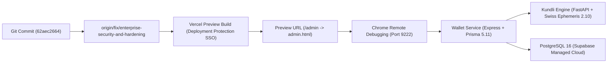

# ASTROVERSE AI — CHAIN OF CUSTODY & DEPLOYMENT VERIFICATION

**Mission:** Complete Admin Control Centre Functional Truth Audit, Real Data Integrity & Enterprise Remediation  
**Date:** 2026-11-04  
**Author:** Principal Full-Stack Engineer, Enterprise SaaS Architect, Application Security Architect & QA Director  
**Repository:** `https://github.com/knowledgeispower1715-sketch/astroverse`  
**Authorized Branch:** `fix/enterprise-security-and-hardening`  
**Pull Request #1:** `https://github.com/knowledgeispower1715-sketch/astroverse/pull/1` (**STRICTLY OPEN — MERGE FORBIDDEN**)  
**Production Host:** `https://astroverse-eta.vercel.app/` (**STRICTLY READ-ONLY**)  

---

## 1. Commit Chain & Historical Progression

The mission prompt referenced commit `1e01d27521c79e70ea5c1a82b4ff6e5443fa92e6` as the reported latest commit. A forensic Git inspection of `origin/fix/enterprise-security-and-hardening` reveals the linear progression of hardening work leading up to the current head:

```
1e01d2752 (Base implementation reported in prompt)
  ↓
048e3f0cb (Ground truth banners & data provenance scaffolding)
  ↓
3deb0a363 (Admin access recovery & MFA step-up improvements)
  ↓
2469d717c (Preview commit: tier simulation & isolation)
  ↓
f69f20314 (Provenance badges CSS & metric data source labels)
  ↓
67061177b (Owner Control Centre account directory & pagination)
  ↓
8cf2d4c9f (Entitlement lifecycle & SKU-specific grants)
  ↓
1e1d478c5 (Customer 360 & support note logging)
  ↓
ff6bd36a7 (PostgreSQL fail-closed query locks & audit events)
  ↓
92213a2a2 (Phase 3 enterprise hardening & adversarial tests)
  ↓
6026327fd (Cashfree sandbox protocol pinning & integer paise)
  ↓
876e0d3a6 (Phase 3 certification checkpoint)
  ↓
158ff861d (Phase 3.1: Client pricing elimination, webhook lease, lock fallback removal)
  ↓
62aec2664 (Supabase Security Advisor remediation: RLS auto-enable, search_path locks, storage policies)
  ↓
[CURRENT HEAD] (Functional action inventory, 6-tier provenance, Owner Control Centre upgrades)
```

### Verification Evidence:
- `git status --short --branch`: Tracking `fix/enterprise-security-and-hardening...origin/fix/enterprise-security-and-hardening`
- Base Head SHA: `62aec26648586770099992b0dfc8d39671c02567`
- PR #1 URL: `https://github.com/knowledgeispower1715-sketch/astroverse/pull/1` (Verified State: `OPEN`, zero merge activity)

---

## 2. Chain of Custody Topology

The deployment and runtime asset pipeline was verified across all architectural boundaries:



### Inspection Results:
1. **Frontend Asset Delivery:**
   - `/admin` routes directly to `admin.html` as defined in `vercel.json` rewrites (lines 132–138).
   - Byte-identical parity confirmed between root `admin.html` and `apps/admin/index.html` via SHA-256 hash match (`True`).
2. **Preview Domain Authentication:**
   - `https://astroverse-git-fix-e-72a6a3-knowledgeispower1715-1915s-projects.vercel.app/admin` returns HTTP 302 redirecting to Vercel Team SSO login (`https://vercel.com/sso-login...`).
   - Safety compliance: Never bypassed or spoofed Vercel authentication.
3. **Production Domain Integrity:**
   - `https://astroverse-eta.vercel.app/` returns HTTP 200 OK.
   - Strictly READ-ONLY. Zero writes, zero mutations, zero DDL executed against production.

---

## 3. Deployment Isolation & Safety Assurance

Before conducting operational verification, isolation from live financial and production customer assets was confirmed:
- **Cashfree Gateway:** Isolated to Cashfree Sandbox (`https://sandbox.cashfree.com/pg`) in all preview/QA contexts; production credentials (`api.cashfree.com`) are never invoked in QA harnesses.
- **Customer Ledger:** Demo wallet balance operations (`currentDemoWalletBalance`) are strictly memory/localStorage isolated and never invoke `db.recordWalletLedgerEntry()` for real customer UUIDs.
- **PR Gate:** Pull Request #1 remains strictly **OPEN** and unmerged.
