# ASTROVERSE AI — CANONICAL DATA SOURCE REGISTRY

**Mission:** Complete Admin Control Centre Functional Truth Audit, Real Data Integrity & Enterprise Remediation  
**Date:** 2026-11-04  
**Author:** Principal Full-Stack Engineer, Database Reliability Engineer & Financial Systems Specialist  

---

## 1. Registry Architecture & Standards

All dashboard metrics, financial indicators, and user counts must resolve to authoritative database tables or certified third-party providers. Integer paise (`amount_paise`) is the mandatory financial unit of truth across all payments, refunds, and wallet transactions. All timestamps are evaluated in `Asia/Kolkata` (IST, UTC+5:30) with explicit ISO 8601 formatting.

```mermaid
flowchart TD
    UserRecords["PostgreSQL 'User' Table"] --> RegisteredUsers["Total Registered (LIVE)"]
    UserRecords --> ActiveAccounts["Active Accounts (LIVE)"]
    UserRecords --> SuspendedAccounts["Suspended Accounts (LIVE)"]
    UserRecords --> ActiveSubs["Active Subscriptions (LIVE)"]
    WalletLedger["PostgreSQL 'WalletLedger' Table"] --> TotalDeposits["Wallet Recharges (DERIVED)"]
    WalletLedger --> ConsultDebits["Consultation Debits (DERIVED)"]
    PaymentOrder["PostgreSQL 'PaymentOrder' Table"] --> GrossCollections["Gross Collections (DERIVED)"]
    PaymentOrder --> PendingRefunds["Pending Refunds (LIVE)"]
    SavedReport["PostgreSQL 'SavedReport' Table"] --> FailedReports["Failed Reports Count (LIVE)"]
    UserSession["PostgreSQL 'UserSession' Table"] --> ActiveSessions["Active Sessions (LIVE)"]
```

---

## 2. Master Dashboard & Operational Metric Registry

| Metric Name | Authoritative Data Source | Underlying Table / Provider | Calculation Formula / SQL Query | Timezone & Currency | Refresh Interval | Provenance | Error Handling | Required Permission |
|---|---|---|---|---|---|---|---|---|
| **Total Registered Users** | PostgreSQL 16 (Supabase) | `public."User"` | `SELECT count(*)::int FROM "User"` | Asia/Kolkata (N/A) | On Load / Manual Refresh | `LIVE` | Fail-closed: Displays `UNAVAILABLE` | `VIEW_OVERVIEW`, `VIEW_USERS` |
| **Active Accounts** | PostgreSQL 16 (Supabase) | `public."User"` | `SELECT count(*)::int FROM "User" WHERE status = 'ACTIVE'` | Asia/Kolkata (N/A) | On Load / Manual Refresh | `LIVE` | Fail-closed: Displays `UNAVAILABLE` | `VIEW_OVERVIEW`, `VIEW_USERS` |
| **Suspended Accounts** | PostgreSQL 16 (Supabase) | `public."User"` | `SELECT count(*)::int FROM "User" WHERE status = 'SUSPENDED'` | Asia/Kolkata (N/A) | On Load / Manual Refresh | `LIVE` | Fail-closed: Displays `UNAVAILABLE` | `VIEW_OVERVIEW`, `VIEW_USERS` |
| **Active Subscriptions** | PostgreSQL 16 (Supabase) | `public."User"` | `SELECT count(*)::int FROM "User" WHERE "subscriptionStatus" = 'ACTIVE' AND "subscriptionTier" IN ('PLUS', 'PREMIUM') AND ("subscriptionExpiresAt" IS NULL OR "subscriptionExpiresAt" > NOW())` | Asia/Kolkata (N/A) | On Load / Manual Refresh | `LIVE` | Fail-closed: Displays `UNAVAILABLE` | `VIEW_OVERVIEW`, `VIEW_SUBSCRIPTIONS` |
| **Total Wallet Recharges** | PostgreSQL 16 (Supabase) | `public."WalletLedger"` | `SELECT COALESCE(SUM(amount), 0)::float FROM "WalletLedger" WHERE "entryType" = 'WALLET_RECHARGE'` | Asia/Kolkata / Integer Paise (converted to INR display) | On Load / Manual Refresh | `DERIVED` | Fail-closed: Displays `UNAVAILABLE` | `VIEW_OVERVIEW`, `VIEW_FINANCIALS` |
| **Consultation Debits** | PostgreSQL 16 (Supabase) | `public."WalletLedger"` | `SELECT ABS(COALESCE(SUM(amount), 0))::float FROM "WalletLedger" WHERE "entryType" = 'CONSULTATION_DEBIT'` | Asia/Kolkata / Integer Paise (converted to INR display) | On Load / Manual Refresh | `DERIVED` | Fail-closed: Displays `UNAVAILABLE` | `VIEW_OVERVIEW`, `VIEW_FINANCIALS` |
| **Saved Birth Profiles** | PostgreSQL 16 (Supabase) | `public."BirthProfile"` | `SELECT count(*)::int FROM "BirthProfile"` | Asia/Kolkata (N/A) | On Load / Manual Refresh | `LIVE` | Fail-closed: Displays `UNAVAILABLE` | `VIEW_OVERVIEW`, `VIEW_USERS` |
| **Active User Sessions** | PostgreSQL 16 (Supabase) | `public."UserSession"` | `SELECT count(*)::int FROM "UserSession" WHERE "expiresAt" > NOW()` | Asia/Kolkata (N/A) | On Load / Manual Refresh | `LIVE` | Fail-closed: Displays `UNAVAILABLE` | `VIEW_OVERVIEW`, `VIEW_SECURITY` |
| **Pending Refunds Count** | PostgreSQL 16 (Supabase) | `public."PaymentOrder"` | `SELECT count(*)::int FROM "PaymentOrder" WHERE status::text IN ('PARTIALLY_REFUNDED', 'REFUND_REQUESTED', 'PENDING_REFUND')` | Asia/Kolkata (N/A) | On Load / Manual Refresh | `LIVE` | Fail-closed: Displays 0 with error toast | `VIEW_OVERVIEW`, `VIEW_FINANCIALS` |
| **Failed Reports Count** | PostgreSQL 16 (Supabase) | `public."SavedReport"` | `SELECT count(*)::int FROM "SavedReport" WHERE status = 'FAILED'` | Asia/Kolkata (N/A) | On Load / Manual Refresh | `LIVE` | Fail-closed: Displays 0 with error toast | `VIEW_OVERVIEW`, `VIEW_REPORTS` |
| **Open Incidents** | PostgreSQL 16 (Supabase) | `public."PlatformIncident"` | `SELECT count(*)::int FROM "PlatformIncident" WHERE status != 'RESOLVED'` | Asia/Kolkata (N/A) | On Load / Manual Refresh | `LIVE` | Fail-closed: Displays 0 with error toast | `VIEW_OVERVIEW`, `VIEW_SECURITY` |
| **Pending Privacy Requests** | PostgreSQL 16 (Supabase) | `public."PrivacyRequest"` | `SELECT count(*)::int FROM "PrivacyRequest" WHERE status = 'PENDING'` | Asia/Kolkata (N/A) | On Load / Manual Refresh | `LIVE` | Fail-closed: Displays 0 with error toast | `VIEW_OVERVIEW`, `VIEW_PRIVACY` |
| **Astrologer Roster Count** | PostgreSQL 16 (Supabase) | `public."Astrologer"` | `SELECT count(*)::int FROM "Astrologer"` | Asia/Kolkata (N/A) | On Load / Manual Refresh | `LIVE` | Fail-closed: Displays 0 with error toast | `VIEW_OVERVIEW`, `VIEW_USERS` |
| **Gross Financial Collections** | PostgreSQL 16 (Supabase) | `public."PaymentOrder"` | `SELECT COALESCE(SUM(amount), 0)::float FROM "PaymentOrder" WHERE status = 'PAID'` | Asia/Kolkata / Exact integer paise | On Load / Manual Refresh | `DERIVED` | Fail-closed: Displays `UNAVAILABLE` | `VIEW_ANALYTICS`, `VIEW_FINANCIALS` |
| **Active Wallet Liabilities** | PostgreSQL 16 (Supabase) | `public."User"` | `SELECT COALESCE(SUM("walletBalance"), 0)::float FROM "User"` | Asia/Kolkata / Exact integer paise | On Load / Manual Refresh | `DERIVED` | Fail-closed: Displays `UNAVAILABLE` | `VIEW_ANALYTICS`, `VIEW_FINANCIALS` |
| **Promotional Credits Given** | PostgreSQL 16 (Supabase) | `public."User"` | `SELECT COALESCE(SUM("promotionalWalletBalance"), 0)::float FROM "User"` | Asia/Kolkata / Exact integer paise | On Load / Manual Refresh | `DERIVED` | Fail-closed: Displays `UNAVAILABLE` | `VIEW_ANALYTICS`, `VIEW_FINANCIALS` |
| **Daily AI Consumption** | Local Durable Ledger | `data/ai_usage_events.json` | Reconstructed from bounded events matching `userId` and `dateStr = getKolkataDateString()` | Asia/Kolkata / Query Count | Real-time per query | `LIVE` / `DERIVED` | Atomic daily reset; throws `AI_QUOTA_EXCEEDED` on limit | `VIEW_AI`, `MANAGE_AI` |
| **Swiss Ephemeris Status** | FastAPI Kundli Engine | `services/kundli-engine` | `GET /health` returning Swiss Ephemeris 2.10 Nirayana Lahiri state | Asia/Kolkata | 60 seconds | `LIVE` | Returns `ENGINE_OFFLINE` | `VIEW_ASTROLOGY` |

---

## 3. Financial Distinction Rules

The following core accounting boundaries are strictly enforced:
1. **Wallet Deposits vs Platform Revenue:** A customer wallet recharge is recorded as an unearned liability (`activeWalletLiabilitiesRupees`). It only transitions to earned platform revenue when debited for a consultation or report purchase.
2. **Promotional Credits vs Paid Cash:** Promotional wallet credits are maintained in a separate column (`promotionalWalletBalance`), spent with secondary priority, non-refundable, and excluded from gross cash collections.
3. **Pending Refunds vs Settled Refunds:** Payment orders with status `REFUND_REQUESTED` or `PENDING_REFUND` remain classified as pending liabilities until gateway webhook confirmation or synchronous Cashfree refund verification confirms completion (`REFUNDED`).
