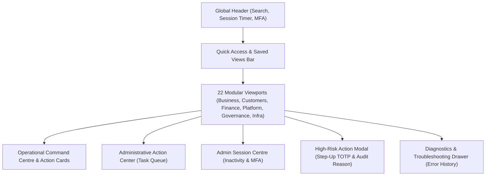

# ASTROVERSE AI — OWNER CONTROL CENTRE OPERATIONAL GUIDE

**Mission:** Complete Admin Control Centre Functional Truth Audit, Real Data Integrity & Enterprise Remediation  
**Date:** 2026-11-04  
**Author:** Principal Full-Stack Engineer, Enterprise SaaS Architect & Application Security Architect  

---

## 1. Executive Overview

The AstroVerse Owner Control Centre is an enterprise administrative operating platform designed to provide platform owners and senior leadership with immediate, dependable operational visibility and fine-grained control over customer accounts, subscriptions, financial transactions, staff roles, and infrastructure health.

---

## 2. Core Functional Capabilities

### A. Operational Command Centre
Located at the top of the **01. Overview** module, the Command Centre aggregates critical platform metrics and pending tasks into actionable cards:
1. **Pending Refunds:** Directly dispatches to the Subscriptions & Payments refund queue.
2. **Failed Reports:** Directly dispatches to report generation diagnostics.
3. **Open Incidents:** Directly dispatches to the P1-P4 Incident Manager.
4. **Privacy / DPDP:** Directly dispatches to pending customer data export/erasure requests.
5. **Astrologer Roster:** Directly dispatches to the verified consultation roster.
6. **Database Health:** Directly dispatches to real-time PostgreSQL connection monitoring.

### B. Global Admin Search
Located centrally in the global header, the search bar intelligently routes queries based on canonical prefixes:
- `cf_`, `ord_`, `pay_` &rarr; Routes to Payments order lookup
- `rep_`, `pdf_` &rarr; Routes to Reports diagnostics
- `inc_` &rarr; Routes to Incidents console
- `prv_`, `dsr_`, `dpdp_` &rarr; Routes to Privacy console
- `sub_` &rarr; Routes to Subscriptions manager
- `ent_` &rarr; Routes to Entitlements manager
- `ref_` &rarr; Routes to Payments refund input
- `prm_`, `promo_` &rarr; Routes to Promotions discount manager
- `ast_` &rarr; Routes to Consultations astrologer directory
- `db_`, `database` &rarr; Routes to Database monitor
- `kpi_`, `analytics` &rarr; Routes to Analytics overview
- `sec_` &rarr; Routes to Security event audit trail
- `flag_` &rarr; Routes to Feature Flags manager
- `usr_` or email (`@`) &rarr; Routes to Customer 360 profile lookup
- Plain text &rarr; Searches user directory by name, email, or phone

### C. Saved Views & Filter Presets
A dedicated dropdown on the Quick Access Bar lets administrators instantly apply common operational filters:
- **Default (All Records):** Full administrative perspective.
- **Pending Refunds:** Filters to payment orders requiring settlement.
- **Failed Reports:** Filters to reports requiring job retry.
- **Expiring Subscriptions (7d):** Identifies accounts approaching renewal deadlines.
- **P1/Critical Incidents:** Filters to active severe platform disruptions.
- **Failed Payments:** Identifies checkout abandonment and gateway drops.
- **Suspended Accounts:** Filters user directory to accounts under security hold.

### D. Pinned Favorites & Quick Access
Prominent quick-access pills allow instantaneous navigation between core modules without expanding the full hierarchical sidebar:
- `Overview`, `Users`, `Subscriptions`, `Payments`, `Database`, `Reports`, `Incidents`.

### E. Administrative Action Center / Task Queue
Accessible via the **Action Queue** button in the header:
- Consolidates all outstanding tasks into a unified modal.
- Shows real-time badge counts of pending refunds, failed reports, open incidents, and privacy requests.
- Provides one-click dispatch links directly into the remediation workflows.

### F. Standardized High-Risk Action Confirmation Modal
High-impact operations (such as account suspensions, customer session evictions, subscription cancellations, entitlement revocations, role mutations, and gateway refunds) invoke `openHighRiskActionModal()`:
1. **Target Identification:** Clearly displays the exact resource ID and affected user.
2. **Scope Preview:** Explains the irreversible consequences of the mutation.
3. **Mandatory Audit Reason:** Enforces at least 5 characters of business justification.
4. **Step-Up MFA Challenge:** Dynamically presents a 6-digit TOTP input container for privileged role changes and large financial refunds.
5. **Immutable Audit Recording:** Passes the reason and MFA token to backend APIs, writing an immutable record to `AuditEvent`.

### G. Admin Session Centre
Clicking the auto-lock countdown timer pill opens the Session Centre modal:
- Displays authenticated email, role, and permissions.
- Outlines inactivity timeout policy (QA: 60 minutes, Production: 10 minutes, Absolute cap: 4 hours).
- Provides an **Extend Session Window** button that issues a background sliding renewal (`/api/auth/admin-refresh`).
- Provides a **Secure Sign Out** button that evicts session tokens from `sessionStorage` and triggers `navigator.sendBeacon('/api/auth/admin-logout')`.

### H. Health & Troubleshooting Centre (Diagnostic Drawer)
Clicking the **Diagnostics** button opens a slide-out drawer on the right edge of the screen:
- Captures and displays a rolling history of recent HTTP API errors.
- Displays request ID, timestamp, module, endpoint, HTTP status code, and safe error explanations.
- Features a **Retry Operation** shortcut button.
- Strict security guardrail: Zero database passwords, session tokens, or private customer PII are ever displayed in diagnostic logs.
