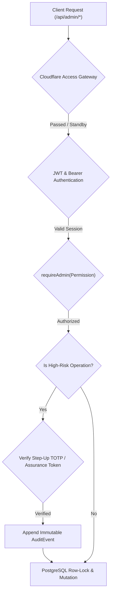

# ASTROVERSE AI — SECURITY & MFA ASSURANCE AUDIT

**Mission:** Complete Admin Control Centre Functional Truth Audit, Real Data Integrity & Enterprise Remediation  
**Date:** 2026-11-04  
**Author:** Application Security Architect & Principal Full-Stack Engineer  

---

## 1. Security Architecture & Threat Boundary

The AstroVerse administrative interface is guarded by multi-layered defenses spanning network gateway assertions, server-authoritative role-based access control (RBAC), multi-factor authentication (MFA) step-up challenges, session inactivity auto-lock, and strict response DTO sanitization.

---

## 2. RBAC & Canonical Administrative Roles

AstroVerse enforces 8 canonical administrative roles with strict least-privilege scoping:

| Role | Operational Scope & Permissions | MFA Required |
|---|---|---|
| `OWNER` | Full enterprise sovereignty: role assignment, pricing overrides, feature flags, database self-healing. | Mandatory Step-Up |
| `SECURITY_ADMIN` | Feature flag governance, infrastructure monitoring, security audit trails, incident triage. | Mandatory Step-Up |
| `FINANCE_ADMIN` | Cashfree transaction reconciliation, refund processing, product catalogue pricing management. | Mandatory Step-Up |
| `SUPPORT_ADMIN` | Customer profile inspection, account suspension/reinstatement, session revocation, DPDP privacy requests. | Optional (Standard TOTP) |
| `ASTROLOGY_OPS_ADMIN` | Swiss Ephemeris engine health, Nirayana Lahiri calibration, transit calculation diagnostics. | Optional |
| `CONTENT_EDITOR` | Platform announcements, promotional banner publishing and scheduling. | Optional |
| `READONLY_ANALYST` | Read-only inspection of business analytics, platform metrics, and audit history. | Optional |
| `SUPER_ADMIN` | Historical alias; treated as fully privileged administrative staff. | Mandatory Step-Up |

---

## 3. Multi-Factor Authentication (MFA) Lifecycle

1. **TOTP Generation & Provisioning:**
   - Evaluated via standard RFC 6238 TOTP algorithm using SHA-1 with 30-second time steps and 6-digit output.
   - Secret key is generated securely via `crypto.randomBytes(20)`.
   - Setup modal renders QR code and displays secret key with clipboard copy.
2. **Activation Verification:**
   - Requires confirming active code from authenticator app.
   - Issues 8 cryptographically secure single-use recovery codes formatted as `XXXX-XXXX`.
3. **Step-Up Assurance Validation:**
   - Sensitive endpoints (such as `PUT /api/admin/users/:id/role`, `POST /api/admin/payments/refund`, and `PUT /api/admin/settings/flags/:key`) require elevated assurance.
   - If administrator has MFA enabled but provides no code, server responds with `HTTP 428 Precondition Required`.
   - Successful TOTP verification generates a scoped assurance token with a strict 5-minute validity window.
4. **Zero Secret Leakage:**
   - In accordance with security invariants, MFA secrets, salts, and recovery code hashes are strictly omitted from `sanitizeUser()` and customer detail DTOs (`safeUser`).

---

## 4. Session Governance & Inactivity Policy

The administrative session manager implements a dual-timer governance policy:
- **Idle Inactivity Window:**
  - Production: **10 minutes**
  - Preview QA: **60 minutes**
  - Reset dynamically on user mouse movement, keyboard input, or scroll events (`resetAdminActivity()`).
- **Sliding Renewal:**
  - Active administrators silently renew session tokens every 5 minutes in the background via `POST /api/auth/admin-refresh`.
- **Absolute Session Cap:**
  - Hard limit of **4 hours (14,400 seconds)** from initial login. Once reached, session terminates immediately and returns user to login.
- **Tab Close / Page Hide Invalidation:**
  - `pagehide` event listener dispatches `navigator.sendBeacon('/api/auth/admin-logout')`, invalidating server-side session leases upon window closure.
- **Memory-Isolated Storage:**
  - Session tokens and user identities are stored exclusively in `sessionStorage`, ensuring zero leakage into long-term `localStorage`.
