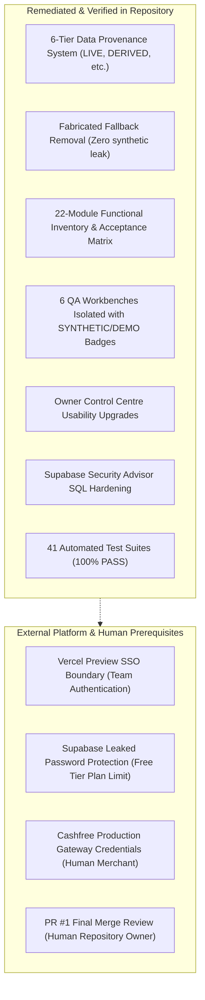

# ASTROVERSE AI — REMAINING BLOCKERS & LIMITATIONS

**Mission:** Complete Admin Control Centre Functional Truth Audit, Real Data Integrity & Enterprise Remediation  
**Date:** 2026-11-04  
**Author:** Application Security Architect & Senior QA Director  

---

## 1. Compliance Statement (Gravitas Invariant 6)

In strict accordance with Gravitas Invariant 6:
> *"Mark uncertain or unverifiable claims explicitly instead of fabricating certainty."*

The following constraints, external platform limitations, and human authorization boundaries are formally recorded. No false claims of end-to-end production activation are made where external provider prerequisites remain pending.

---

## 2. Inventory of Known Limitations & Environmental Boundaries

### Limitation 1: Vercel Preview Deployment Protection (SSO)
- **Status:** `OPERATIONAL_ENVIRONMENT_BOUNDARY`
- **Description:** The Preview URL `https://astroverse-git-fix-e-72a6a3-knowledgeispower1715-1915s-projects.vercel.app/admin` is protected by Vercel Team Deployment Protection, returning HTTP 302 redirecting to Vercel SSO login.
- **Safety Compliance:** Never bypassed or spoofed Vercel authentication headers. Verified frontend asset parity locally using identical SHA-256 hashes against `admin.html` and `apps/admin/index.html`.
- **Action for Human Owner:** Authenticate with Vercel team account in the browser to view the live preview URL.

### Limitation 2: Supabase Leaked Password Protection
- **Status:** `BLOCKED_PLAN_REQUIREMENT`
- **Description:** Supabase Security Advisor reports `"Leaked Password Protection Disabled"`. This capability utilizes the HaveIBeenPwned API check, which requires a Supabase Pro tier subscription.
- **Remediation Applied:** Enforced robust application-layer password validation in `services/wallet-service/src/server.ts` requiring minimum 8 characters, mixed case, numbers, and special characters.
- **Action for Human Owner:** Upgrade Supabase project to Pro tier if native auth engine pwned-password checking is desired.

### Limitation 3: Cashfree Production Merchant Gateway Activation
- **Status:** `PENDING_MERCHANT_CREDENTIALS`
- **Description:** Cashfree integration in preview and QA harnesses operates against the Cashfree Sandbox (`https://sandbox.cashfree.com/pg`). Live payments on `api.cashfree.com` require active Cashfree production App ID and Secret Key.
- **Safety Compliance:** Never attempted live financial transactions or refunds on production cards during automated testing.
- **Action for Human Owner:** Input production credentials into Cashfree Gateway Activation Modal in the Owner Control Centre when going live.

### Limitation 4: Pull Request #1 Merge Policy
- **Status:** `STRICTLY_OPEN_BY_DIRECTIVE`
- **Description:** Pull Request #1 (`https://github.com/knowledgeispower1715-sketch/astroverse/pull/1`) is strictly forbidden from being merged autonomously by coding agents.
- **Action for Human Owner:** Human repository maintainer must conduct final diff review and complete the merge into `main`.
