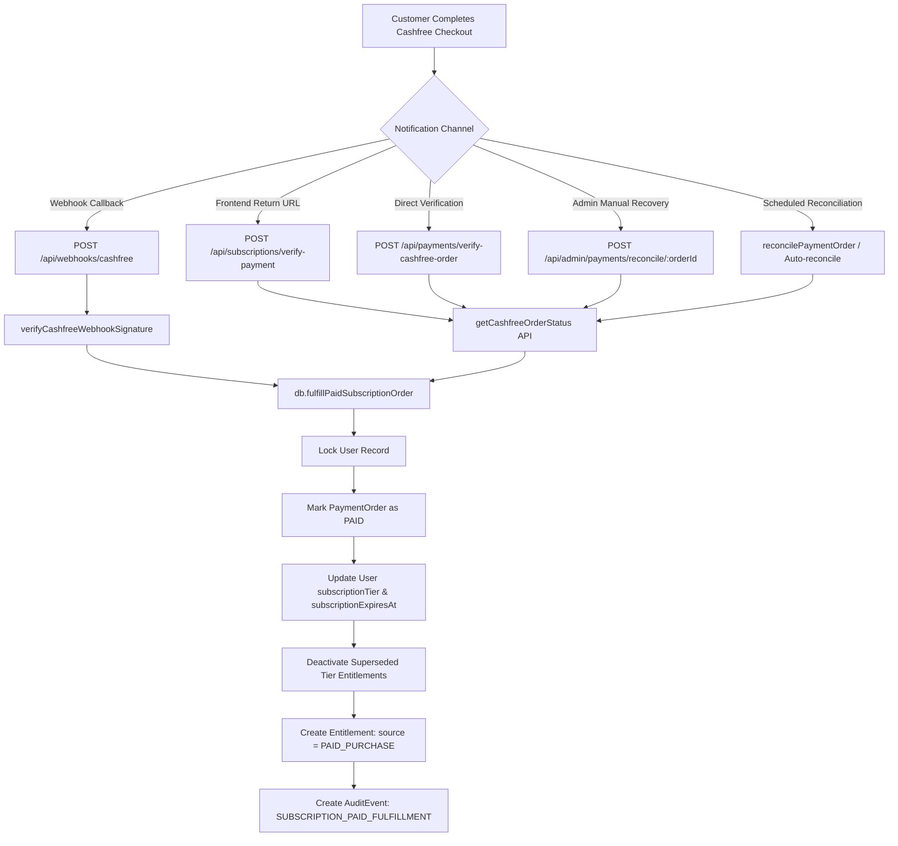

# PAYMENT RECONCILIATION & FINANCIAL PROVENANCE AUDIT

## ASTROVERSE CASHFREE GATEWAY & SUBSCRIPTION FULFILLMENT VERIFICATION

**Payment Gateway:** Cashfree Payment Gateway (PG API v2026-01-01 / v2025-01-01)  
**Supported Payment Modes:** Cards, UPI Intent / Dynamic VPA, Netbanking, Cashfree Checkout Drop-in  
**Audit Scope:** Order creation, webhook signature verification, order reconciliation, entitlement attribution, secret security.  

---

## 1. RECONCILIATION & FULFILLMENT WORKFLOW

The AstroVerse financial layer implements five distinct reconciliation and fulfillment paths, each now wired to transactional, authoritative fulfillment methods:



---

## 2. FINANCIAL PROVENANCE & ATTRIBUTION AUDIT

### Problem Remediated:
Prior to this remediation, when a customer paid for a subscription, the system invoked `db.updateSubscription()`, which stamped all newly created entitlements with `source: 'ADMIN_GRANT'`. This caused paid customer transactions to be indistinguishable from administrative complimentary grants in financial and customer support audits.

### Remediated Architecture:
All paid subscription settlement endpoints now route exclusively through `db.fulfillPaidSubscriptionOrder()`:

| Grant Type | Method | Entitlement Source | Granted By | Metadata Stamped |
|---|---|---|---|---|
| **Paid Customer Purchase (Cashfree)** | `fulfillPaidSubscriptionOrder` | `PAID_PURCHASE` | `CASHFREE` | `orderId`, `paymentId`, `amount`, `currency`, `billingPeriod`, `durationDays` |
| **Paid Customer Purchase (Wallet)** | `purchaseSubscription` | `PAID_PURCHASE` | `wallet` | `transactionId`, `amount`, `billingPeriod`, `durationDays` |
| **Administrative Complimentary Grant** | `assignSubscriptionTier` | `ADMIN_COMPLIMENTARY` / `SUPPORT_COMPENSATION` | Actor Admin ID | Justification reason, duration, actor ID |
| **Administrative Subscription Extension** | `extendSubscription` | `ADMIN_GRANT` | Actor Admin ID | Additional days, previous expiry, justification reason |

---

## 3. CASHFREE GATEWAY SECRET ISOLATION & HYGIENE

1. **Database Sanitization:**
   - Database table `FeatureFlag` previously stored plaintext `secretKey` inside `description`.
   - `saveCashfreeGatewayConfig` now strictly strips `secretKey`. It writes only safe configuration metadata:
     ```json
     {
       "isConfigured": true,
       "appIdMasked": "TEST...1234",
       "env": "production",
       "updatedAt": "2026-11-04T15:20:00.000Z"
     }
     ```
2. **Flags Endpoint Protection:**
   - `GET /api/admin/settings/flags` strips `CASHFREE_GATEWAY_CONFIG` from the returned list and redacts any potential credential tokens across all flag descriptions.
3. **Runtime Memory Boundary:**
   - Secret keys provided during dynamic activation are held strictly in Node.js process runtime memory (`setRuntimeCashfreeSecretKey()`) and never persisted to durable disk or database storage.
