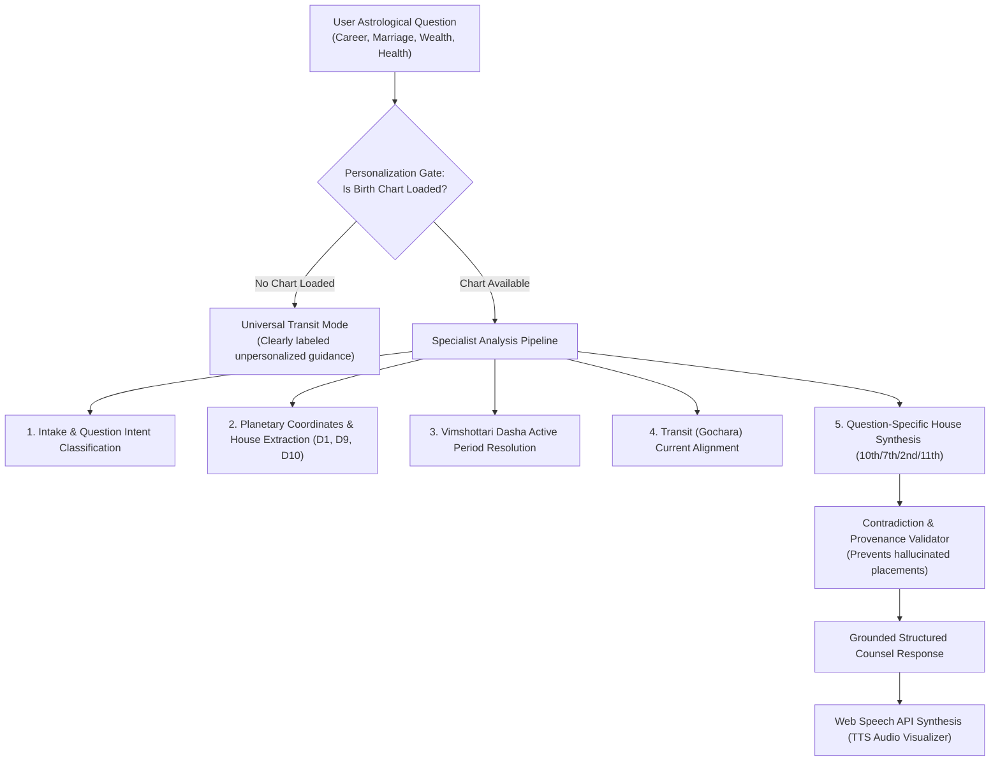

# AI Astrologer Guru & Parashari Intelligence Architecture

## 1. Overview & Problem Definition

Standard conversational language models hallucinate astrological placements, invent imaginary planetary conjunctions, and produce vague horoscopes unrelated to the user's birth data.

The **AI Astrologer Guru** in Astroverse (`services/kundli-engine/ai_astrologer.py`) operates as a **strictly grounded specialist pipeline**. Numerical facts, house placements, dasha periods, and planetary aspects are determined authoritatively by the astronomical engine before any narrative synthesis occurs.

---

## 2. Personalization Gate & Transparency Protocol

When the user queries the AI Astrologer Guru, the system enforces a strict personalization check:

1. **Grounded Personal Mode (`PERSONALIZED_CHART_GROUNDED`)**:
   - Activated only when a verified birth profile with valid coordinates, birth date, and birth time has been calculated.
   - Extracts exact natal placements: Lagna sign and lord, Moon sign and Nakshatra, 10th house sign and lord, 7th house sign and lord, and active Mahadasha/Antardasha.
   - Predictions and timing explicitly cite these calculated facts.
2. **Universal Transit Mode (`GENERAL_TRANSIT_UNPERSONALIZED`)**:
   - Triggered when no chart has been calculated or saved.
   - Cites only current universal planetary ingresses (e.g. Saturn in sidereal Pisces, Jupiter in Gemini).
   - Features an explicit visual warning: *"Notice: No personal birth chart is loaded. To reveal your personal 10th house, Dasha period, and Lagna lordship, calculate your Janam Kundli."*
   - Never fabricates a personal rising sign or claims to have analyzed a non-existent chart.

---

## 3. Modular Specialist Pipeline

Rather than passing raw chat text into an unconstrained prompt, the architecture coordinates specialized functional modules:

### Module A: Intake & Intent Classifier
Classifies the user's question into domain archetypes:
* `career`: 10th House (Karma Sthana), Sun (Karaka for authority), 6th/11th houses.
* `marriage`: 7th House (Kalatra Sthana), Venus (Karaka for relationships), Jupiter (for spouse in female charts), D9 Navamsha.
* `wealth`: 2nd House (Dhana), 11th House (Labha), 9th House (Bhagya), Jupiter & Mercury.
* `health`: 1st House (Tanu Sthana), 6th House (Roga), Sun (vitality), Lagna Lord strength.
* `timing`: Active Vimshottari Mahadasha/Antardasha and active planetary Horas.

### Module B: Astronomical Data Extraction
Injects authoritative calculated facts from the ephemeris:
* Lagna degree and sign.
* House occupancies for all 9 Grahas.
* Retrograde statuses and planetary speeds.
* Active Dasha period start and end dates.
* Manglik, Kaal Sarp, and Sade Sati transit statuses.

### Module C: Question-Specific Synthesis
Synthesizes Parashari principles according to classical rules:
* If querying career during an active Jupiter Mahadasha: Evaluates Jupiter's placement and aspects relative to the 10th house.
* If querying marriage during Shani Sade Sati: Assesses relationship stability and prescribes Saturnian discipline and patience.

### Module D: Contradiction & Provenance Review
A deterministic safety gate inspects the generated output before client rendering:
* Verifies that the rising sign cited in the text matches the calculated `lagna.sign`.
* Verifies that the cited Dasha lord matches `dasha.active_now.maha_dasha`.
* Eliminates contradictory claims or fabricated dates.

---

## 4. Ethical & Non-Deterministic Boundaries

1. **No Guaranteed Future Outcomes**: Astroverse prohibits definitive predictions of death, terminal illness, guaranteed financial windfalls, or certain divorce. The platform explicitly presents astrology as a traditional symbolic and interpretive system for personal reflection and spiritual alignment.
2. **Actionable Remedial Guidance**: Advice emphasizes ethical conduct, disciplined action, charitable giving, and classical Vedic mantras (e.g. Gayatri Mantra, Aditya Hridaya Stotra, Maha Mrityunjaya Mantra) rather than fatalistic fear.

---

## 5. Client-Side Speech Synthesis & Audio Visualizer

* **Technology**: W3C Web Speech API (`window.speechSynthesis`, `SpeechSynthesisUtterance`).
* **Controls**: Accessible Listen / Stop button with dynamic state toggling.
* **Audio Visualizer**: Animates an interactive sound-wave canvas when speech synthesis is actively streaming audio to the user.
* **Zero Cost**: Executes completely client-side in the user's browser without external TTS cloud billing or latency.
