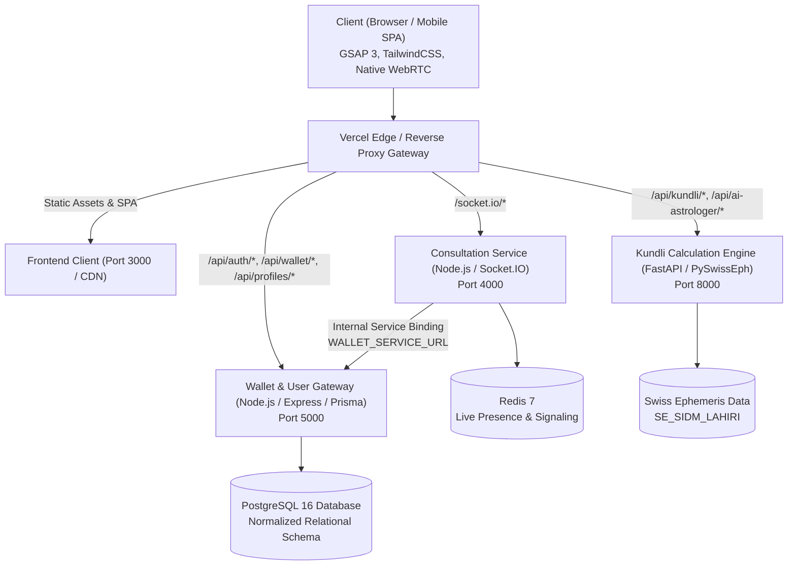

# System Architecture — Astroverse Platform

## 1. System Overview

Astroverse is an enterprise-grade, high-performance Vedic astrology and consultation platform engineered with a decoupled multi-service architecture. The platform combines deterministic astronomical mathematics, real-time consultation billing, a double-entry financial ledger, and chart-grounded artificial intelligence.

---

## 2. Service Inventory & Responsibilities

### 2.1 Frontend Client (`/`)
* **Technology**: Modern Single Page Application (HTML5, GSAP 3, CSS Grid/Flexbox, Native Web APIs).
* **Responsibilities**:
  * Clean, empty-state landing and consultation discovery.
  * Form input validation for birth details (date, time, latitude, longitude, timezone).
  * Interactive SVG North Indian Diamond Chart renderer with planetary markers and house cusps.
  * 24-Hour Planetary Horas dynamic timeline with active hour highlight and Chaldean ruler display.
  * Conversational AI Astrologer Guru chat with local speech synthesis readout (`window.speechSynthesis`).
  * 36-Guna Ashtakoota matchmaking matrix view.
  * Authentication modal (Phone OTP / Email Magic Code) and profile switcher (Self, Spouse, Child, Friend).
  * User dashboard displaying persistent wallet balances, past consultations, and puja bookings.

### 2.2 Kundli Calculation Engine (`services/kundli-engine`)
* **Technology**: Python 3.12, FastAPI, `pyswisseph` (Swiss Ephemeris C-bindings), Pydantic v2.
* **Responsibilities**:
  * High-precision sidereal planetary longitude calculations using Lahiri Ayanamsha (`SE_SIDM_LAHIRI`).
  * Exact true Ketu calculation in 180° opposition to Rahu (`(Rahu + 180) % 360`).
  * Complete Janam Panchang derivation (Tithi, Vaar, Yoga, Karana, Nakshatra).
  * Divisional chart matrices: D1 Rashi, D9 Navamsha, D10 Dashamsha, Moon Chart (Chandra Lagna), and Bhava Chalit cusp math.
  * 120-year Vimshottari Dasha calculation with fractional birth balance and 9 Antardashas per Mahadasha.
  * Classical Parashari Dosha diagnostics: Manglik (with 7 cancellation rules), Kaal Sarp (7-planet hemming arc test), and Shani Sade Sati transit phases.
  * Unequal 24-Hour Planetary Horas calculated from exact sunrise and sunset times.
  * Deterministic 8-Koota Ashtakoota matchmaking engine (strictly summing to 36 Gunas).
  * Parashari-grounded AI consultation synthesizer with multi-horizon predictions (hourly, daily, weekly, monthly, yearly).

### 2.3 Wallet & User Gateway (`services/wallet-service`)
* **Technology**: Node.js 20, Express, TypeScript, Prisma ORM, PostgreSQL.
* **Responsibilities**:
  * Authentication: Phone OTP and Email verification, persistent session management.
  * Multi-profile management: Create, update, list, and switch user birth charts (Self, Spouse, Child, Friend).
  * Financial transactions: Double-entry wallet ledger ensuring debit/credit immutability and non-negative balances.
  * Payment gateway integration: Razorpay order creation and HMAC-SHA256 signature verification.
  * Astromall Puja booking workflow: Pandit assignment, date scheduling, sankalp notes, and status lifecycle.

### 2.4 Consultation Service (`services/consultation-service`)
* **Technology**: Node.js 20, Socket.IO, Redis, TypeScript.
* **Responsibilities**:
  * Real-time WebSocket signaling for text chat, audio, and video consultations.
  * Live astrologer presence tracking and queue management.
  * Per-minute billing coordination: Deducts fees via internal service binding to `wallet-service` (`WALLET_SERVICE_URL`).
  * Auto-termination of consultation sessions when wallet balance falls below the 1-minute threshold.

---

## 3. Communication Protocols & Service Discovery

| Source | Destination | Protocol | Path / Variable | Purpose |
| :--- | :--- | :--- | :--- | :--- |
| Client | Gateway | HTTPS | `/api/*`, `/*` | User requests, UI hydration |
| Client | Gateway | WSS | `/socket.io/*` | Real-time chat & consultation signaling |
| Gateway | `kundli-engine` | HTTP/1.1 | `/api/(.*)` | Calculation queries & AI synthesis |
| Gateway | `wallet-service` | HTTP/1.1 | `/api/wallet/*`, `/api/auth/*`, `/api/profiles/*`, `/api/pujas/*` | Auth, profile CRUD, billing |
| Gateway | `consultation-service` | HTTP/1.1 & WSS | `/socket.io/(.*)` | Real-time communication |
| `consultation-service` | `wallet-service` | HTTP/1.1 | `process.env.WALLET_SERVICE_URL` | Per-minute deduction & settlement |

---

## 4. Security Architecture

1. **Authentication & Session Tokens**:
   - OTP codes are cryptographically generated (6-digit entropy) with a strict 5-minute time-to-live.
   - JWT tokens signed using HMAC-SHA256 with user claims, profile IDs, and role designations.
2. **Double-Entry Financial Invariant**:
   - Wallet credits and debits are executed inside atomic ACID transactions via Prisma `$transaction`.
   - Before any deduction, the account balance is evaluated to prevent race conditions and overdrafts.
   - External payments require cryptographic verification (`crypto.createHmac('sha256', secret).update(body).digest('hex')`) against Razorpay webhook payloads before balance credit.
3. **Empty-State & Privacy Compliance**:
   - No mock user profiles or fabricated personal records are bundled into the public application bundle.
   - All charts and predictions are derived dynamically from verified inputs or authenticated user profiles.
   - Sensitive birth metadata (place of birth, exact time) is stored with row-level ownership isolation.
