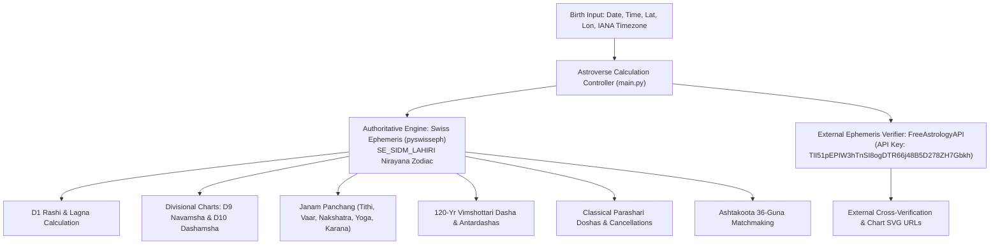

# Authoritative Centralized Astrology Calculation Engine Specification

## 1. Engine Architecture & Ephemeris Baseline

The Astroverse Calculation Engine (`services/kundli-engine`) is the authoritative computational backbone for all planetary coordinates, divisional charts, dasha timelines, and compatibility evaluations. The engine is strictly deterministic: no language model or heuristic approximation is permitted to generate astronomical values.

---

## 2. Ephemeris Integration & Dual-Source Verification

### 2.1 Swiss Ephemeris (`pyswisseph 2.10.3.2`)
* **Precision Model**: High-precision planetary positions computed via Moshier and Swiss Ephemeris compressed ephemeris files.
* **Ayanamsha**: Chitra Paksha / Lahiri Ayanamsha (`swe.SIDM_LAHIRI`), the official standard endorsed by the Indian Calendar Reform Committee.
* **Coordinate Frame**: Geocentric Sidereal Ecliptic Coordinates.
* **True Ketu**: Calculated mathematically in exact 180° opposition to Rahu:
  $$\lambda_{\text{Ketu}} = (\lambda_{\text{Rahu}} + 180.0^\circ) \pmod{360.0^\circ}$$
* **Retrograde Motion**: Evaluated from longitudinal velocity $v_\lambda < 0$.

### 2.2 FreeAstrologyAPI Integration (`services/kundli-engine/external_api.py`)
* **Endpoint Base**: `https://json.freeastrologyapi.com`
* **Configured Key**: `TlI51pEPIW3hTnSI8ogDTR66j48B5D278ZH7Gbkh`
* **Integrated Endpoints**:
  - `POST /planets`: Returns external planetary coordinates, houses, and signs.
  - `POST /planets/extended`: Provides extended dignities and planetary metrics.
  - `POST /horoscope-chart-url`: Generates visual Vedic horoscope chart images and URLs.
* **Hybrid Failover Policy**: FreeAstrologyAPI is queried for external validation. When external networks or third-party quotas are constrained, the Swiss Ephemeris engine provides 100% offline mathematical coverage without interrupting application services.

---

## 3. Divisional Charts (Varga Charts)

### 3.1 D1 Rashi Chart & Ascendant (Lagna)
Ascendant degree $\lambda_{\text{Asc}}$ is derived using geodetic latitude $\phi$, longitude $\theta$, and Julian Day via `swe.houses_ex(JD, lat, lon, b'P')`.
$$\text{Lagna Sign Index} = \left\lfloor \frac{\lambda_{\text{Asc}}}{30^\circ} \right\rfloor \in \{0 \dots 11\}$$

### 3.2 D9 Navamsha Chart (Spouse & Dharma)
Each sign is divided into 9 padas of $3^\circ 20'$ ($3.3333^\circ$):
$$\text{deg\_in\_sign} = \lambda \pmod{30^\circ}, \quad \text{part} = \left\lfloor \frac{\text{deg\_in\_sign}}{3.333333^\circ} \right\rfloor$$
- **Fire Signs** (Aries, Leo, Sagittarius): $\text{D9} = \text{part} \pmod{12}$
- **Earth Signs** (Taurus, Virgo, Capricorn): $\text{D9} = (9 + \text{part}) \pmod{12}$
- **Air Signs** (Gemini, Libra, Aquarius): $\text{D9} = (6 + \text{part}) \pmod{12}$
- **Water Signs** (Cancer, Scorpio, Pisces): $\text{D9} = (3 + \text{part}) \pmod{12}$

### 3.3 D10 Dashamsha Chart (Career, Authority & Public Status)
Each sign is divided into 10 divisions of $3^\circ 00'$ ($3.0^\circ$):
$$\text{part} = \left\lfloor \frac{\text{deg\_in\_sign}}{3.0^\circ} \right\rfloor \in \{0 \dots 9\}$$
- **Odd Signs** (Aries, Gemini, Leo, Libra, Sagittarius, Aquarius):
  $$\text{D10} = (\text{sign\_idx} + \text{part}) \pmod{12}$$
- **Even Signs** (Taurus, Cancer, Virgo, Scorpio, Capricorn, Pisces):
  $$\text{D10} = (\text{sign\_idx} + 8 + \text{part}) \pmod{12}$$

### 3.4 Moon Chart (Chandra Lagna)
Re-indexes house cusps by setting natal Moon sign as House 1 and cycling houses $2 \dots 12$.

### 3.5 Bhava Chalit Cusp Math
Computes midpoint cusps $\text{Mid}_i = \frac{\text{Cusp}_i + \text{Cusp}_{i+1}}{2}$. Planets crossing boundary midpoints shift into adjacent Bhavas.

---

## 4. 120-Year Vimshottari Dasha Engine

### 4.1 Fractional Balance at Birth
Moon's longitude in its birth Nakshatra determines the consumed arc fraction:
$$f_{\text{consumed}} = \frac{\lambda_{\text{Moon}} \pmod{13^\circ 20'}}{13.333333^\circ}, \quad f_{\text{balance}} = 1.0 - f_{\text{consumed}}$$
$$\text{Remaining Years of First Mahadasha} = Y_{\text{start}} \times f_{\text{balance}}$$

### 4.2 Sub-Periods (Antardashas)
$$\text{Duration}_{\text{AD}} = \frac{Y_{\text{MD}} \times Y_{\text{AD}}}{120} \text{ years}$$
The engine builds an exact timeline matching query timestamps to identify active Mahadasha, Antardasha, and progress percentage.

---

## 5. Classical Parashari Dosha Evaluation

1. **Manglik Dosha (Kuja Dosha)**:
   Mars in houses 1, 4, 7, 8, or 12. Astroverse implements **7 classical Parashari cancellation rules**:
   - Mars in own sign (Aries, Scorpio).
   - Mars exalted (Capricorn).
   - Mars in 1st house in Aries, 4th house in Scorpio, 7th house in Capricorn/Pisces, 8th in Sagittarius, 12th in Sagittarius.
   - Benefic Jupiter aspecting or conjunct with Mars.
2. **Kaal Sarp Dosha**:
   Astronomical hemming test: evaluates whether all 7 classical planets are strictly enclosed within the Rahu-Ketu nodal arc. Identifies all 12 classical varieties (Anant, Kulik, Vasuki, Shankhpal, Padma, Mahapadma, Takshak, Karkotak, Shankhachur, Ghatak, Vishdhar, Sheshnag).
3. **Shani Sade Sati**:
   Evaluates sidereal transit of Saturn relative to natal Moon sign (Rising: 12th house, Peak: natal Moon sign, Setting: 2nd house from Moon).

---

## 6. Ashtakoota 36-Guna Matchmaking Matrix

Evaluates all 8 classical Kootas:
1. **Varna (1 pt)**: Spiritual ego & work alignment.
2. **Vashya (2 pt)**: Mutual dominance & magnetic control.
3. **Tara (3 pt)**: Karmic destiny & longevity harmony.
4. **Yoni (4 pt)**: Biological affinity & physical intimacy.
5. **Graha Maitri (5 pt)**: Psychological friendship of Moon lords.
6. **Gana (6 pt)**: Behavioral outlook (Deva, Manushya, Rakshasa).
7. **Bhakoot (7 pt)**: Family welfare & prosperity ($2/12, 6/8, 9/5$ dosha detection).
8. **Nadi (8 pt)**: Genetic health & progeny (Adi, Madhya, Antya Nadi dosha detection).

**Mathematical Invariant**: $\sum_{i=1}^8 \text{Koota}_i \le 36.0$. A score $\ge 18.0$ indicates acceptable compatibility.
