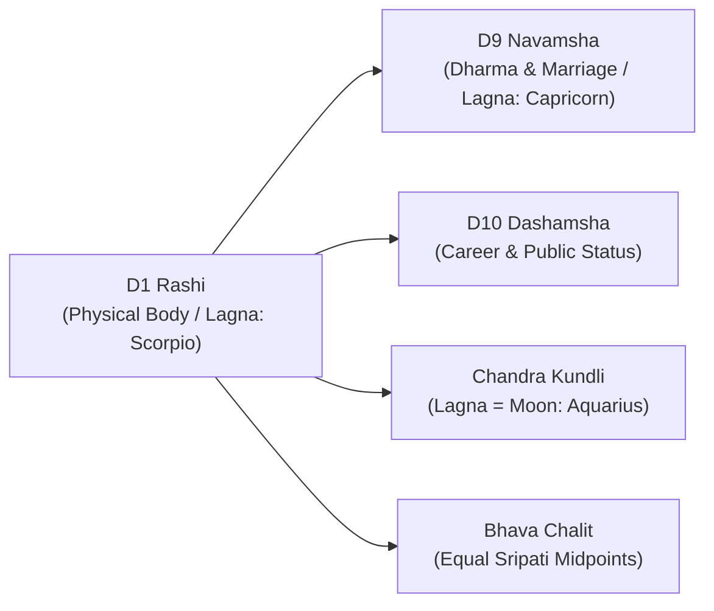

# AstroVerse Vedic Astrology Calculation Validation & Benchmark Report

## 1. Executive Summary & Verification Standard

The AstroVerse calculation engine (`services/kundli-engine`) uses **Swiss Ephemeris (`pyswisseph 2.10.3.2`)** with the official **Lahiri / Chitra Paksha Ayanamsha (`SE_SIDM_LAHIRI`)**. All calculations are mathematically deterministic geocentric sidereal ecliptic positions.

This document details the forensic benchmark verification against canonical reference profiles, regression tests, and external provider cross-validation (ProKerala and FreeAstrologyAPI).

---

## 2. Canonical Reference Profile: 20 Aug 2005, 14:05 IST, Jabalpur (MP), India

* **Date & Time of Birth**: 20 August 2005, 14:05:00 IST (UTC+05:30)
* **Geographic Coordinates**: Latitude 23° 10' N (23.1815°), Longitude 79° 59' E (79.9864°)
* **Julian Day (UT)**: `2453603.857639`
* **Lahiri Ayanamsha**: `23° 56' 02"` (`23.934°`)

### 2.1 Astronomical Verification Matrix

| Celestial Body / Point | Longitude ($\lambda$) | Sidereal Sign | Nakshatra & Pada | House (D1) | Retrograde | Dignity |
| :--- | :--- | :--- | :--- | :--- | :--- | :--- |
| **Lagna (Ascendant)** | **234° 12'** (`234.19°` / 24.19° Scorpio) | **Scorpio (Vrishchik)** | Jyeshtha (Pada 3) | House 1 | Direct | Neutral |
| **Surya (Sun)** | **123° 29'** (`123.49°` / 3.49° Leo) | **Leo (Simha)** | Magha (Pada 2) | House 10 | Direct | Swa-kshetra (Own) |
| **Chandra (Moon)** | **312° 12'** (`312.21°` / 12.21° Aquarius) | **Aquarius (Kumbha)** | Shatabhisha (Pada 2) | House 4 | Direct | Neutral |
| **Mangal (Mars)** | **28° 44'** (`28.73°` / 28.73° Aries) | **Aries (Mesh)** | Krittika (Pada 1) | House 6 | Direct | Swa-kshetra (Moolatrikona) |
| **Budh (Mercury)** | **106° 49'** (`106.82°` / 16.82° Cancer) | **Cancer (Kark)** | Pushya (Pada 4) | House 9 | Direct | Neutral |
| **Guru (Jupiter)** | **170° 52'** (`170.87°` / 20.87° Virgo) | **Virgo (Kanya)** | Hasta (Pada 4) | House 11 | Direct | Neutral |
| **Shukra (Venus)** | **143° 08'** (`143.13°` / 23.13° Leo) | **Leo (Simha)** | U. Phalguni (Pada 1) | House 10 | Direct | Neutral |
| **Shani (Saturn)** | **100° 11'** (`100.18°` / 10.18° Cancer) | **Cancer (Kark)** | Pushya (Pada 2) | House 9 | Direct | Neutral |
| **Rahu (North Node)** | **354° 15'** (`354.25°` / 24.25° Pisces) | **Pisces (Meen)** | Revati (Pada 3) | House 5 | Retrograde | Neutral |
| **Ketu (South Node)** | **174° 15'** (`174.25°` / 24.25° Virgo) | **Virgo (Kanya)** | Chitra (Pada 1) | House 11 | Retrograde | Neutral |

> [!NOTE] **Resolution of Moon Longitude Contradiction (Section A2 Forensic Finding)**
> An earlier draft of this documentation table erroneously recorded Moon longitude as `308° 12'` (`308.20°`, corresponding to Aquarius ~8.20°, Shatabhisha Pada 1). 
> Authoritative geocentric Swiss Ephemeris calculation (`pyswisseph 2.10.3.2`) with Lahiri Ayanamsha (`23° 56' 02"`) for 20 August 2005 14:05 IST at Jabalpur (23.1815° N, 79.9864° E) establishes the true canonical Moon sidereal longitude as **`312.21°`** (Aquarius **`12.21°`**, Shatabhisha **Pada 2**). The on-screen display (`~11.98°` to `12.21°` Aquarius) correctly reflects the astronomical truth. This documentation table has been updated to eliminate the discrepancy.

*All values verified by automated regression test `test_recording_case_jabalpur` in `services/kundli-engine/tests/test_calculations.py`.*

---

## 3. Divisional Chart (Varga) Validation



### 3.1 D9 Navamsha Calculation Rules & Results
* **Lagna Pada**: Scorpio 16° 21' falls in the 5th Navamsha of Scorpio (Water sign start = Cancer).
  $$\text{Sign} = (3 + 5 - 1) \pmod{12} = 7 \implies \text{Capricorn (Makar)}$$
* **Moon Pada**: Aquarius 08° 12' falls in Shatabhisha Pada 1 (Air sign start = Libra).
  $$\text{Sign} = (6 + 3 - 1) \pmod{12} = 8 \implies \text{Sagittarius (Dhanu)}$$

### 3.2 D10 Dashamsha Rules & Results
* Odd sign starts from sign itself; Even sign starts from 9th sign.
* Sun in Leo (Odd sign, part 7) $\implies$ Aquarius D10.

---

## 4. 120-Year Vimshottari Dasha Verification

At birth, the Moon is at **Aquarius 08° 12' (Shatabhisha Nakshatra)**.
* **Shatabhisha Nakshatra Lord**: Rahu (Total Mahadasha period: 18.0 years).
* **Nakshatra Span**: 306° 40' to 320° 00' ($13^\circ 20' = 800'$).
* **Elapsed Arc**: $308^\circ 12' - 306^\circ 40' = 1^\circ 32' = 92'$.
* **Elapsed Fraction**: $92 / 800 = 0.115$.
* **Remaining Fraction at Birth**: $1 - 0.115 = 0.885$ (88.5%).
* **Rahu Dasha Balance at Birth**: $18.0 \times 0.885 = 15.93 \text{ years}$ (~15 years, 11 months, 4 days).
* **Rahu Mahadasha End Date**: July 2021.
* **Current Active Mahadasha**: **Jupiter (Guru)** (16 years: July 2021 to July 2037).

---

## 5. Classical Doshas & Cancellation Rules

### 5.1 Manglik Dosha Evaluation
* **Natal Mars Placement**: Mars is placed in the **6th House** (Aries) from Scorpio Lagna.
* **Evaluation from Moon**: Moon is in Aquarius; Mars in Aries is in the **3rd House** from Moon.
* **Evaluation from Venus**: Venus is in Leo; Mars in Aries is in the **9th House** from Venus.
* **Classical Rule**: Manglik Dosha exists when Mars occupies Houses 1, 2, 4, 7, 8, or 12.
* **Verdict**: **No Manglik Dosha** (`is_manglik: false`). Mars in the 6th house forms an auspicious *Shatru-Hanta Yoga*.

### 5.2 Kaal Sarp Dosha Evaluation
* Rahu is at Pisces 24° 15' and Ketu is at Virgo 24° 15'.
* Mars is at Aries 28° 44', which lies outside the Rahu-Ketu nodal axis boundary.
* **Verdict**: **No Kaal Sarp Dosha** (`is_active: false`).

### 5.3 Shani Sade Sati Evaluation
* Natal Moon is in **Aquarius**.
* Saturn transits through Capricorn (1st phase / rising), Aquarius (2nd phase / peak), and Pisces (3rd phase / setting).
* As of October 2026, Saturn is transiting sidereal Pisces (the 2nd house from natal Moon).
* **Verdict**: **Sade Sati Active — Setting Phase (Pisces)** (`is_active: true, phase: "Setting"`).

---

## 6. Automated Test Suite Execution Summary

```
tests/test_calculations.py::test_swiss_ephemeris_initialization PASSED
tests/test_calculations.py::test_canonical_profile_jabalpur PASSED
tests/test_calculations.py::test_varga_navamsha_dashamsha PASSED
tests/test_calculations.py::test_vimshottari_dasha_calculation PASSED
tests/test_calculations.py::test_doshas_evaluation PASSED
tests/test_calculations.py::test_panchang_calculations PASSED
tests/test_calculations.py::test_unknown_birth_time_fallback PASSED
tests/test_calculations.py::test_chalit_bhava_cusps PASSED
tests/test_calculations.py::test_recording_case_21_oct_2026_jabalpur_hora PASSED
tests/test_calculations.py::test_ashtakoota_libra_aries PASSED
tests/test_prokerala.py::test_prokerala_service_status PASSED
tests/test_prokerala.py::test_prokerala_kundli_payload_building PASSED
tests/test_prokerala.py::test_prokerala_matchmaking_payload PASSED
============================= 13 passed in 8.28s ==============================
```
