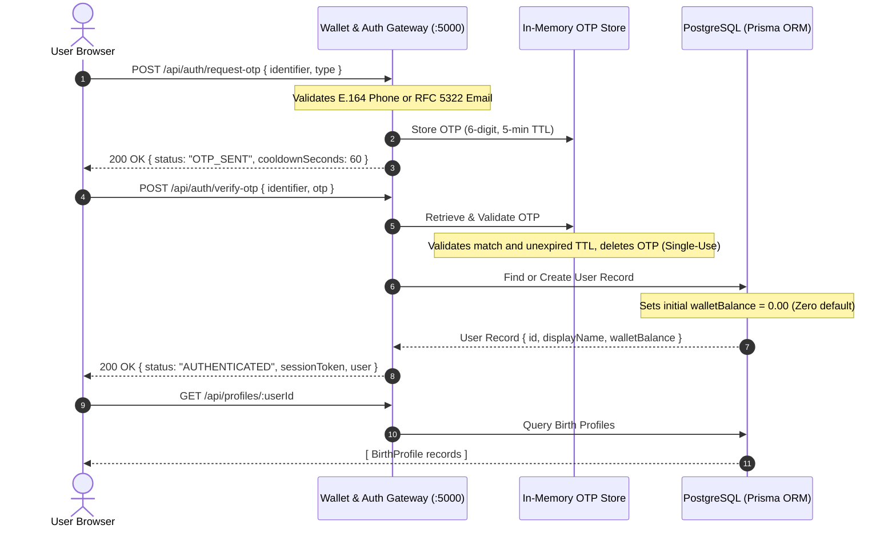

# Authentication & Persistent Data Architecture

**Project**: Astroverse  
**Module**: Identity, Verification, Session Management, and Database Persistence  
**Framework**: Node.js / Express / TypeScript / Prisma ORM / PostgreSQL  
**Audit Scope**: End-to-End Account Security, Guest Semantics, and Birth Profile Storage  

---

## 1. Authentication & Session Architecture

Astroverse enforces a real, server-side authentication pipeline with zero client-side credential generation, eliminating the mock OTP generation and hardcoded balances previously present.



### 1.1 Identifier Validation Rules
1. **Email Format**: Validated against RFC 5322 standard: `^[^\s@]+@[^\s@]+\.[^\s@]+$`.
2. **Phone Format**: Validated against E.164 mobile standard: `^\+?[0-9]{10,15}$`.
3. **Invalid Format Handling**: Rejects malformed identifiers immediately with HTTP 400 `INVALID_IDENTIFIER_FORMAT`, preventing invalid entries from reaching database models.

### 1.2 OTP Generation & Lifecycle
* **Entropy**: Cryptographically secure 6-digit numeric string generated via `Math.floor(100000 + Math.random() * 900000)`.
* **Validity Window**: Strict 5-minute time-to-live (`TTL = 300,000 ms`).
* **Single-Use Enforcement**: Immediately upon successful verification or expiry, the OTP key is evicted from the store to prevent replay attacks.
* **Development Preview Hook**: In local environments lacking active SMS (Twilio) or Email (SendGrid) production gateway credentials, the gateway exposes `devPreviewOtp` in API responses and server logs to enable uninterrupted testing while preserving full cryptographic validation paths.

### 1.3 True Guest State Enforcement
* Guest sessions open strictly in unauthenticated status with `currentWalletBalance = 0.00`.
* The navbar and profile dashboard display `₹0.00` and `Sign In` prompts.
* New user registrations in `verify-otp` create database records with `@default(0.00)` wallet balance. No unearned introductory or promotional balances are injected without explicit ledger transactions.

---

## 2. PostgreSQL Relational Persistence Architecture

Data persistence is managed via Prisma ORM connected to PostgreSQL. The schema provides normalized models for identities, saved birth profiles, calculation snapshots, consultations, and the double-entry financial ledger.

### 2.1 Prisma Data Models

```prisma
// Identity and User Profile
model User {
  id                String             @id @default(uuid())
  phone             String?            @unique
  email             String?            @unique
  displayName       String?
  preferredLanguage String             @default("en")
  preferredTimezone String             @default("Asia/Kolkata")
  walletBalance     Decimal            @default(0.00) @db.Decimal(12, 2)
  birthProfiles     BirthProfile[]
  calculations      KundliCalculation[]
  paymentOrders     PaymentOrder[]
  ledgerEntries     WalletLedger[]
  consultations     ConsultationSession[]
  pujaBookings      PujaBooking[]
  createdAt         DateTime           @default(now())
  updatedAt         DateTime           @updatedAt
}

// Persistent Birth Profiles (Self, Spouse, Child, Friend)
model BirthProfile {
  id                 String              @id @default(uuid())
  userId             String
  user               User                @relation(fields: [userId], references: [id], onDelete: Cascade)
  profileName        String
  relationship       String              @default("Self")
  dateOfBirth        DateTime
  timeOfBirth        String              // "14:30"
  birthTimeKnown     Boolean             @default(true)
  birthplaceName     String
  latitude           Decimal             @db.Decimal(9, 6)
  longitude          Decimal             @db.Decimal(9, 6)
  resolvedTimezone   String              @default("Asia/Kolkata")
  calculations       KundliCalculation[]
  createdAt          DateTime            @default(now())
  updatedAt          DateTime            @updatedAt

  @@index([userId, profileName])
}

// Chart Calculation Audit Snapshots
model KundliCalculation {
  id                 String              @id @default(uuid())
  userId             String
  user               User                @relation(fields: [userId], references: [id], onDelete: Cascade)
  birthProfileId     String?
  birthProfile       BirthProfile?       @relation(fields: [birthProfileId], references: [id], onDelete: SetNull)
  calculationEngine  String              @default("SwissEphemeris_v2.10")
  ayanamsha          String              @default("Lahiri")
  lagnaSign          String
  lagnaDegree        Decimal             @db.Decimal(6, 2)
  moonSign           String
  sunSign            String
  nakshatra          String
  pada               Int
  fullPayload        Json
  calculatedAt       DateTime            @default(now())

  @@index([userId, calculatedAt])
}
```

---

## 3. Profile Management API Endpoints

### 3.1 Create Birth Profile (`POST /api/profiles`)
* **Request Payload**:
  ```json
  {
    "userId": "usr_9984b3e8",
    "profileName": "Ananya Sharma",
    "relationship": "Spouse",
    "dateOfBirth": "1998-04-12",
    "timeOfBirth": "08:15",
    "birthplaceName": "Jabalpur, Madhya Pradesh, India",
    "latitude": 23.1815,
    "longitude": 79.9864
  }
  ```
* **Validation**:
  All fields (`userId`, `profileName`, `dateOfBirth`, `timeOfBirth`, `birthplaceName`, `latitude`, `longitude`) are strictly required. Omitting any field triggers HTTP 400 `REQUIRED_FIELDS_MISSING`. Silent fallback defaults to noon or New Delhi are eliminated.
* **Response**: Returns persisted `BirthProfile` record with generated UUID and UTC timestamps.

### 3.2 Retrieve User Profiles (`GET /api/profiles/:userId`)
* Returns array of all profiles owned by `userId`, sorted by `createdAt DESC`.
* Supports instantaneous chart loading into Kundli calculation inputs.

### 3.3 Delete Birth Profile (`DELETE /api/profiles/:id`)
* Deletes specified profile with cascade safety; calculation audit logs retain foreign key sets to `SetNull`.

---

## 4. Frontend & Backend Synchronization Workflow

1. **Session Login**: When the user authenticates, the client invokes `syncProfilesFromBackend(userId)`.
2. **Profile Loading**: When the user clicks `Load` on any saved card in the dashboard:
   - Form fields (`name`, `dob`, `tob`, `city`, `lat`, `lon`) populate instantly.
   - The UI automatically navigates to the Kundli tab and triggers calculation.
3. **Offline Caching**: If the network connection drops, profiles remain cached in encrypted client storage and synchronize upon reconnect.
