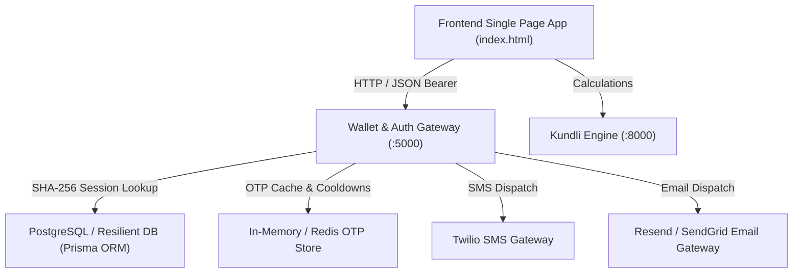
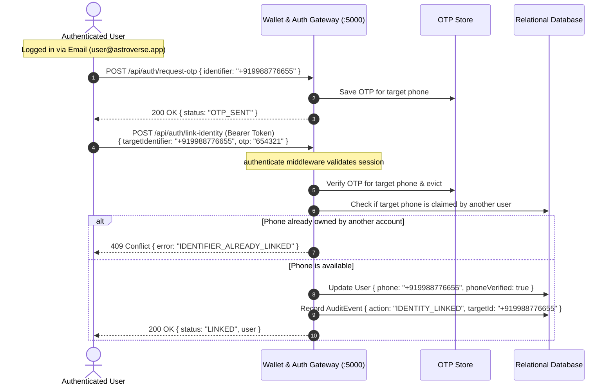

# Astroverse Authentication & Identity Architecture

**Project**: Astroverse Vedic Astrology Platform  
**Architecture Layer**: Application Identity, Authentication, and Session Security  
**Runtime**: Node.js / Express / TypeScript / Prisma ORM / PostgreSQL  
**Gateway Port**: `5000`  

---

## 1. System Topology & Component Interactions

The Astroverse authentication architecture separates presentation, gateway validation, cryptographic execution, and persistent storage:



---

## 2. Sequence Diagrams

### 2.1 OTP Registration & Login Sequence

```mermaid
sequenceDiagram
    autonumber
    actor User as Client Browser
    participant Gateway as Wallet & Auth Gateway (:5000)
    participant OTPStore as OTP & Rate Limit Store
    participant DB as Relational Database (Prisma)

    User->>Gateway: POST /api/auth/request-otp { identifier: "+919876543210" }
    Note over Gateway: Validates E.164 phone or RFC 5322 email
    Note over Gateway: Checks 60s cooldown & IP rate limits
    Gateway->>OTPStore: Save OTP (6-digit, 5-min TTL, attempts=0)
    Gateway-->>User: 200 OK { status: "OTP_SENT", cooldownSeconds: 60, devPreviewOtp }

    User->>Gateway: POST /api/auth/verify-otp { identifier, otp: "123456" }
    Gateway->>OTPStore: Retrieve record & verify OTP match
    Note over OTPStore: Increments attempt count; evicts on match (Single-Use)
    Gateway->>DB: Query User by Phone or Email
    alt User does not exist
        Gateway->>DB: Create User { walletBalance: 0.00, role: USER, status: ACTIVE }
    else User exists
        Note over Gateway: Verify account status is ACTIVE (Reject if SUSPENDED)
        Gateway->>DB: Update lastLoginAt and verification flags
    end
    Note over Gateway: Generate 256-bit random token; hash with SHA-256
    Gateway->>DB: Store UserSession { tokenHash, userId, expiresAt: 7d }
    Gateway->>DB: Record AuditEvent { action: "AUTH_LOGIN", userId }
    Gateway-->>User: 200 OK { status: "AUTHENTICATED", sessionToken, user }
    User->>User: Persist token to localStorage
```

### 2.2 Dual-Identity Linking Sequence (Phone + Email)



---

## 3. Session & Cryptographic Token Lifecycle

### 3.1 Token Generation & Storage Security
1. **Entropy**: Tokens are generated via Node.js cryptographic randomness:
   ```ts
   const rawSessionToken = crypto.randomBytes(32).toString('hex'); // 256 bits of entropy
   ```
2. **One-Way Hashing**: The raw token is returned only once to the client. The database never stores plaintext tokens; it stores the SHA-256 hash:
   ```ts
   const tokenHash = crypto.createHash('sha256').update(rawSessionToken).digest('hex');
   ```
3. **Lookup & Verification**: Incoming requests with `Authorization: Bearer <token>` hash the token before querying `UserSession`. This eliminates credential exposure even in the event of database snapshot leakage.

### 3.2 Expiration & Eviction Policy
* **Validity Window**: Default session duration is 7 days (`604,800,000 ms`).
* **Active Invalidation**: Calling `POST /api/auth/logout` explicitly deletes the token hash record.
* **Security Revocation**: When an administrator suspends or deactivates an account via `PUT /api/admin/users/:id/status`, all active sessions associated with the user ID are evicted immediately, instantly terminating all open client connections.

---

## 4. Role-Based Access Control (RBAC) Architecture

The platform defines five discrete roles within the `Role` enum:

| Role | Hierarchy Level | Capabilities & Access Scope |
| :--- | :--- | :--- |
| `SUPER_ADMIN` | Level 5 (Highest) | Full platform authority: role assignment, user status moderation, financial audits, system KPI monitoring, database operations. |
| `SUPPORT` | Level 4 | User inspection, account status moderation (Suspend/Activate), profile troubleshooting, refund assistance. Cannot modify admin roles. |
| `OPERATIONS` | Level 3 | Consultation queue monitoring, astrologer onboarding/payout verification, Puja scheduling. |
| `ANALYST` | Level 2 | Read-only access to platform metrics, calculation performance, conversion rates, and audit logs. |
| `USER` | Level 1 (Default) | Personal Kundli generation, birth profile CRUD, wallet top-up, consultations, and personal account settings. |

### 4.1 RBAC Enforcement Middleware

```typescript
function requireAdmin(allowedRoles: Role[] = [Role.SUPER_ADMIN, Role.SUPPORT, Role.OPERATIONS, Role.ANALYST]) {
  return (req: AuthenticatedRequest, res: Response, next: NextFunction) => {
    if (!req.user) return res.status(401).json({ error: 'UNAUTHORIZED' });
    if (!allowedRoles.includes(req.user.role)) {
      return res.status(403).json({
        error: 'FORBIDDEN',
        message: 'You do not have administrative privileges to perform this action.'
      });
    }
    next();
  };
}
```

---

## 5. Error Contract & Status Code Specifications

All authentication endpoints return standardized JSON payloads adhering to the following structure:

```json
{
  "error": "ERROR_CODE_CONSTANT",
  "message": "Human-readable explanation of error and required corrective action."
}
```

* `400 Bad Request`: Validation failure (e.g., `IDENTIFIER_REQUIRED`, `INVALID_IDENTIFIER_FORMAT`, `REQUIRED_FIELDS_MISSING`).
* `401 Unauthorized`: Missing or invalid credentials (e.g., `UNAUTHORIZED`, `INVALID_OR_EXPIRED_OTP`, `INVALID_OR_EXPIRED_SESSION`).
* `403 Forbidden`: Insufficient role permissions or inactive account (e.g., `FORBIDDEN`, `ACCOUNT_INACTIVE`).
* `404 Not Found`: Resource does not exist (e.g., `USER_NOT_FOUND`, `PROFILE_NOT_FOUND`).
* `409 Conflict`: Resource collision (e.g., `IDENTIFIER_ALREADY_LINKED`).
* `429 Too Many Requests`: Rate limit or cooldown triggered (e.g., `COOLDOWN_ACTIVE`, `RATE_LIMIT_EXCEEDED`, `TOO_MANY_ATTEMPTS`).
* `500 Internal Server Error`: Unhandled gateway exception.
