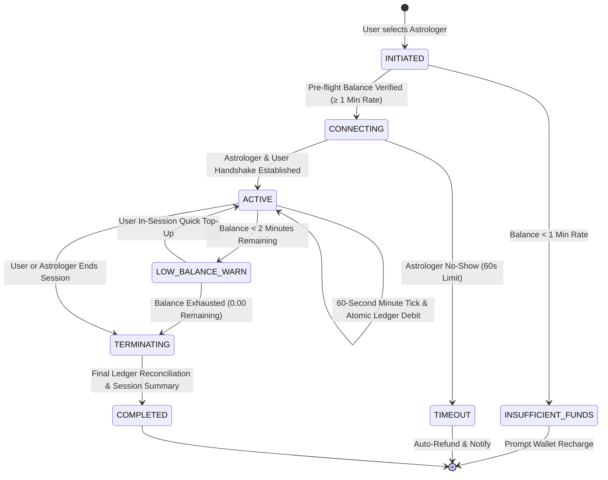
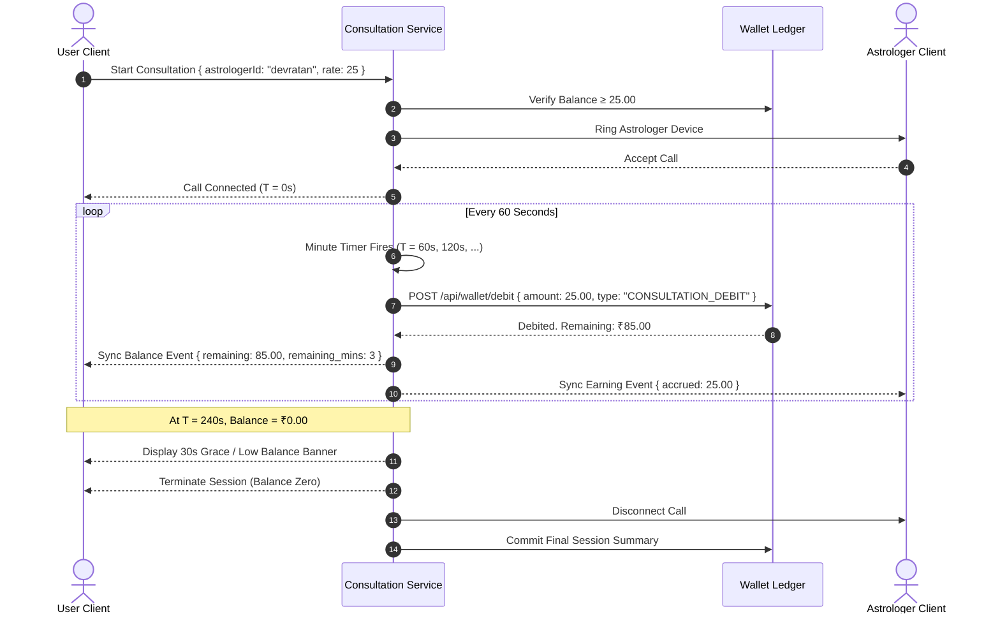

# AstroVerse 1-on-1 Consultation Lifecycle & Real-Time Billing Specification

## 1. Consultation Lifecycle State Machine

AstroVerse provides private, real-time consultations with verified Vedic astrologers via text chat, audio, and video streams. Every active consultation is governed by a strict state machine with server-authoritative timekeeping and per-minute billing.

---

## 2. Pre-Flight Balance Validation & Duration Projection

Prior to initiating any consultation channel (WebRTC audio/video or WebSocket chat):

1. **Pre-Flight Invariant**:
   $$\text{WalletBalance} \ge \text{AstrologerRate} \times 1$$
   * If balance is insufficient, connection is aborted immediately and the Wallet Recharge Modal is surfaced.
2. **Session Duration Projection**:
   $$\text{AvailableDurationMinutes} = \left\lfloor \frac{\text{WalletBalance}}{\text{AstrologerRate}} \right\rfloor$$
   * For an astrologer charging ₹25/min:
     * Balance ₹10.00 $\implies$ Disallowed (Shortfall ₹15.00).
     * Balance ₹110.00 $\implies$ Allowed ($\lfloor 110 / 25 \rfloor = 4 \text{ minutes available}$).
     * Balance ₹500.00 $\implies$ Allowed ($\lfloor 500 / 25 \rfloor = 20 \text{ minutes available}$).

---

## 3. Real-Time Per-Minute Billing Engine

---

## 4. Edge Case Handling & Fault Tolerance

### 4.1 Temporary Network Disconnections
* If either participant's connection drops during an active session, a **60-second reconnection grace period** begins.
* If reconnected within 60 seconds, the session resumes seamlessly without double-charging the interruption window.
* If reconnection fails, the session transitions to `TERMINATING` and only elapsed completed minutes are debited.

### 4.2 Graceful Zero-Balance Termination
* Under no circumstances can a consultation continue into negative balance territory.
* When less than 120 seconds of balance remain, an inline non-intrusive alert prompts the user for single-click in-session top-up.
* At $T = \text{Balance} - \text{Rate} < 0$, the server terminates the media stream cleanly, plays a polite wrap-up tone, and presents the rating and session summary dialog.
