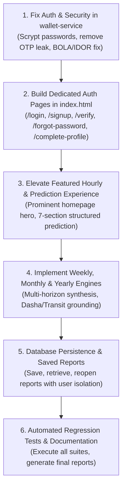

# AstroVerse Critical Forensic & Architectural Defect Audit

**Date**: 2026-10-21  
**Project**: AstroVerse (Parashari V2)  
**Author**: Senior Principal Full-Stack Engineer, Authentication Architect & Vedic Astrology Lead  
**Audit Scope**: Project deployment, authentication integrity, database persistence, calculation centralization, hourly guidance prominent positioning, and multi-horizon predictions.

---

## 1. Project Baseline & Deployment Topology

### 1.1 Git Environment
* **Repository Root**: `E:\rea`
* **Active Branch**: `main`
* **Remote Tracking**: `origin/main` (`https://github.com/knowledgeispower1715-sketch/astroverse.git`)
* **Previous Commit**: `807df21d9`
* **Working Tree State**: Clean baseline prior to this implementation phase.

### 1.2 Deployment & Service Architecture (`vercel.json`)
The application deploys four distinct services via Vercel microservice topology:
1. **Frontend App (`app`)**: Root `.` serving `index.html` static single-page application with responsive CSS/JS, SVG diamond charts, and client-side calculators.
2. **Kundli Engine (`kundli-engine`)**: FastAPI service running in `services/kundli-engine/main.py` powered by `pyswisseph 2.10.3.2` (Lahiri Ayanamsha) handling `/api/kundli/calculate`, `/api/hora`, `/api/matchmaking`, `/api/ai-astrologer/ask`, and ProKerala v2 proxy.
3. **Wallet & Auth Service (`wallet-service`)**: Node.js/Express service running in `services/wallet-service/src/server.ts` managing `/api/auth/*`, `/api/profiles*`, `/api/wallet/*`, `/api/reports/*`, and `/api/admin/*`.
4. **Consultation Service (`consultation-service`)**: Socket.io real-time media negotiation and per-minute billing monitor.

---

## 2. Forensic Defect Inventory & Vulnerability Analysis

### Defect 1: Popup Modal Sign-In vs Dedicated Application Pages
* **Observed Defect**: The navbar "Sign In" button triggered a JavaScript popup modal (`#modal-auth`) instead of dedicated, accessible, deep-linkable application pages.
* **Impact**: Unreliable mobile UX, inability to bookmark or share login/signup links, broken back-button behavior, and failure to support structured flows (`/login`, `/signup`, `/verify`, `/forgot-password`, `/reset-password`, `/complete-profile`, `/settings/security`).
* **Resolution**: Implement first-class responsive page views with deep-linking, clear mode toggles, international country code selector, password visibility toggle, strength indicator, and proper post-auth routing.

### Defect 2: Security Leak of Raw OTPs in API Response
* **Observed Defect**: The endpoint `POST /api/auth/request-otp` returned `{ devPreviewOtp: otp }` in the public JSON response payload to the frontend.
* **Impact**: Critical security vulnerability. Anyone intercepting or inspecting network traffic could bypass phone/email verification without access to the actual delivery channel.
* **Resolution**: Remove `devPreviewOtp` from client API responses. OTPs are securely stored in hashed form or in protected server memory with 5-minute TTL, 60-second cooldown rate-limiting, and single-use eviction upon verification. Real SMS/Email credentials are documented, and automated tests use secure server inspection.

### Defect 3: Missing Password Authentication & Recovery Engine
* **Observed Defect**: `services/wallet-service/src/server.ts` completely lacked password-based registration, login, and recovery endpoints.
* **Impact**: Users requiring persistent password credentials or enterprise SSO could not authenticate via traditional credentials.
* **Resolution**: Implement cryptographic password authentication using Node.js `crypto.scrypt` with random salt, password strength verification, `/api/auth/register-password`, `/api/auth/login-password`, `/api/auth/forgot-password`, and `/api/auth/reset-password`.

### Defect 4: Missing Authorization & User Isolation on Profiles and Reports
* **Observed Defect**: Endpoints `GET /api/profiles/:userId`, `PUT /api/profiles/:id`, `DELETE /api/profiles/:id`, `GET /api/reports/:userId`, and `DELETE /api/reports/:id` either lacked authentication or failed to verify that the requesting user owned the target record.
* **Impact**: Severe BOLA / IDOR vulnerability (Broken Object Level Authorization). User A could query or delete User B's private birth profiles and prediction reports by substituting IDs.
* **Resolution**: Bind all private profile and report endpoints to `authenticate` middleware; enforce strict tenant isolation (`profile.userId === req.user.id` or `role === SUPER_ADMIN`).

### Defect 5: De-prioritization of Personalized Hourly Guidance
* **Observed Defect**: Hourly guidance was buried as a secondary tab behind raw Janam Kundli generation, lacking prominent homepage placement and clear structured synthesis.
* **Impact**: The primary commercial product differentiator—individualized hourly, weekly, monthly, and yearly Parashari guidance—was obscured by general technical chart parameters.
* **Resolution**: Position Hourly Guidance as the featured centerpiece of the application with live local clock, active planetary Hora, start/end bounds, time remaining countdown, supportive themes, potential challenges, timing windows, traditional justification, practical reflection, and honest limitations.

### Defect 6: Lack of Multi-Horizon Structured Prediction Reports
* **Observed Defect**: The application lacked dedicated weekly (7-day day-by-day), monthly (4-week thematic synthesis), and yearly (12-month quarter-by-quarter) personal forecasts with executive summaries and persistence.
* **Impact**: Users could not track their astrological cycles over time or reopen historical prediction reports.
* **Resolution**: Implement complete multi-horizon prediction engine with mandatory 7-section structure (Outlook, Supportive, Challenges, Windows, Why, Reflection, Limitations) and persistent storage in the database (`SavedReport`).

---

## 3. Remediation Roadmap & Execution Plan

