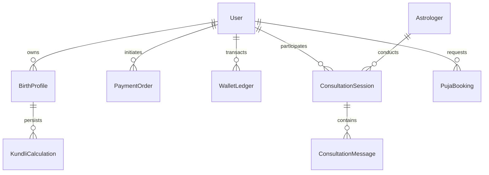

# Relational Database Schema & Data Architecture — Astroverse

## 1. Schema Overview

The Astroverse data layer is built on PostgreSQL 16, orchestrated via Prisma ORM (`services/wallet-service/prisma/schema.prisma`). The schema enforces strict referential integrity, relational normalization, and double-entry ledger bookkeeping.

---

## 2. Entity Definitions

### 2.1 User (`User`)
Stores account credentials, profile status, and current cached wallet balance.

| Column | Type | Constraints | Description |
| :--- | :--- | :--- | :--- |
| `id` | `String` (UUID) | Primary Key, default `uuid()` | Unique user identifier |
| `phone` | `String?` | Unique, Indexed | E.164 formatted mobile number |
| `email` | `String?` | Unique, Indexed | Contact email address |
| `displayName`| `String?` | Nullable | Full name of account owner |
| `avatarUrl` | `String?` | Nullable | Profile avatar image link |
| `role` | `String` | Default `"USER"` | Account role (`"USER"`, `"ASTROLOGER"`, `"ADMIN"`) |
| `walletBalance`| `Float` | Default `0.0` | Cached available funds (INR) |
| `createdAt` | `DateTime` | Default `now()` | Timestamp of creation |
| `updatedAt` | `DateTime` | Auto-updated | Timestamp of last modification |

### 2.2 Birth Profile (`BirthProfile`)
Represents individual horoscopes saved under a user account (e.g., Self, Spouse, Child, Friend).

| Column | Type | Constraints | Description |
| :--- | :--- | :--- | :--- |
| `id` | `String` (UUID) | Primary Key, default `uuid()` | Unique profile identifier |
| `userId` | `String` (UUID) | Foreign Key -> `User(id)` | Owning user account |
| `fullName` | `String` | Required | Name on the birth chart |
| `relationship`| `String` | Default `"Self"` | `"Self"`, `"Spouse"`, `"Child"`, `"Friend"`, `"Other"` |
| `gender` | `String` | Required | `"Male"`, `"Female"`, `"Other"` |
| `dateOfBirth`| `DateTime` | Required | Gregorian date of birth |
| `timeOfBirth`| `String` | Required | Time of birth (`"HH:MM"`) |
| `placeOfBirth`| `String` | Required | City, State, Country |
| `latitude` | `Float` | Required | Geodetic latitude (-90 to +90) |
| `longitude` | `Float` | Required | Geodetic longitude (-180 to +180) |
| `timezone` | `Float` | Default `5.5` | Offset in hours from UTC |
| `isDefault` | `Boolean` | Default `false` | Primary profile flag |

### 2.3 Kundli Calculation Cache (`KundliCalculation`)
Persists calculated planetary coordinates, divisional charts, dasha timelines, and dosha reports to prevent redundant ephemeris computing.

| Column | Type | Constraints | Description |
| :--- | :--- | :--- | :--- |
| `id` | `String` (UUID) | Primary Key, default `uuid()` | Record ID |
| `profileId` | `String` (UUID) | Foreign Key -> `BirthProfile(id)` | Associated birth profile |
| `ayanamsa` | `String` | Default `"Lahiri"` | Ayanamsha convention used |
| `planetaryData`| `Json` | Required | Planet positions, signs, houses, nakshatras |
| `divisionalData`| `Json`| Required | D1, D9, D10, Moon, Chalit charts |
| `dashaData` | `Json` | Required | 120-year Vimshottari Mahadashas & Antardashas |
| `doshaData` | `Json` | Required | Manglik, Kaal Sarp, Sade Sati diagnostics |
| `createdAt` | `DateTime` | Default `now()` | Calculation timestamp |

### 2.4 Astrologer Directory (`Astrologer`)
Verified practitioner profiles, specializations, ratings, and per-minute rates.

| Column | Type | Constraints | Description |
| :--- | :--- | :--- | :--- |
| `id` | `String` (UUID) | Primary Key, default `uuid()` | Astrologer ID |
| `name` | `String` | Required | Practitioner name |
| `specialties`| `String[]` | Required | Array of skills (e.g. `["Vedic", "Vastu", "Numerology"]`) |
| `languages` | `String[]` | Required | Supported languages (`["Hindi", "English"]`) |
| `experienceYears`| `Int` | Required | Years of practice |
| `pricePerMinute`| `Float`| Required | Billing rate in INR |
| `rating` | `Float` | Default `5.0` | Average user rating |
| `totalConsultations`| `Int`| Default `0` | Number of completed sessions |
| `isOnline` | `Boolean` | Default `false` | Real-time presence flag |
| `isBusy` | `Boolean` | Default `false` | In-call status flag |

### 2.5 Real-Time Consultation Sessions (`ConsultationSession`)
Tracks live calls, duration, per-minute billing, and total debits.

| Column | Type | Constraints | Description |
| :--- | :--- | :--- | :--- |
| `id` | `String` (UUID) | Primary Key, default `uuid()` | Session ID |
| `userId` | `String` (UUID) | Foreign Key -> `User(id)` | Consulting user |
| `astrologerId`| `String` (UUID)| Foreign Key -> `Astrologer(id)`| Practitioner |
| `channelType` | `String` | Required | `"CHAT"`, `"VOICE"`, `"VIDEO"` |
| `status` | `String` | Required | `"INITIATED"`, `"ACTIVE"`, `"COMPLETED"`, `"TERMINATED"` |
| `startTime` | `DateTime` | Default `now()` | Connection time |
| `endTime` | `DateTime?`| Nullable | Hangup time |
| `durationSeconds`| `Int`| Default `0` | Elapsed billable seconds |
| `costPerMinute`| `Float`| Required | Rate applied |
| `totalCost` | `Float` | Default `0.0` | Settled cost |

### 2.6 Wallet Ledger (`WalletLedger`)
Double-entry financial log guaranteeing transactional transparency.

| Column | Type | Constraints | Description |
| :--- | :--- | :--- | :--- |
| `id` | `String` (UUID) | Primary Key, default `uuid()` | Ledger entry ID |
| `userId` | `String` (UUID) | Foreign Key -> `User(id)` | Account debited or credited |
| `amount` | `Float` | Required | Positive value |
| `type` | `String` | Required | `"CREDIT"` or `"DEBIT"` |
| `category` | `String` | Required | `"RECHARGE"`, `"CONSULTATION"`, `"PUJA"`, `"REFUND"` |
| `referenceId` | `String?` | Nullable | Order ID or Session ID |
| `balanceAfter`| `Float` | Required | Account balance following transaction |
| `description` | `String` | Required | Audit description |
| `createdAt` | `DateTime` | Default `now()` | Immutable timestamp |

### 2.7 Puja Bookings (`PujaBooking`)
Astromall spiritual remedy and puja service orders.

| Column | Type | Constraints | Description |
| :--- | :--- | :--- | :--- |
| `id` | `String` (UUID) | Primary Key, default `uuid()` | Booking ID |
| `userId` | `String` (UUID) | Foreign Key -> `User(id)` | Requesting client |
| `pujaName` | `String` | Required | e.g. "Maha Mrityunjaya Puja", "Shani Shanti" |
| `amount` | `Float` | Required | Price in INR |
| `status` | `String` | Default `"SCHEDULED"`| `"PENDING"`, `"SCHEDULED"`, `"COMPLETED"` |
| `scheduledDate`| `DateTime` | Required | Target date of ceremony |
| `sankalpNotes`| `String?` | Nullable | Client's Gotra and prayer intention |
| `panditAssigned`| `String?`| Nullable | Lead priest assigned |

---

## 3. Database Indexes

To maintain sub-10ms query response times under high concurrency, the following indexes are declared:

1. `User_phone_idx` on `User(phone)`
2. `User_email_idx` on `User(email)`
3. `BirthProfile_userId_idx` on `BirthProfile(userId)`
4. `WalletLedger_userId_createdAt_idx` on `WalletLedger(userId, createdAt DESC)`
5. `ConsultationSession_userId_idx` on `ConsultationSession(userId)`
6. `ConsultationSession_astrologerId_idx` on `ConsultationSession(astrologerId)`
7. `Astrologer_isOnline_isBusy_idx` on `Astrologer(isOnline, isBusy)`
