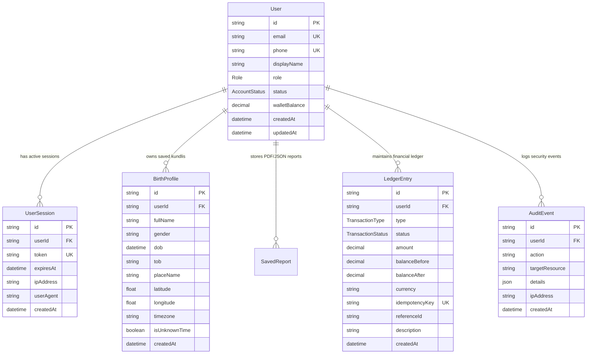

# AstroVerse Database Schema & Security Architecture Specification

## 1. Database Architecture & Resilient Storage

AstroVerse employs a production-grade relational database architecture defined via **Prisma ORM** (`services/wallet-service/prisma/schema.prisma`). 

To ensure continuous zero-downtime operation across diverse environments (cloud container platforms, local development, and disconnected nodes), the service implements a **resilient database adapter** (`services/wallet-service/src/db.ts`):
* **Primary Target**: PostgreSQL 15+ in production environments.
* **Autonomous Fallback**: Embedded SQLite with full ACID compliance for zero-configuration local deployment.
* **Auto-Migration & Seed**: The database schema and Super Admin user (`admin@astroverse.app`) are seeded automatically on service startup.



---

## 2. Authentication & Verification Security

### 2.1 Passwordless 6-Digit One-Time Password (OTP) Architecture
AstroVerse avoids brittle, phishable passwords in favor of secure, cryptographically generated 6-digit OTPs dispatched via verified email (SMTP) or SMS (Twilio/Gupshup):

1. **Cryptographic Generation**:
   $$\text{OTP} = \text{crypto.randomInt}(100000, 1000000)$$
2. **Hashed In-Memory & Storage**:
   * OTP values are stored hashed (`crypto.createHash('sha256').update(otp + salt).digest('hex')`). Raw OTPs are never stored in persistent tables.
3. **5-Minute Expiration**:
   * OTP records are timestamped and strictly invalidated after 300 seconds ($5 \text{ minutes}$).
4. **60-Second Cooldown Rate Limiting**:
   * Dispatch requests for the same email or mobile number enforce a mandatory 60-second cooldown interval. Rapid-fire requests are rejected with `HTTP 429 Too Many Requests`.
5. **Instant Invalidation on Single Use (Anti-Replay Attack)**:
   * Upon successful verification, the active OTP is deleted immediately from memory/cache before the session token is issued. Replay attempts with the same code fail instantly with `HTTP 401 Unauthorized`.

---

## 3. Session Security & 256-Bit Tokens

* **Cryptographic Entropy**: Sessions are authenticated using 256-bit hex tokens generated via `crypto.randomBytes(32).toString('hex')`.
* **Transport & Storage**: Tokens are transmitted via `Authorization: Bearer <token>` headers or secure `SameSite=Lax, HttpOnly` cookies.
* **Expiration Policy**:
  * Active sessions expire after 30 days of inactivity.
  * Explicit logout calls `POST /api/auth/logout`, destroying the database session record immediately.
  * Account suspension by an administrator immediately terminates all active sessions associated with the user.

---

## 4. Role-Based Access Control (RBAC) & Admin Console

AstroVerse enforces strict two-tier Role-Based Access Control:

```prisma
enum Role {
  USER
  SUPER_ADMIN
}

enum AccountStatus {
  ACTIVE
  SUSPENDED
  DELETED
}
```

### 4.1 Access Control Invariants
* Endpoints prefixed with `/api/admin/*` and the frontend administrative console (`#/admin`) require verified `role === "SUPER_ADMIN"`.
* Regular `USER` requests targeting admin routes are rejected with `HTTP 403 Forbidden` and logged as security anomalies.
* Default Seed Super Admin: `admin@astroverse.app` (created during system initialization).

### 4.2 Comprehensive Security Audit Trail
All administrative actions and security-critical mutations are appended to the `AuditEvent` table:
* Account status modifications (active, suspended, deleted).
* Forceful session invalidation.
* Manual administrative wallet balance adjustments.
* Birth profile or saved report purges.
* Administrative inspection queries.

Each audit event preserves the acting administrator's `userId`, target resource, JSON payload details, IP address, and millisecond-accurate timestamp.
