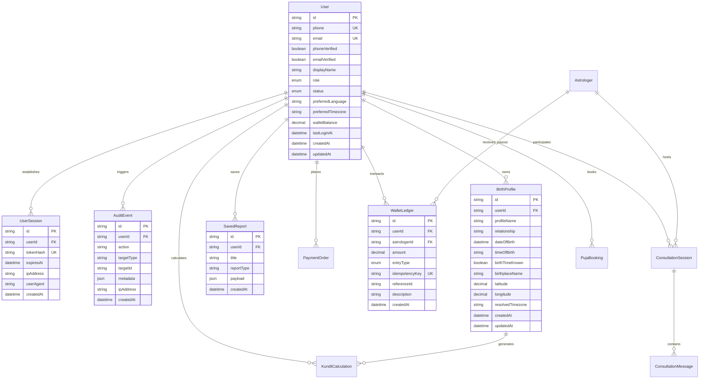

# Astroverse Relational Database Schema & Data Dictionary

**Project**: Astroverse Vedic Astrology Platform  
**ORM**: Prisma Client v5.22.0  
**Database**: PostgreSQL 16+ (with ACID-Compliant Embedded Store Fallback)  
**Specification**: Production Normalized Schema  

---

## 1. Entity Relationship Diagram (ERD)

---

## 2. Model Specifications & Data Dictionary

### 2.1 Identity & RBAC Models

#### `User`
Primary identity entity storing authentication credentials, authorization roles, and financial balance.
* `id` (`String`, UUID/ULID, Primary Key): Unique platform identifier.
* `phone` (`String?`, Unique, Index): Normalized international E.164 phone number (e.g. `+919876543210`).
* `email` (`String?`, Unique, Index): Normalized lowercase RFC 5322 email address.
* `phoneVerified` (`Boolean`, Default: `false`): Verification status of mobile phone.
* `emailVerified` (`Boolean`, Default: `false`): Verification status of email address.
* `displayName` (`String?`): User chosen name or identifier alias.
* `role` (`Role`, Enum: `USER`, `SUPER_ADMIN`, `SUPPORT`, `OPERATIONS`, `ANALYST`, Default: `USER`).
* `status` (`AccountStatus`, Enum: `ACTIVE`, `SUSPENDED`, `DEACTIVATED`, Default: `ACTIVE`).
* `preferredLanguage` (`String`, Default: `"en"`): Client localization preference.
* `preferredTimezone` (`String`, Default: `"Asia/Kolkata"`): Default regional timezone.
* `walletBalance` (`Decimal(12, 2)`, Default: `0.00`): Live uncommitted balance.
* `lastLoginAt` (`DateTime?`): Timestamp of most recent authentication.
* `createdAt` / `updatedAt` (`DateTime`): Lifecycle audit timestamps.

#### `UserSession`
Cryptographically secure session records tracking active device authorizations.
* `id` (`String`, Primary Key): Internal session identifier.
* `userId` (`String`, Foreign Key -> `User.id`, Cascade Delete): Associated user.
* `tokenHash` (`String`, Unique, Index): SHA-256 hash of the 256-bit bearer token.
* `expiresAt` (`DateTime`, Index): Hard session expiration time (7-day TTL).
* `ipAddress` (`String?`): IP address at token creation.
* `userAgent` (`String?`): Browser/device client string.
* `createdAt` (`DateTime`): Timestamp of issuance.

#### `AuditEvent`
Tamper-resistant audit log capturing all security-critical operations.
* `id` (`String`, Primary Key): Audit event record identifier.
* `userId` (`String?`, Foreign Key -> `User.id`, Set Null on Delete): Actor performing the action.
* `action` (`String`, Index): Event action key (`AUTH_LOGIN`, `AUTH_REGISTER`, `OTP_DISPATCHED`, `IDENTITY_LINKED`, `ADMIN_STATUS_CHANGE`, `ADMIN_ROLE_CHANGE`, `ACCOUNT_DEACTIVATED`, `ACCOUNT_DELETED`, `WALLET_RECHARGE`).
* `targetType` (`String?`): Target entity classification (`USER`, `PROFILE`, `ORDER`, `SESSION`).
* `targetId` (`String?`): Unique identifier of target affected entity.
* `metadata` (`Json?`): Arbitrary contextual metadata payload.
* `ipAddress` (`String?`): Remote client IP address.
* `createdAt` (`DateTime`, Index): UTC event timestamp.

---

### 2.2 Astrological & Profile Models

#### `BirthProfile`
Persistent storage of family and user birth charts.
* `id` (`String`, Primary Key): Profile UUID.
* `userId` (`String`, Foreign Key -> `User.id`, Cascade Delete): Account owner.
* `profileName` (`String`): Person's name.
* `relationship` (`String`, Default: `"Self"`): Relationship type (`Self`, `Spouse`, `Child`, `Parent`, `Friend`).
* `dateOfBirth` (`DateTime`): Astronomical Gregorian birth date.
* `timeOfBirth` (`String`): 24-hour time string (`"HH:mm"`).
* `birthTimeKnown` (`Boolean`, Default: `true`): Flag for birth time certainty.
* `birthplaceName` (`String`): Resolved geographical location name.
* `latitude` (`Decimal(9, 6)`): Geographic latitude (`-90.000000` to `+90.000000`).
* `longitude` (`Decimal(9, 6)`): Geographic longitude (`-180.000000` to `+180.000000`).
* `resolvedTimezone` (`String`): IANA timezone identifier (e.g. `"Asia/Kolkata"`).

#### `SavedReport`
Snapshot storage of generated Parashari, Dosha, Matchmaking, and Transit reports.
* `id` (`String`, Primary Key): Saved report UUID.
* `userId` (`String`, Foreign Key -> `User.id`, Cascade Delete): Account owner.
* `title` (`String`): Descriptive report title.
* `reportType` (`String`): Categorization (`KUNDLI`, `DOSHA`, `HORA`, `MATCHING`, `AI_INSIGHT`).
* `payload` (`Json`): Full calculation result snapshot.
* `createdAt` (`DateTime`): Timestamp of calculation.

---

### 2.3 Financial & Ledger Models

#### `WalletLedger`
Immutable double-entry transaction record.
* `id` (`String`, Primary Key): Ledger entry UUID.
* `userId` (`String?`, Foreign Key -> `User.id`): Affected user account.
* `astrologerId` (`String?`, Foreign Key -> `Astrologer.id`): Affected astrologer account.
* `amount` (`Decimal(12, 2)`): Transaction amount (Positive for credits, negative for debits).
* `entryType` (`EntryType`, Enum: `WALLET_RECHARGE`, `CONSULTATION_DEBIT`, `ASTROLOGER_CREDIT`, `PLATFORM_COMMISSION`, `PUJA_BOOKING`, `STORE_PURCHASE`, `REFUND`).
* `idempotencyKey` (`String`, Unique): Unique key preventing double-charge replay attacks.
* `referenceId` (`String?`): External reference (Razorpay payment ID or Session ID).
* `description` (`String?`): Ledger transaction explanation.
* `createdAt` (`DateTime`, Index): UTC transaction timestamp.

---

## 3. Indexing & Integrity Strategies

1. **Compound Indexes**:
   - `User`: `[role, status]` for optimized administrative filtering.
   - `BirthProfile`: `[userId, profileName]` for fast autocomplete and listing.
   - `AuditEvent`: `[userId, createdAt]` and `[action, createdAt]` for rapid audit trail inspection.
   - `WalletLedger`: `[userId, createdAt]` and `[astrologerId, createdAt]` for fast ledger statement rendering.
2. **Cascade Deletion Rules**:
   - Deleting a `User` cascades to delete associated `UserSession`, `BirthProfile`, and `SavedReport` records.
   - Associated `WalletLedger`, `PaymentOrder`, and `AuditEvent` records retain historical compliance with `SetNull` or soft-archive to ensure financial traceability.
3. **Idempotency Guarantees**:
   - `WalletLedger.idempotencyKey` guarantees that no payment capture or consultation deduction can execute twice even under concurrent network retries.
