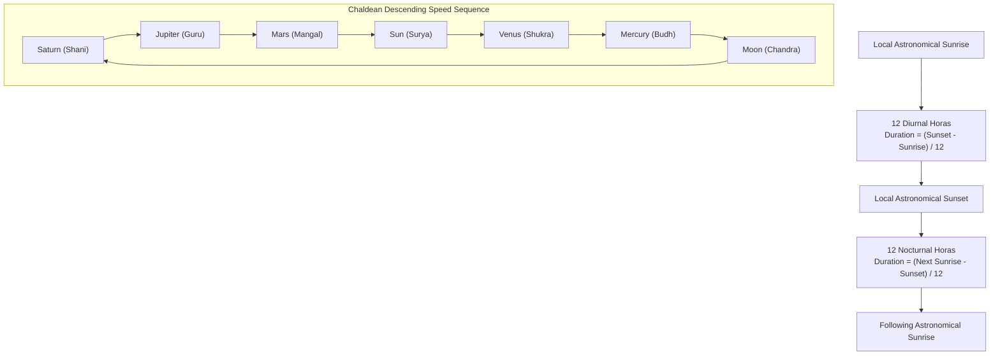

# AstroVerse 24-Hour Planetary Hora & Timing Guidance Specification

## 1. Classical Foundation: The Planetary Hora System

The Vedic **Hora (होरा)** system is the classical planetary division of time governing daily activities, decision-making, and ritual timing (*Muhurta*).

Unlike conventional fixed 60-minute civil clock hours, classical Vedic Horas are **unequal solar divisions**:
* The daylight period (from local astronomical **Sunrise** to **Sunset**) is divided into exactly **12 equal diurnal Horas**.
* The nighttime period (from **Sunset** to the following day's **Sunrise**) is divided into exactly **12 equal nocturnal Horas**.
* Therefore, depending on geographic latitude and the time of year, daytime Horas may range from ~50 to ~70 minutes, while nighttime Horas vary inversely to preserve the 24-division solar cycle.

---

## 2. Weekday Lords & The Chaldean Sequence

The ruler of the **1st Hora of the day** (commencing at exact local sunrise) is the ruler of that Vedic weekday (*Vaara Lord*):

| Weekday | English Name | Sanskrit Vaara | 1st Hora Ruler (at Sunrise) |
| :--- | :--- | :--- | :--- |
| Sunday | Sunday | Ravivaar | **Sun (Surya)** |
| Monday | Monday | Somvaar | **Moon (Chandra)** |
| Tuesday | Tuesday | Mangalvaar | **Mars (Mangal)** |
| Wednesday | Wednesday | Budhvaar | **Mercury (Budh)** |
| Thursday | Thursday | Guruvaar | **Jupiter (Guru)** |
| Friday | Friday | Shukravaar | **Venus (Shukra)** |
| Saturday | Saturday | Shanivaar | **Saturn (Shani)** |

Following the 1st Hora, each subsequent Hora is ruled by the next planet in the **descending geocentric orbital speed sequence** (the classical **Chaldean Order**):
$$\text{Saturn} \to \text{Jupiter} \to \text{Mars} \to \text{Sun} \to \text{Venus} \to \text{Mercury} \to \text{Moon} \to \text{Saturn} \dots$$

Because $24 \pmod 7 = 3$, after 24 Horas elapse, the 25th Hora (sunrise of the next day) naturally advances to the ruler of the subsequent weekday ($1 \to 4 \to 7 \to 3 \to 6 \to 2 \to 5$), maintaining perpetual astronomical alignment.

---

## 3. Mathematical Formulas

### 3.1 Astronomical Sunrise and Sunset Computation
Using Swiss Ephemeris (`pyswisseph`):
$$\text{Sunrise JD} = \text{swe.rise\_trans}(t_{\text{start}}, \text{swe.SUN}, \text{swe.CALC\_RISE}, \phi, \theta)$$
$$\text{Sunset JD} = \text{swe.rise\_trans}(t_{\text{start}}, \text{swe.SUN}, \text{swe.CALC\_SET}, \phi, \theta)$$

Where:
* $\phi$ is the geodetic latitude.
* $\theta$ is the geodetic longitude.
* Atmospheric refraction is computed with standard pressure ($1013.25\text{ hPa}$) and temperature ($10^\circ\text{C}$).

### 3.2 Hora Interval Durations
$$\Delta t_{\text{day}} = \frac{t_{\text{sunset}} - t_{\text{sunrise}}}{12}$$
$$\Delta t_{\text{night}} = \frac{t_{\text{next\_sunrise}} - t_{\text{sunset}}}{12}$$

### 3.3 Active Hora Identification
For any given observation timestamp $t_{\text{obs}}$:
* If $t_{\text{sunrise}} \le t_{\text{obs}} < t_{\text{sunset}}$:
  $$i = \left\lfloor \frac{t_{\text{obs}} - t_{\text{sunrise}}}{\Delta t_{\text{day}}} \right\rfloor \in \{0 \dots 11\}$$
  $$\text{Ruling Planet} = \text{CHALDEAN}\left[(\text{start\_idx} + i) \pmod 7\right]$$
* If $t_{\text{obs}} \ge t_{\text{sunset}}$:
  $$j = \left\lfloor \frac{t_{\text{obs}} - t_{\text{sunset}}}{\Delta t_{\text{night}}} \right\rfloor \in \{0 \dots 11\}$$
  $$\text{Ruling Planet} = \text{CHALDEAN}\left[(\text{start\_idx} + 12 + j) \pmod 7\right]$$

---

## 4. Special Astrological Periods (Daylight Octants)

Classical Muhurta divides the daylight span into **8 equal segments** ($\Delta t_{\text{oct}} = \frac{t_{\text{sunset}} - t_{\text{sunrise}}}{8}$):

### 4.1 Rahu Kaal (Inauspicious Window)
Rahu Kaal segment assignments by weekday:
* **Sunday**: 8th Octant (04:30 PM – 06:00 PM nominal)
* **Monday**: 2nd Octant (07:30 AM – 09:00 AM nominal)
* **Tuesday**: 7th Octant (03:00 PM – 04:30 PM nominal)
* **Wednesday**: 5th Octant (12:00 PM – 01:30 PM nominal)
* **Thursday**: 6th Octant (01:30 PM – 03:00 PM nominal)
* **Friday**: 4th Octant (10:30 AM – 12:00 PM nominal)
* **Saturday**: 3rd Octant (09:00 AM – 10:30 AM nominal)

### 4.2 Yamaganda Kaal
* Sunday: 5th | Monday: 4th | Tuesday: 3rd | Wednesday: 2nd | Thursday: 1st | Friday: 7th | Saturday: 6th

### 4.3 Gulika Kaal
* Sunday: 7th | Monday: 6th | Tuesday: 5th | Wednesday: 4th | Thursday: 3rd | Friday: 2nd | Saturday: 1st

---

## 5. Canonical Regression Test: 21 October 2026, Jabalpur (MP), India

* **Date**: Wednesday, 21 October 2026
* **Location**: Jabalpur (Latitude: 23.1815°, Longitude: 79.9864°)
* **Astronomical Sunrise**: `06:09 AM IST`
* **Astronomical Sunset**: `05:39 PM IST`
* **Daylight Duration**: 11 hours 30 minutes ($690 \text{ minutes}$)
* **Day Hora Duration**: $690 / 12 = \mathbf{57.5 \text{ minutes}}$
* **Night Hora Duration**: $(24 \times 60 - 690) / 12 = \mathbf{62.5 \text{ minutes}}$
* **Day Ruler (Wednesday)**: **Mercury (Budh)**

### 5.1 Daylight Hora Schedule (Wednesday 21 Oct 2026)

| Hora # | Ruling Planet | Start Time (IST) | End Time (IST) | Category | Muhurta Recommendation |
| :---: | :--- | :--- | :--- | :--- | :--- |
| 1 | **Mercury** | 06:09 AM | 07:06 AM | Favorable | Commerce, learning, communications |
| 2 | **Moon** | 07:06 AM | 08:04 AM | Moderate | Personal reflection, household affairs |
| 3 | **Saturn** | 08:04 AM | 09:01 AM | Caution | Routine labor, discipline, avoid starts |
| 4 | **Jupiter** | 09:01 AM | 09:59 AM | Highly Auspicious | Financial expansion, advisory, spirituality |
| 5 | **Mars** | 09:59 AM | 10:56 AM | Caution | Technical tasks, courage, avoid conflict |
| 6 | **Sun** | 10:56 AM | 11:54 AM | Authoritative | Leadership alignment, executive discussions |
| 7 | **Venus** | 11:54 AM | 12:51 PM | Highly Auspicious | Creative initiatives, arts, negotiations |
| 8 | **Mercury** | 12:51 PM | 01:49 PM | Favorable | Analytical work, agreements, digital media |
| **9** | **Moon** | **01:49 PM** | **02:46 PM** | **Moderate** | **ACTIVE AT 14:38 IST (Video Timestamp)** |
| 10 | **Saturn** | 02:46 PM | 03:44 PM | Caution | Structural review, maintenance |
| 11 | **Jupiter** | 03:44 PM | 04:41 PM | Highly Auspicious | Strategic agreements, consultations |
| 12 | **Mars** | 04:41 PM | 05:39 PM | Caution | Closing daily operations, physical tasks |

### 5.2 Special Periods for 21 Oct 2026
* **Rahu Kaal (5th Octant)**: `11:54 AM – 01:21 PM IST`
* **Yamaganda (2nd Octant)**: `07:35 AM – 09:01 AM IST`
* **Gulika Kaal (4th Octant)**: `10:27 AM – 11:54 AM IST`

*Verified via automated pytest: `tests/test_calculations.py::test_recording_case_21_oct_2026_jabalpur_hora`.*
