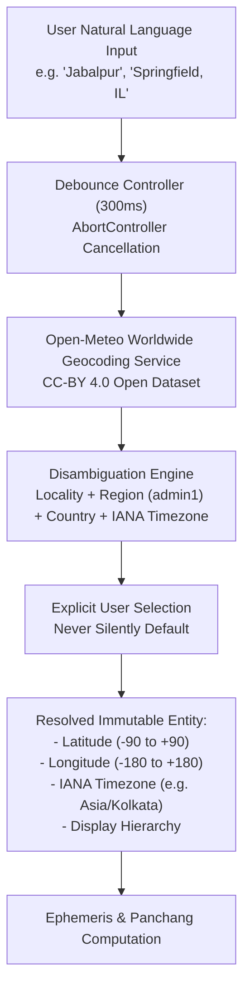

# Worldwide Location Search & Timezone Intelligence Specification

## 1. Overview & Architectural Requirements

A fundamental flaw identified in legacy astrology software is the reliance on finite, hardcoded city dropdowns (typically 10 major metropolitan centers). Astroverse replaces this with an open, worldwide location intelligence pipeline supporting cities, towns, villages, districts, administrative regions, and custom geographic coordinates.



---

## 2. Geocoding Provider & Autocomplete Behavior

### 2.1 Provider Selection & License Compliance
* **Provider**: Open-Meteo Geocoding API (`https://geocoding-api.open-meteo.com/v1/search`).
* **Terms of Use**: Open dataset under Creative Commons Attribution 4.0 International (CC BY 4.0).
* **Policy Compliance**: Unlike the public OpenStreetMap Nominatim endpoint (which strictly forbids keystroke autocomplete per its Usage Policy), Open-Meteo explicitly permits client search queries and autocomplete workloads.
* **Cost**: Zero external recurring budget required; no server secret embedded in client-side code.

### 2.2 Client-Side Autocomplete Contract
1. **Debouncing**: Requests are delayed by 300ms after the last user keystroke to eliminate unnecessary network traffic.
2. **Request Cancellation (`AbortController`)**: If a new query is entered while a previous HTTP request is in-flight, the preceding request is immediately aborted:
   ```javascript
   if (locationAbortController) {
     locationAbortController.abort();
   }
   locationAbortController = new AbortController();
   ```
3. **Protection Against Stale Responses**: Ensures an older asynchronous response can never overwrite results from a newer user keystroke.
4. **Minimum Query Threshold**: Requires at least 2 characters before initiating external lookups.
5. **No-Results & Fallback State**: If no settlements match the search string, a clear message is shown offering manual coordinate entry.

### 2.3 Disambiguation Strategy
When a query matches multiple settlements, Astroverse presents the full administrative hierarchy:
* **"Jabalpur"** $\to$
  1. Jabalpur, Madhya Pradesh, India (`Asia/Kolkata` | 23.17°N, 79.95°E)
  2. Jabalpur, Narsinghpur, Madhya Pradesh, India (`Asia/Kolkata` | 22.74°N, 78.85°E)
* **"Springfield"** $\to$
  1. Springfield, Missouri, United States (`America/Chicago` | 37.22°N, 93.30°W)
  2. Springfield, Illinois, United States (`America/Chicago` | 39.80°N, 89.65°W)
  3. Springfield, Massachusetts, United States (`America/New_York` | 42.10°N, 72.59°W)

The user must explicitly click a resolved item; the system never silently assumes the first result.

---

## 3. IANA Timezone Resolution & Historical Precision

### 3.1 IANA Timezone Identifiers
Astroverse strictly prohibits hardcoded timezone labels (such as `"IST +5:30"` or `"EST -5:00"`). Civil timezones observe historical Daylight Saving Time (DST) changes, war time shifts, and territorial boundary adjustments.

The platform stores the canonical **IANA Timezone Identifier** (e.g. `Asia/Kolkata`, `America/Chicago`, `Europe/London`).

### 3.2 Historical Offset Reconstruction
In Python's standard library, `zoneinfo.ZoneInfo` evaluates the exact UTC offset for historical birth instants:
```python
from datetime import datetime
from zoneinfo import ZoneInfo

# Summer Daylight Saving (CDT: UTC-5)
dt_summer = datetime(1995, 6, 15, 10, 30, tzinfo=ZoneInfo("America/Chicago"))
assert dt_summer.utcoffset().total_seconds() / 3600.0 == -5.0

# Winter Standard Time (CST: UTC-6)
dt_winter = datetime(1995, 1, 15, 10, 30, tzinfo=ZoneInfo("America/Chicago"))
assert dt_winter.utcoffset().total_seconds() / 3600.0 == -6.0
```

### 3.3 Conversion to Julian Day Universal Time (UT)
For local civil birth time $(Y, M, D, H, Min, Sec)$ in timezone $\text{TZ}$:
$$\text{UT} = \text{Local Time} - \text{Offset}(\text{TZ}, Y, M, D, H, Min)$$
$$\text{JD}_{\text{UT}} = \text{swe.julday}(Y, M, D, \text{UT}, \text{swe.GREG_CAL})$$
This guarantees that astronomical positions are computed for the exact physical instant rather than local clock approximations.

---

## 4. Manual Coordinate & Off-Grid Override Workflow

For remote settlements, ancestral village records, offshore births, or astronomical field observatories, Astroverse provides a collapsible manual override:
* **Geodetic Latitude**: `-90.0000` to `+90.0000`
* **Geodetic Longitude**: `-180.0000` to `+180.0000`
* **Custom IANA Timezone**: User can select or enter any valid timezone from the tz database.

---

## 5. Separation of Birthplace vs. Current Visitor Location

* **Birthplace Location**: Fixed in the natal record. Never inferred or replaced by the browser's current IP/GPS location.
* **Current Location (for Horas & Muhurta)**: The 24-hour planetary Horas module evaluates transits for the user's *current* physical location or an explicitly chosen query city, without modifying the natal birth profile.
