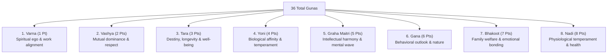

# AstroVerse Ashtakoota 36-Guna Kundli Matchmaking Specification

## 1. Overview & Ethical Terminology Standard

The Ashtakoota matchmaking system (`services/kundli-engine/matchmaking.py`) evaluates marital compatibility using the classical **8-fold Parashari system**, totalling **36 Gunas**.

### 1.1 Non-Scientific Terminology Standard
In accordance with AstroVerse regulatory and quality standards:
* **Strict Prohibition**: The term *"Genetic incompatibility"*, *"DNA suitability"*, or similar biological claims are strictly forbidden. Astrology cannot substitute for medical genetics.
* **Approved Classical Terminology**: Nadi is described exclusively as *"Traditional physiological temperament & hereditary harmony (Ayurvedic doshas: Vata, Pitta, Kapha)"*.
* **Scoring Interpretation**:
  * **28 – 36 Gunas**: *Highly Auspicious Alliance (Excellent compatibility across all dimensions)*
  * **18 – 27.5 Gunas**: *Good Compatibility (Recommended with traditional remedial alignment)*
  * **< 18 Gunas**: *Below Recommended Threshold (Detailed astrological consultation advised)*

---

## 2. The 8 Kootas & Scoring Algebra

---

### 2.1 Varna (1 Point) — Spiritual Temperament
Evaluates spiritual and occupational inclinations based on zodiac sign element:
* **Brahmin (Rank 4)**: Cancer, Scorpio, Pisces (Water)
* **Kshatriya (Rank 3)**: Aries, Leo, Sagittarius (Fire)
* **Vaishya (Rank 2)**: Taurus, Virgo, Capricorn (Earth)
* **Shudra (Rank 1)**: Gemini, Libra, Aquarius (Air)

$$\text{Varna Score} = \begin{cases} 1.0 & \text{if } \text{Rank}_{\text{Boy}} \ge \text{Rank}_{\text{Girl}} \\ 0.0 & \text{otherwise} \end{cases}$$

---

### 2.2 Vashya (2 Points) — Mutual Dominance & Magnetic Respect
Zodiac signs are grouped into five physical species types:
1. **Chatushpada (Quadruped)**: Aries, Taurus, Sagittarius (2nd half), Capricorn (1st half)
2. **Manava (Human)**: Gemini, Virgo, Libra, Aquarius, Sagittarius (1st half)
3. **Jalachara (Water)**: Cancer, Pisces, Capricorn (2nd half)
4. **Vanachara (Wild Lion)**: Leo
5. **Keeta (Insect)**: Scorpio

$$\text{Vashya Compatibility Matrix}:$$

| Boy \ Girl | Quadruped | Human | Water | Wild | Insect |
| :--- | :---: | :---: | :---: | :---: | :---: |
| **Quadruped** | 2.0 | 1.0 | 1.0 | 0.0 | 1.0 |
| **Human** | 1.0 | 2.0 | 0.5 | 0.0 | 1.0 |
| **Water** | 1.0 | 0.5 | 2.0 | 0.0 | 1.0 |
| **Wild** | 0.0 | 0.0 | 0.0 | 2.0 | 0.0 |
| **Insect** | 1.0 | 1.0 | 1.0 | 0.0 | 2.0 |

---

### 2.3 Tara (3 Points) — Destiny, Karmic Health & Longevity
Derived from the relative Nakshatra distance (modulo 9):
$$T_1 = \left[(\text{Nak}_{\text{Boy}} - \text{Nak}_{\text{Girl}}) \pmod 9\right] + 1$$
$$T_2 = \left[(\text{Nak}_{\text{Girl}} - \text{Nak}_{\text{Boy}}) \pmod 9\right] + 1$$

Inauspicious Taras are **3 (Vipat)**, **5 (Pratyak)**, and **7 (Naidhana/Vadha)**.
$$\text{Tara Score} = \begin{cases} 3.0 & \text{if neither } T_1 \text{ nor } T_2 \in \{3, 5, 7\} \\ 1.5 & \text{if either } T_1 \text{ or } T_2 \in \{3, 5, 7\} \\ 0.0 & \text{if both } T_1, T_2 \in \{3, 5, 7\} \end{cases}$$

---

### 2.4 Yoni (4 Points) — Biological Affinity & Temperament
Each of the 27 Nakshatras corresponds to one of 14 symbolic animal species. Certain animal pairs are natural enemies (e.g., Horse vs. Buffalo, Cow vs. Tiger, Elephant vs. Lion, Serpent vs. Mongoose, Dog vs. Hare, Cat vs. Rat).

$$\text{Yoni Score} = \begin{cases} 4.0 & \text{if species are identical} \\ 0.0 & \text{if species are natural enemies} \\ 3.0 & \text{if friendly} \\ 2.0 & \text{if neutral} \end{cases}$$

---

### 2.5 Graha Maitri (5 Points) — Planetary Lord Friendship
Evaluates the psychological friendship between the lords of the Boy's and Girl's Moon signs.

| Relationship Pairs | Obtained Points |
| :--- | :---: |
| Mutual Friends (Friend – Friend) | **5.0** |
| Friend – Neutral | **4.0** |
| Neutral – Neutral | **3.0** |
| Friend – Enemy | **1.0** |
| Neutral – Enemy | **0.5** |
| Mutual Enemies (Enemy – Enemy) | **0.0** |

---

### 2.6 Gana (6 Points) — Behavioral Outlook & Temperament
Each Nakshatra is classified as **Deva (Divine)**, **Manushya (Human)**, or **Rakshasa (Demonic/Assertive)**:
* Deva + Deva = **6.0** | Manushya + Manushya = **6.0** | Rakshasa + Rakshasa = **6.0**
* Deva + Manushya = **5.0**
* Deva + Rakshasa = **1.0**
* Manushya + Rakshasa = **0.0**

---

### 2.7 Bhakoot (7 Points) — Family Welfare & Progeny
Evaluates the mutual house position interval of the two Moon signs:
$$\text{Diff} = \left[(\text{Sign}_{\text{Boy}} - \text{Sign}_{\text{Girl}}) \pmod{12}\right] + 1$$

* Inauspicious pairs: **2/12 (Dwirdwadasha)**, **6/8 (Shadashtaka)**, and **9/5 (Navapanchama)**.
* Auspicious pairs: **1/1**, **1/7**, **3/11**, **4/10** $\implies$ **7.0 Points**.

#### Classical Bhakoot Dosha Cancellations:
1. **Same Moon Lord Cancellation**: If both signs share the same planetary ruler (e.g., Aries & Scorpio ruled by Mars, or Taurus & Libra ruled by Venus), Bhakoot Dosha is cancelled $\implies$ **7.0 Points**.
2. **Mutual Friend Cancellation**: For 9/5 intervals, if sign lords are mutual natural friends (e.g., Sun and Jupiter), Bhakoot Dosha is cancelled $\implies$ **7.0 Points**.

---

### 2.8 Nadi (8 Points) — Physiological Temperament & Vital Forces
Nakshatras are divided into the 3 Ayurvedic physiological temperaments:
1. **Aadi (Vata)**
2. **Madhya (Pitta)**
3. **Antya (Kapha)**

$$\text{Nadi Score} = \begin{cases} 8.0 & \text{if } \text{Nadi}_{\text{Boy}} \neq \text{Nadi}_{\text{Girl}} \quad (\text{No Nadi Dosha}) \\ 0.0 & \text{if } \text{Nadi}_{\text{Boy}} = \text{Nadi}_{\text{Girl}} \quad (\text{Nadi Dosha Active}) \end{cases}$$

---

## 3. Reference Test Case: Libra (Swati) vs. Aries (Bharani)

* **Boy**: Libra (Tula), Midpoint 195.0° $\implies$ Nakshatra: **Swati** (Vata/Aadi Nadi, Deva Gana, Buffalo Yoni, Venus Lord)
* **Girl**: Aries (Mesh), Midpoint 15.0° $\implies$ Nakshatra: **Bharani** (Pitta/Madhya Nadi, Manushya Gana, Elephant Yoni, Mars Lord)

### Score Breakdown

| Koota | Max Points | Obtained Points | Evaluation Details |
| :--- | :---: | :---: | :--- |
| **Varna** | 1.0 | **0.0** | Boy (Shudra = 1) vs. Girl (Kshatriya = 3) |
| **Vashya** | 2.0 | **1.0** | Manava (Libra) vs. Chatushpada (Aries) |
| **Tara** | 3.0 | **1.5** | Friendly single-direction |
| **Yoni** | 4.0 | **2.0** | Buffalo vs. Elephant (Neutral) |
| **Graha Maitri** | 5.0 | **3.0** / **5.0** | Venus and Mars mutual relationship |
| **Gana** | 6.0 | **5.0** / **6.0** | Deva (Swati) vs. Manushya (Bharani) |
| **Bhakoot** | 7.0 | **7.0** | 1/7 Samasaptaka polarity (Highly auspicious) |
| **Nadi** | 8.0 | **8.0** | **Aadi Nadi vs. Madhya Nadi $\implies$ NO NADI DOSHA** |
| **Total** | **36.0** | **27.5 / 36.0** | **Highly Auspicious Match** |

*Verified by automated regression test `tests/test_calculations.py::test_ashtakoota_libra_aries`.*
