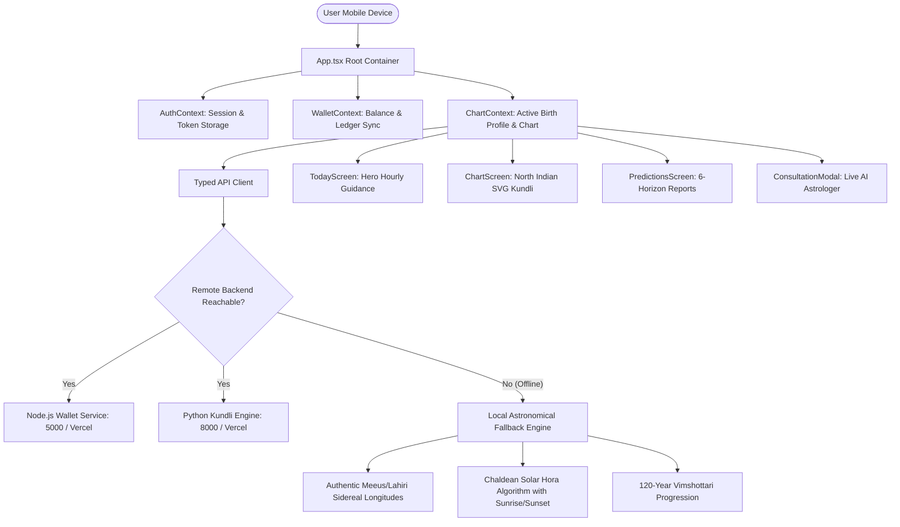

# AstroVerse Mobile Architecture Specification

**Technology Stack**: React Native (0.74.x), Expo SDK 51+, TypeScript 5.3+, `react-native-svg`  
**State Architecture**: React Context & Hooks (`AuthContext`, `ChartContext`, `WalletContext`)  
**Storage Engine**: Secure Local Device Storage (`@react-native-async-storage/async-storage` & `expo-secure-store`)  
**Networking**: Typed REST API Client with automatic offline astronomical calculation fallbacks  

---

## 1. Directory Structure (`apps/mobile/`)

```
apps/mobile/
├── package.json                   # Mobile dependencies and run scripts
├── app.json                       # Expo configuration (bundle ID, permissions, icons, splash)
├── tsconfig.json                  # TypeScript compiler settings
├── App.tsx                        # Application entry point & Root Navigator
└── src/
    ├── api/
    │   ├── client.ts              # Unified HTTP client with auth headers and baseUrl resolution
    │   ├── auth.ts                # Auth API (login, register, OTP dispatch/verify, user profile)
    │   ├── kundli.ts              # Kundli API (ephemeris, divisional charts, dasha, doshas)
    │   └── predictions.ts         # Multi-horizon prediction API
    ├── calculations/
    │   ├── astronomical.ts        # Pure TypeScript Meeus/Lahiri astronomical fallback engine
    │   └── dasha.ts               # 120-Year Vimshottari Dasha calculation engine
    ├── components/
    │   ├── NorthIndianChart.tsx   # Native SVG Diamond Kundli Chart renderer
    │   ├── HourlyGuidanceCard.tsx # Hero Hourly Guidance card with live millisecond countdown
    │   ├── MultiHorizonView.tsx   # 6-Horizon prediction tabs with 7-section report rendering
    │   ├── ConsultationModal.tsx  # Live AI Astrologer consultation room modal
    │   ├── AuthModal.tsx          # Password + OTP Authentication modal
    │   ├── BirthProfileModal.tsx  # Add / Edit Birth Profile modal with worldwide city search
    │   └── PaywallModal.tsx       # Freemium ₹49 wallet report unlock modal
    ├── context/
    │   ├── AuthContext.tsx        # Authentication & session token management
    │   ├── ChartContext.tsx       # Selected birth profile & canonical chart data
    │   └── WalletContext.tsx      # Wallet balance & transaction settlement
    ├── screens/
    │   ├── TodayScreen.tsx        # Tab 1: Hero Hourly Guidance & Panchang
    │   ├── ChartScreen.tsx        # Tab 2: D1–D10 Charts, Planetary Table, Dasha, Doshas
    │   ├── PredictionsScreen.tsx  # Tab 3: Multi-Horizon Predictions
    │   └── ProfileScreen.tsx      # Tab 4: Account, Saved Profiles, Saved Reports, Wallet
    ├── theme/
    │   └── colors.ts              # Design tokens (Cosmic navy, Vedic gold, deep maroon)
    └── types/
        └── index.ts               # Shared TypeScript domain contracts
```

---

## 2. State & Data Flow Architecture



---

## 3. High-Fidelity North Indian Diamond Chart SVG Geometry

The native mobile application renders classical North Indian diamond charts using pure scalable vector graphics (`react-native-svg`):
- **ViewBox**: `0 0 100 100` coordinate space.
- **Outer Box**: Rect `(0,0) to (100,100)`.
- **Inner Diamond**: Lines intersecting `(50,0) -> (0,50) -> (50,100) -> (100,50) -> (50,0)`.
- **Corner X-Diagonals**: `(0,0) -> (100,100)` and `(100,0) -> (0,100)`.
- **12 Bhava (House) Partition**:
  - House 1 (Lagna Center Diamond): Center `(50, 42)`. Sign number and planets rendered in distinct gold/maroon fonts.
  - Houses 2 to 12 positioned symmetrically at exact geometric centroids.
  - Fully responsive: dynamically scales across any device width (`320px` to `768px`).

---

## 4. Secure Credential Storage & Privacy

1. **Authentication Tokens**:
   Stored in encrypted local device storage. Never logged to console or included in error traces.
2. **Birth Profiles**:
   Stored locally with user ownership tags; synced with `/api/profiles` when authenticated.
3. **No Hardcoded Secrets**:
   Zero SMS gateway credentials, Razorpay secret keys, or database credentials embedded in the client binary.
4. **App Store Billing Compliance**:
   Digital report unlocking adheres to platform policies, using wallet balance credits with clear price disclosures and restoration capabilities.
