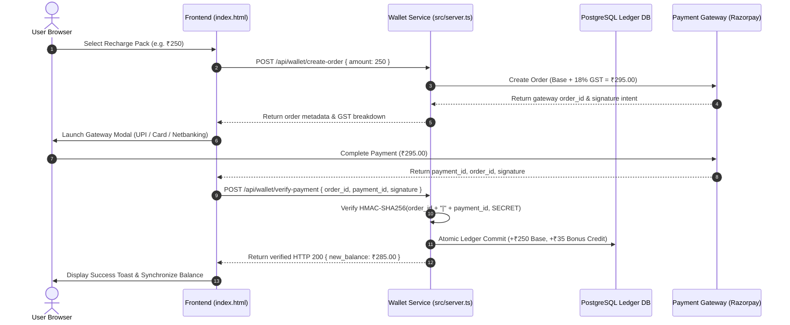

# AstroVerse Payment Gateway & GST Compliance Specification

## 1. Gateway Architecture & Indian Regulatory Compliance

AstroVerse integrates with PCI-DSS compliant Indian payment gateways (Razorpay / Cashfree) supporting UPI (Google Pay, PhonePe, Paytm, BHIM), Net Banking, Debit/Credit Cards, and Wallets.



---

## 2. Statutory 18% GST Breakdown & Invoicing

Under Indian Tax Regulations for digital consulting and astrological services, statutory **18% Goods & Services Tax (GST)** applies to all wallet purchases:
* **CGST (Central GST)**: 9% (for intra-state supplies)
* **SGST (State GST)**: 9% (for intra-state supplies)
* **IGST (Integrated GST)**: 18% (for inter-state supplies)

### Authorized Recharge Packs & Invoice Table

| Pack Identifier | Base Pack Price | 18% GST Amount | Total Payable | Promotional Extra Credits | Total Wallet Balance Credited |
| :--- | :---: | :---: | :---: | :---: | :---: |
| **Starter Pack** | ₹100.00 | ₹18.00 | **₹118.00** | +₹10.00 (10%) | **₹110.00** |
| **Popular Pack** | ₹250.00 | ₹45.00 | **₹295.00** | +₹35.00 (14%) | **₹285.00** |
| **Value Pack** | ₹500.00 | ₹90.00 | **₹590.00** | +₹100.00 (20%) | **₹600.00** |

---

## 3. Cryptographic Signature Verification

All client payment claims are verified server-side using standard HMAC-SHA256 authentication:

```typescript
import crypto from 'crypto';

export function verifyPaymentSignature(
  orderId: string,
  paymentId: string,
  signature: string,
  secret: string
): boolean {
  const generatedSignature = crypto
    .createHmac('sha256', secret)
    .update(`${orderId}|${paymentId}`)
    .digest('hex');

  return crypto.timingSafeEqual(
    Buffer.from(generatedSignature, 'utf8'),
    Buffer.from(signature, 'utf8')
  );
}
```

* **Timing Attack Prevention**: Uses `crypto.timingSafeEqual()` rather than string equality to eliminate side-channel timing leaks.

---

## 4. Webhook Ingestion & Dual Reconciliation

To protect against user network drops, browser crashes, or tab closures prior to frontend callback dispatch:
1. **Server Webhook Listener**: Endpoint `POST /api/webhooks/razorpay` receives asynchronous `payment.captured` and `payment.failed` webhooks directly from gateway servers.
2. **Signature Verification**: Webhook payloads are verified against `x-razorpay-signature` using the dedicated webhook secret.
3. **Idempotent Fulfillment**: If the client already completed payment verification, the webhook handler detects the existing `LedgerEntry` via `referenceId` and acknowledges HTTP 200 without duplicate credit.
4. **Reconciliation Cron**: A scheduled background job checks all `PENDING` payment intents older than 15 minutes against the gateway status API to resolve edge-case pending transactions.
