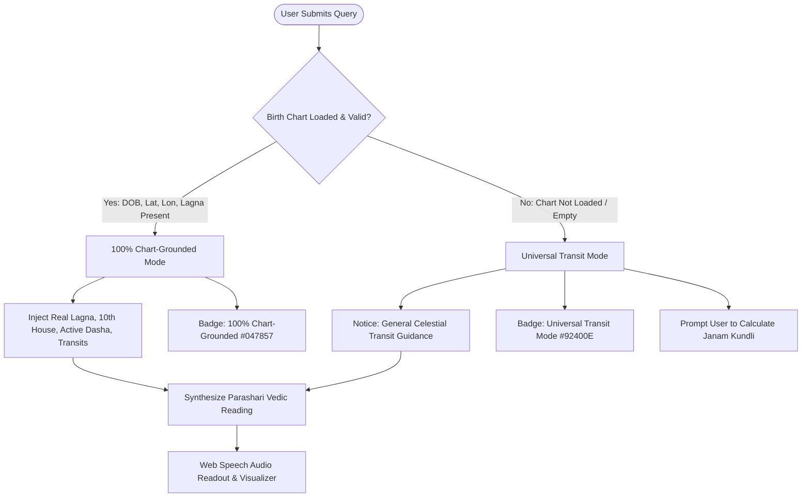

# Personalized AI Astrologer Architecture & Context Grounding

**Project**: Astroverse  
**Module**: AI Astrologer Guru & Personalization Gate  
**Backend Endpoint**: `POST /api/ai-astrologer/ask`  
**Framework**: FastAPI / Python / Client Web Speech API  
**Status**: OPERATIONAL & GROUNDED  

---

## 1. Architectural Philosophy: The Personalization Gate

A core defect in conventional automated astrology tools is delivering generic transit horoscopes while masquerading them as personalized birth-chart readings. Astroverse introduces an unambiguous **Personalization Gate**:



### 1.1 Personalization Gate States

| State | Mode Badge | Description | Data Inputs Used |
| :--- | :--- | :--- | :--- |
| **Personalized** | `100% Chart-Grounded` (Green) | Deeply personalized Parashari consultation tailored to the user's specific birth chart. | Calculated Lagna, 10th house lord, Moon sign, Nakshatra, active Mahadasha/Antardasha, Sade Sati status. |
| **Unpersonalized** | `Universal Transit Mode` (Amber) | General astronomical transit guidance. Clearly alerts the user that birth data is absent. | Planetary transit positions of the day (e.g. Saturn in Pisces, Jupiter in Gemini). |

---

## 2. Context Injection & Astrological Prompt Engineering

When a birth profile is active, the engine compiles a structured astrological context payload before prompting the language model:

### 2.1 Injected Astrological Context Payload
```json
{
  "subject_name": "User",
  "lagna": {
    "sign": "Scorpio",
    "degree": 24.16,
    "nakshatra": "Jyeshtha",
    "pada": 3,
    "lagna_lord": "Mars"
  },
  "moon": {
    "sign": "Aquarius",
    "degree": 12.21,
    "nakshatra": "Shatabhisha",
    "pada": 2,
    "nakshatra_lord": "Rahu"
  },
  "career_tenth_house": {
    "sign": "Leo",
    "lord": "Sun",
    "occupants": ["Sun", "Mars"],
    "aspects": ["Jupiter in 4th"]
  },
  "active_vimshottari_dasha": {
    "maha_dasha": "Jupiter",
    "antar_dasha": "Venus",
    "start_date": "2024-04-29",
    "end_date": "2026-12-28",
    "progress_percentage": 92.9
  },
  "active_transits": {
    "saturn_in_pisces": { "house_from_moon": 2, "sade_sati_phase": "Phase 3 (Setting)" },
    "jupiter_in_gemini": { "house_from_lagna": 8, "house_from_moon": 5 }
  }
}
```

### 2.2 System Prompt Directives
The system prompt enforces strict classical Vedic rules:
1. **Rule of Grounding**: Never fabricate a planetary placement not present in the payload.
2. **Rule of Specificity**: Directly cite the Lagna sign, 10th house lord, and current active Dasha lord in the reasoning.
3. **Rule of Constructive Remediation**: Propose classical, non-superstitious remedies (e.g. Aditya Hridaya Stotra on Sundays for Sun in Leo, specific Hora timing, meditation, charity).
4. **Time Horizon Grounding**: Frame short-term guidance around active Antardasha milestones and hourly Hora influences.

---

## 3. Audio Voice Readout & Visualizer

Astroverse incorporates native speech synthesis for hands-free audio consultation:
* **Engine**: Browser Web Speech API (`SpeechSynthesisUtterance`).
* **Tone**: Tuned to natural cadence, `pitch = 1.0`, `rate = 0.95`.
* **Waveform Visualizer**: When speech is playing, an animated multi-bar SVG audio waveform animates in the UI, toggling back to a static icon upon completion or cancellation.
* **Non-Blocking Control**: Clicking `Listen` toggles playback cleanly; re-clicking cancels in-flight utterances via `window.speechSynthesis.cancel()`.
