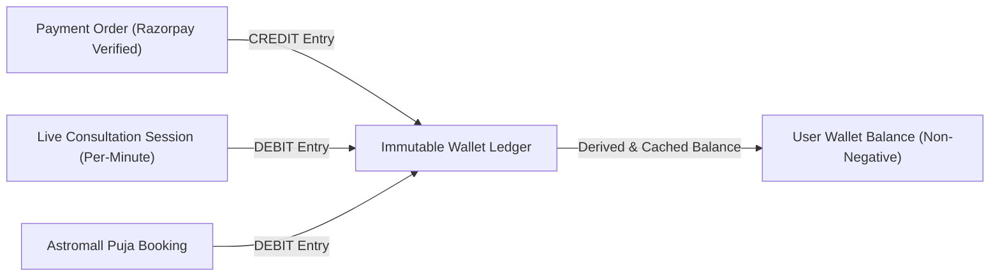

# Security, Data Integrity & Double-Entry Financial Model

## 1. Authentication & Session Architecture

### 1.1 Fresh Session Invariant (No Automatic Demo Logins)
A critical defect identified in legacy prototypes was automatically logging all visitors into a seeded demonstration account with a prefilled ₹150.00 wallet balance.

In Astroverse:
* Every fresh browser session starts in an **Unauthenticated Guest State**.
* The header displays `"Sign In"` and wallet balance initializes to `₹0.00`.
* Personal records and saved birth charts are accessible only after successful authentication.

### 1.2 Multi-Factor Passwordless Authentication
* **Phone OTP & Email Magic Code**: Users authenticate via a cryptographically random 6-digit one-time password generated with 300-second (5-minute) TTL:
  ```typescript
  const otp = Math.floor(100000 + Math.random() * 900000).toString();
  const expiresAt = Date.now() + 5 * 60 * 1000;
  ```
* **JWT Session Tokens**: Signed using HMAC-SHA256 with user ID, role, and expiration claims. Tokens are verified via middleware on all protected API routes (`/api/profiles`, `/api/wallet/*`, `/api/pujas/*`).

---

## 2. Double-Entry Financial Ledger & Invariants

All wallet balances are backed by an immutable double-entry ledger (`WalletLedger` table in PostgreSQL via Prisma ORM).



### 2.1 Core Ledger Invariants
1. **Append-Only Immutability**: Ledger rows cannot be updated or deleted (`UPDATE` and `DELETE` queries are prohibited at the database permissions level).
2. **ACID Transaction Isolation**: All credit and debit operations execute inside atomic database transactions (`prisma.$transaction`).
3. **Non-Negative Balance Invariant**: Before debiting funds for a consultation minute or puja booking, the system asserts:
   $$\text{Current Balance} \ge \text{Debit Amount}$$
   If the balance is insufficient, the transaction throws an `INSUFFICIENT_FUNDS` error, and active WebRTC consultation calls are automatically terminated.
4. **Client-Side Balance Tamper Resistance**: The browser client has zero authority to set its own balance. All balance displays are read-only projections fetched from `/api/wallet/balance`.

### 2.2 Payment Gateway Verification (Razorpay)
Before any wallet credit is recorded, the server cryptographically validates the webhook payload signature:
```typescript
import crypto from 'crypto';

const generatedSignature = crypto
  .createHmac('sha256', process.env.RAZORPAY_KEY_SECRET!)
  .update(`${razorpay_order_id}|${razorpay_payment_id}`)
  .digest('hex');

if (generatedSignature !== razorpay_signature) {
  throw new Error('INVALID_PAYMENT_SIGNATURE');
}
```

---

## 3. Data Privacy & Row-Level Ownership

### 3.1 Birth Data Sensitivity
Birth date, time, and birthplace geocoordinates are classified as sensitive personal data. They reveal geographic origins and private biographical information.

### 3.2 Tenant Isolation
* All `BirthProfile` and `KundliCalculation` records carry a foreign key constraint to `userId`.
* API controllers enforce strict user ownership:
  ```typescript
  const profile = await prisma.birthProfile.findFirst({
    where: { id: profileId, userId: req.user.id }
  });
  if (!profile) throw new NotFoundException('PROFILE_NOT_FOUND_OR_UNAUTHORIZED');
  ```
* One user cannot inspect, modify, or load another user's saved charts.
