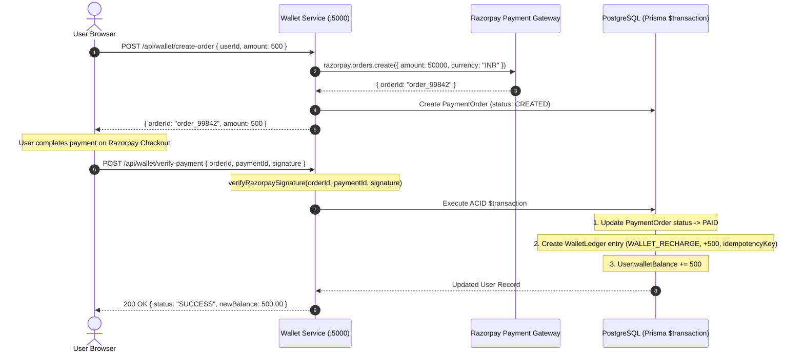

# Security & Financial Integrity Architecture

**Project**: Astroverse  
**Module**: Financial Ledger, Double-Entry Accounting, Razorpay Integration, and System Hardening  
**Framework**: Node.js / Express / TypeScript / Prisma ORM / PostgreSQL  
**Compliance**: ACID Transactional Guarantees, HMAC-SHA256 Payment Verification, Zero-Trust Balances  

---

## 1. Double-Entry Accounting & Financial Ledger

In Astroverse, financial balances are treated as derived read-models rather than directly editable values. The single source of truth is the immutable `WalletLedger`.



### 1.1 Idempotency Enforcement
Every ledger transaction requires a unique `idempotencyKey` (e.g. `RECHARGE_order_99842` or `PUJA_usr123_1729450000`). If a network retry occurs or a webhook fires duplicate events, the database unique constraint rejects the second write, completely preventing double-crediting.

---

## 2. Consultation Metering & Commission Settlement

When a user initiates a live consultation (Chat, Voice, or Video):
1. **Pre-flight Fund Verification**: User balance must equal at least 5 minutes of consultation time at the astrologer's published `ratePerMinute`. If insufficient, connection is denied with `INSUFFICIENT_FUNDS`.
2. **Real-time Per-Minute Metering**: Active duration is tracked by server-side heartbeat counters.
3. **Graceful Auto-Termination**: If the remaining balance drops below the cost of 1 additional minute, the session triggers warning signals and terminates cleanly with status `TERMINATED_INSUFFICIENT_FUNDS`.
4. **Settlement Split**:
   At session end, `settleConsultationSession` executes within a single database transaction:
   * **User Debit**: Total session deduction debited from `User.walletBalance`.
   * **Platform Commission**: Configured platform fee (e.g. 20%) retained by Astroverse.
   * **Astrologer Credit**: Net payout (80%) credited to `Astrologer.pendingPayout`.
   * **Ledger Records**: Three synchronized entries recorded in `WalletLedger` (`CONSULTATION_DEBIT`, `PLATFORM_COMMISSION`, `ASTROLOGER_CREDIT`).

---

## 3. Razorpay Signature Verification

Webhook events and checkout client payloads are verified using standard HMAC-SHA256 cryptography:

```typescript
// razorpay.ts
import crypto from 'crypto';

export function verifyRazorpaySignature(orderId: string, paymentId: string, signature: string): boolean {
  const secret = process.env.RAZORPAY_KEY_SECRET || 'dev_secret_key';
  const hmac = crypto.createHmac('sha256', secret);
  hmac.update(`${orderId}|${paymentId}`);
  const digest = hmac.digest('hex');
  return digest === signature;
}
```

---

## 4. Application Hardening & Defect Elimination

1. **Zero Client Balance Authority**: Client-side storage (`localStorage.getItem('astro_wallet_bal')`) serves solely as an optimistic UI render cache. Any operational spend (Puja bookings, consultations, store purchases) is verified server-side against database balance.
2. **Zero-Balance Initial Accounts**: New accounts start at `₹0.00`. Fictitious `₹150.00` promotional balance injections have been removed.
3. **Format Validation**: Strict regular expressions enforce valid E.164 phone numbers and RFC 5322 emails.
4. **Elimination of Blocking Alerts**: All browser `alert()` invocations have been replaced with accessible, non-blocking toast notifications.
