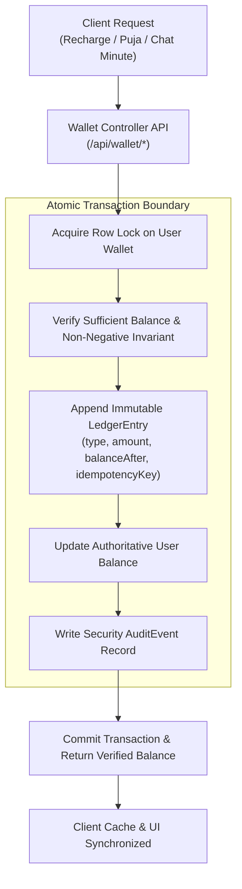

# AstroVerse Server-Authoritative Wallet & Financial Accounting Specification

## 1. Core Financial Invariants & Architecture

AstroVerse enforces a strictly **server-authoritative, double-entry financial ledger** (`services/wallet-service`). 

### Non-Negotiable Invariants:
1. **Zero Client Trust**: The frontend browser client has zero authority to mutate wallet balances. Any local state (`localStorage.getItem('astro_wallet_bal')`) is strictly a read-only render cache invalidated by server events.
2. **Immutable Append-Only Ledger**: Balances are derived directly from or continuously audited against the append-only `LedgerEntry` table. Ledger rows are never updated or deleted.
3. **ACID Transaction Isolation**: Every wallet recharge, per-minute consultation debit, or Puja service purchase is executed within an atomic database transaction with strict row-level locking.
4. **Non-Negative Balance Rule**: A user's wallet balance can never drop below ₹0.00. Any operation that would result in a negative balance is rejected atomically.



---

## 2. Double-Entry Ledger Schema

### 2.1 Prisma Schema Specification

```prisma
model User {
  id            String         @id @default(uuid())
  email         String?        @unique
  phone         String?        @unique
  displayName   String?
  role          Role           @default(USER)
  status        AccountStatus  @default(ACTIVE)
  walletBalance Decimal        @default(0.00) @db.Decimal(12, 2)
  createdAt     DateTime       @default(now())
  updatedAt     DateTime       @updatedAt
  
  ledgerEntries LedgerEntry[]
  auditEvents   AuditEvent[]
}

enum TransactionType {
  RECHARGE
  PROMOTIONAL_BONUS
  CONSULTATION_DEBIT
  PUJA_DEBIT
  REFUND
  ADMIN_ADJUSTMENT
}

enum TransactionStatus {
  PENDING
  SUCCESS
  FAILED
  REVERSED
}

model LedgerEntry {
  id             String            @id @default(uuid())
  userId         String
  user           User              @relation(fields: [userId], references: [id], onDelete: Cascade)
  type           TransactionType
  status         TransactionStatus @default(SUCCESS)
  amount         Decimal           @db.Decimal(12, 2)
  balanceBefore  Decimal           @db.Decimal(12, 2)
  balanceAfter   Decimal           @db.Decimal(12, 2)
  currency       String            @default("INR")
  idempotencyKey String?           @unique
  referenceId    String?           // Payment Gateway Order/Payment ID or Consultation ID
  description    String
  createdAt      DateTime          @default(now())

  @@index([userId, createdAt])
}
```

---

## 3. Financial Transaction Workflows

### 3.1 Wallet Recharge (Payment Gateway Fulfillment)
1. User selects recharge pack (e.g., ₹250 Base + 18% GST ₹45 = ₹295 Payable).
2. Backend creates payment order with unique `order_id` and records pending intent.
3. Upon verified gateway callback or webhook:
   * Execute atomic transaction:
     $$\text{Balance}_{\text{new}} = \text{Balance}_{\text{old}} + \text{Base} + \text{BonusCredits}$$
   * Append `RECHARGE` ledger entry (`+₹250.00`).
   * If bonus credit applies, append `PROMOTIONAL_BONUS` entry (`+₹35.00`).
   * Return verified `new_balance`.

### 3.2 Real-Time Consultation Per-Minute Debit
1. Client initiates consultation with Astrologer (e.g., ₹25/min).
2. Pre-flight check:
   $$\text{WalletBalance} \ge \text{Rate} \times 1 \quad (\text{Minimum ₹25 required to connect})$$
3. During active session, server consultation monitor debits ₹25 every 60 seconds:
   $$\text{Balance}_{\text{after}} = \text{Balance}_{\text{before}} - \text{Rate}$$
4. If $\text{Balance} < \text{Rate}$, session terminates gracefully with an out-of-funds disconnect signal.

### 3.3 Puja Service Booking Shortfall Arithmetic
When booking a religious Puja (e.g., *Maha Mrityunjaya Puja*, fee ₹2,100):
1. Client checks current available balance (e.g., ₹110.00).
2. If $\text{Balance} \ge \text{Fee}$, immediately debit ₹2,100.
3. If $\text{Balance} < \text{Fee}$, compute exact shortfall:
   $$\text{Shortfall} = \text{Fee} - \text{Balance} = 2100 - 110 = \mathbf{₹1,990.00}$$
4. Client presents targeted dialog: *Available: ₹110 | Shortfall to Add: ₹1,990*.
5. In a single atomic operation:
   * Gateway processes payment for shortfall ₹1,990.
   * Ledger credits ₹1,990 (`RECHARGE`), bringing balance to ₹2,100.
   * Ledger debits ₹2,100 (`PUJA_DEBIT`), confirming the booking and reducing balance to ₹0.00.

---

## 4. Idempotency & Replay Attack Defense

* Every mutating financial request must supply or generate an `idempotencyKey` derived from `SHA-256(userId + timestamp + operation + nonce)`.
* If a duplicate request arrives with the same `idempotencyKey`, the database unique constraint blocks secondary execution and returns the existing transaction result without re-debiting.
