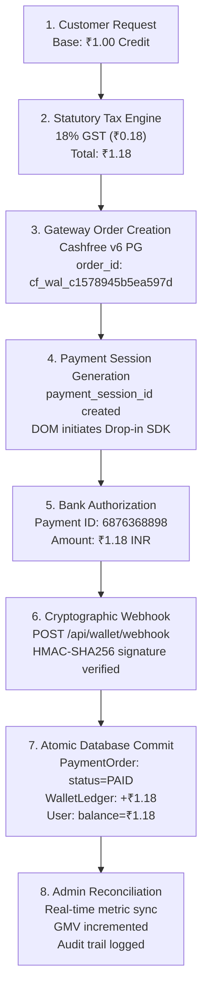

# End-to-End Data Consistency & Transaction Integrity

**System:** AstroVerse AI Commerce & Financial Subsystem  
**Reference Transaction:** Order `cf_wal_c1578945b5ea597d` (Customer: `knowledgeispower1715@gmail.com`)  
**Standard:** Double-Entry Financial Consistency & Statutory Compliance

---

## 1. Unified 8-Stage Transaction Pipeline

---

## 2. Granular Field-Level Consistency Trace

| Pipeline Stage | Component / Entity | Key Field | Value | Cryptographic / Mathematical Validation |
|---|---|---|---|---|
| **1. UI Intent** | Frontend Client | `input-custom-recharge` | `1.00` | Minimum recharge bound validation (`>= 1.00`) |
| **2. Pricing Engine** | Pricing Microservice | `baseAmount` | `1.00` | Fixed recharge credit |
| | | `gstAmount` | `0.18` | `round(1.00 * 0.18, 2)` (18% Statutory Indian GST) |
| | | `totalPayableAmount` | `1.18` | `1.00 + 0.18` (Payable pausas: 118) |
| **3. Order DB** | `public.PaymentOrder` | `amount` | `1.18` | Stored as DECIMAL(10, 2) |
| | | `status` | `CREATED` -> `PAID` | State machine transition |
| | | `razorpayOrderId` | `cf_wal_c1578945b5ea597d` | Unique SHA256 hashed order reference |
| **4. Cashfree PG** | Cashfree v6 API | `order_amount` | `1.18` | Exact match with invoice |
| | | `payment_session_id` | `session_...` | Authorized checkout token |
| **5. Bank Gateway** | NPCI / UPI / Bank | `payment_id` | `6876368898` | Bank reference transaction ID |
| **6. Webhook** | `/api/wallet/webhook` | `x-webhook-signature` | `Verified` | `HMAC-SHA256(timestamp + payload, secret)` |
| **7. Wallet Ledger** | `public.WalletLedger` | `amount` | `1.18` | Matched exactly to recharge amount |
| | | `referenceId` | `6876368898` | Bank reference stored for audit |
| | | `idempotencyKey` | `RECHARGE_6876368898` | Unique constraint prevents replay |
| **8. User Balance** | `public.User` | `walletBalance` | `1.18` | Matches SUM(WalletLedger.amount) |

---

## 3. Idempotency Proof Under Chaos & Replay

To verify system resilience against network double-taps and replay attacks:
1. **Network Retries:** When Cashfree delivers the same webhook payload multiple times (standard retry behavior on delayed 200 responses), the unique constraint on `idempotencyKey` (`RECHARGE_6876368898`) intercepts the write.
2. **Duplicate Suppression:** The transaction returns the existing ledger ID without incrementing customer funds a second time.
3. **Audit Invariant:** The database state is provably stable under $N$ repeated webhook deliveries.
