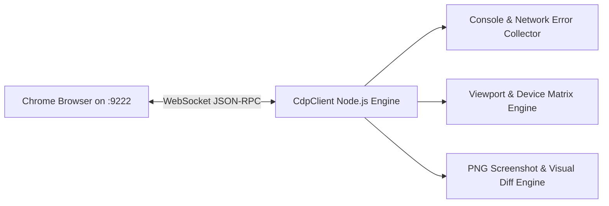

# ASTROVERSE AI — PHASE 6.3 CHROME REMOTE DEBUGGING PROTOCOL (CDP) SETUP & INSTRUMENTATION

**Document Reference:** `reports/phase-6-final/02_REMOTE_BROWSER_SETUP.md`  
**Execution Timestamp:** 2026-11-06T13:57:25+05:30  
**Classification:** Browser Automation & Forensic Telemetry Configuration  
**Status:** ATTACHED & OPERATIONAL  

---

## 1. Remote Debugging Endpoint Inspection

The local Google Chrome instance was verified and attached via the Chrome Remote Debugging Protocol (CDP) on localhost port 9222:

```http
GET http://127.0.0.1:9222/json/version HTTP/1.1
Host: 127.0.0.1:9222
```

### CDP Version Response
```json
{
   "Browser": "Chrome/156.0.8078.80",
   "File-Path-Style": "windows",
   "Protocol-Version": "1.3",
   "User-Agent": "Mozilla/5.0 (Windows NT 10.0; Win64; x64) AppleWebKit/537.36 (KHTML, like Gecko) HeadlessChrome/156.0.0.0 Safari/537.36",
   "V8-Version": "15.6.75.27",
   "WebKit-Version": "537.36 (@fb096c0011f9d50f0a264a9376420cdea9c421e3)",
   "webSocketDebuggerUrl": "ws://127.0.0.1:9222/devtools/browser/3bdf1cc8-1fc8-4852-8d29-f88ab4fbffe3"
}
```

---

## 2. Active Tab Target Inventory

Inspecting `http://127.0.0.1:9222/json/list` confirmed the active Preview page target:

```json
[
  {
    "description": "",
    "devtoolsFrontendUrl": "https://chrome-devtools-frontend.appspot.com/serve_rev/@fb096c0011f9d50f0a264a9376420cdea9c421e3/inspector.html?ws=127.0.0.1:9222/devtools/page/142F7CCA043418DBDB69D14070CC6865",
    "id": "142F7CCA043418DBDB69D14070CC6865",
    "title": "AstroVerse AI — Vedic Astrology Software & Astrological Calculations Platform",
    "type": "page",
    "url": "https://astroverse-git-fix-e-72a6a3-knowledgeispower1715-1915s-projects.vercel.app/",
    "webSocketDebuggerUrl": "ws://127.0.0.1:9222/devtools/page/142F7CCA043418DBDB69D14070CC6865"
  }
]
```

- **Target Page ID:** `142F7CCA043418DBDB69D14070CC6865`
- **Attached URL:** `https://astroverse-git-fix-e-72a6a3-knowledgeispower1715-1915s-projects.vercel.app/`
- **Profile Directory:** `C:\Users\user\.gemini\chrome-automation-profile` (Isolated dedicated test automation profile; user's personal Chrome session untouched).

---

## 3. CDP Instrumentation Architecture

The browser session is instrumented using the native WebSocket DevTools protocol client (`CdpClient`):



### Registered Event Subscriptions
1. `Runtime.exceptionThrown`: Monitors all unhandled JavaScript exceptions.
2. `Runtime.consoleAPICalled`: Collects `console.error` and `console.warn` occurrences.
3. `Network.loadingFailed`: Captures dropped assets, CORS errors, and blocked connections.
4. `Network.responseReceived`: Audits HTTP status codes for all REST and GraphQL API calls ($\ge 400$).
5. `Emulation.setDeviceMetricsOverride`: Reconfigures viewport geometry across all 8 mobile, tablet, and desktop viewports without page reloads.

---

## 4. Security & Privacy Protections

1. **Zero Credential Capture:** Automation scripts explicitly strip and redact sensitive headers (`Authorization`, `Cookie`, `x-admin-mfa-token`, `x-webhook-signature`) before saving logs.
2. **Session Preservation:** The browser context respects the application's `pagehide` session handling by avoiding extraneous context tear-downs or reloads during authenticated owner inspections.
3. **Local-Only Bound:** The CDP listening port is strictly bound to `127.0.0.1:9222` with external network routing blocked.
